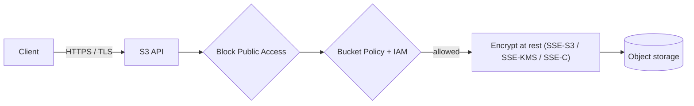

## 1. Core Concept

Bảo mật S3 gồm hai lớp: **access control** (ai được đọc/ghi bucket, object) và **encryption** (dữ liệu được mã hoá khi truyền và khi lưu). Bucket và object **mặc định là private**, và từ 2023 mọi object mới được mã hoá **SSE-S3** tự động. Mental model: *Block Public Access là cầu dao tổng, Bucket Policy là luật của cả bucket, ACL là di sản nên tắt.*

## 2. How It Works

- **Bucket Policy** (resource-based JSON policy): áp cho toàn bucket hoặc prefix; hỗ trợ cross-account, điều kiện theo IP, VPC endpoint, HTTPS, header mã hoá.
- **ACL**: cấp quyền ở mức **từng bucket/object** (cũ, kém linh hoạt). Bucket mới mặc định **Object Ownership = Bucket owner enforced** → ACL bị **tắt**; AWS khuyến nghị giữ nguyên.
- **S3 Block Public Access**: bật mặc định ở bucket mới; ghi đè mọi policy/ACL làm bucket public.
- **Encryption in transit**: SSL/TLS (HTTPS). Ép buộc bằng điều kiện `aws:SecureTransport`.
- **Encryption at rest – Server-Side Encryption**:
  - **SSE-S3**: S3 quản lý key (AES-256), mặc định, không tốn thêm phí.
  - **SSE-KMS**: key trong **AWS KMS**; có audit qua CloudTrail, phân quyền dùng key, xoay vòng key; tính phí và chịu **KMS request quota**.
  - **SSE-C**: bạn gửi key trong mỗi request, S3 không lưu key; bắt buộc HTTPS.
- **Client-Side Encryption**: tự mã hoá trước khi upload; S3 chỉ thấy ciphertext.

```json
{
  "Effect": "Deny",
  "Principal": "*",
  "Action": "s3:*",
  "Resource": ["arn:aws:s3:::my-bucket", "arn:aws:s3:::my-bucket/*"],
  "Condition": { "Bool": { "aws:SecureTransport": "false" } }
}
```

## 3. Visual Diagram



## 4. Rules of Thumb & Trade-offs

- Mặc định: **Block Public Access ON + ACL disabled + Bucket Policy + IAM policy**.
- Cần chứng minh tuân thủ, kiểm soát ai được giải mã, audit việc dùng key → **SSE-KMS**. Chỉ cần "được mã hoá" → **SSE-S3**.
- Tự quản lý key ngoài AWS → **SSE-C** (S3 vẫn làm phần mã hoá) hoặc **client-side** (S3 không bao giờ thấy plaintext).
- Website tĩnh public → ưu tiên **CloudFront + Origin Access Control (OAC)**, giữ bucket private.
- Trade-off: SSE-KMS tăng khả năng kiểm soát nhưng thêm phí KMS, latency và có thể bị throttling khi traffic cao (giảm bằng **S3 Bucket Key**).

## 5. Must Remember / Production Pitfalls

- Explicit `Deny` trong bucket policy thắng `Allow` trong IAM policy.
- Ép mã hoá: bucket policy deny `s3:PutObject` khi thiếu header `x-amz-server-side-encryption` (hoặc sai giá trị `aws:kms`). Với default encryption hiện nay, chủ yếu cần khi bắt buộc dùng **SSE-KMS**.
- SSE-KMS dùng key trong account khác → cần quyền ở **cả** key policy lẫn IAM.
- Mất key SSE-C là mất dữ liệu: AWS không khôi phục được.
- Exam trap: "audit trail về việc ai dùng key" → **SSE-KMS**; "AWS quản lý hoàn toàn, không thêm phí" → **SSE-S3**.

## 6. Search Hooks

- `S3 bucket policy examples` — mẫu policy giới hạn IP, VPC endpoint, HTTPS.
- `S3 Object Ownership bucket owner enforced` — cơ chế tắt ACL mặc định.
- `S3 Block Public Access` — cầu dao chặn mọi cấu hình làm bucket public.
- `SSE-S3 vs SSE-KMS vs SSE-C` — so sánh ba kiểu server-side encryption.
- `aws:SecureTransport` — điều kiện ép buộc dùng HTTPS.
- `S3 Bucket Key KMS cost` — giảm số request và chi phí KMS.
