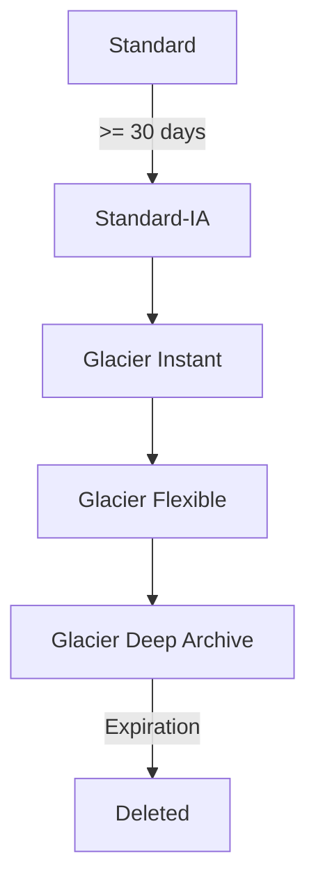

## 1. Core Concept

**S3 Storage Classes** cho phép đổi giữa **giá lưu trữ** và **giá + tốc độ truy xuất** theo mức độ truy cập dữ liệu. **Lifecycle configuration** tự động chuyển (transition) hoặc xoá (expire) object theo tuổi. Mental model: *dữ liệu càng "lạnh" thì lưu càng rẻ, nhưng lấy ra càng đắt, càng chậm, và có thời gian lưu tối thiểu.*

## 2. How It Works

| Storage class | Truy cập | Latency | Retrieval fee | Min duration |
| --- | --- | --- | --- | --- |
| S3 Standard | Thường xuyên | ms | Không | — |
| S3 Intelligent-Tiering | Không đoán được | ms | Không (có phí monitoring/object) | — |
| S3 Standard-IA | Ít, ≥ 3 AZ | ms | Có | 30 ngày |
| S3 One Zone-IA | Ít, 1 AZ | ms | Có | 30 ngày |
| S3 Glacier Instant Retrieval | ~1 lần/quý | ms | Có | 90 ngày |
| S3 Glacier Flexible Retrieval | 1–2 lần/năm | phút → giờ | Có | 90 ngày |
| S3 Glacier Deep Archive | Rất hiếm | 12–48 giờ | Có | 180 ngày |

- Mọi class (trừ One Zone) lưu ở ≥ 3 AZ, durability 11 số 9; **One Zone-IA** mất dữ liệu nếu AZ bị phá huỷ.
- Glacier Flexible: **Expedited** 1–5 phút, **Standard** 3–5 giờ, **Bulk** 5–12 giờ. Deep Archive: Standard ≤ 12 giờ, Bulk ≤ 48 giờ.
- **Lifecycle rule** (theo prefix/tag): *Transition actions* chuyển class sau N ngày; *Expiration actions* xoá object, noncurrent version, delete marker hết hạn, multipart upload dở dang.

```json
{
  "Rules": [{
    "ID": "logs-tiering",
    "Filter": { "Prefix": "logs/" },
    "Status": "Enabled",
    "Transitions": [
      { "Days": 30, "StorageClass": "STANDARD_IA" },
      { "Days": 90, "StorageClass": "GLACIER" }
    ],
    "Expiration": { "Days": 365 },
    "AbortIncompleteMultipartUpload": { "DaysAfterInitiation": 7 }
  }]
}
```

## 3. Visual Diagram



## 4. Rules of Thumb & Trade-offs

- Không biết pattern truy cập → **Intelligent-Tiering**. Biết rõ dữ liệu nguội theo tuổi (log, backup) → **Lifecycle** rẻ hơn.
- Dữ liệu có thể tái tạo (thumbnail, bản sao phụ) → **One Zone-IA**.
- Archive cần lấy ngay trong ms → **Glacier Instant**; compliance lưu 7–10 năm → **Deep Archive**.
- Trade-off cốt lõi: *Storage cost vs. Retrieval cost/latency*; class lạnh mà truy cập thường xuyên lại đắt hơn Standard.

## 5. Must Remember / Production Pitfalls

- **Minimum storage duration**: xoá/chuyển trước hạn vẫn bị tính đủ (IA 30, Glacier 90, Deep Archive 180 ngày).
- IA tính tối thiểu **128 KB/object** → nhiều file nhỏ chuyển sang IA có thể *tăng* chi phí.
- Transition theo chiều "waterfall" xuống lạnh hơn; không chuyển ngược lên bằng lifecycle. Object phải ở Standard ≥ 30 ngày mới chuyển sang Standard-IA/One Zone-IA.
- Object trong Glacier Flexible/Deep Archive phải **restore** tạo bản tạm trước khi đọc.
- Luôn thêm rule `AbortIncompleteMultipartUpload` để tránh phí ẩn.

## 6. Search Hooks

- `S3 storage classes comparison` — bảng so sánh chi phí, latency, độ bền.
- `S3 Intelligent-Tiering monitoring fee` — phí theo object của tầng tự động.
- `S3 Glacier retrieval options expedited standard bulk` — các tốc độ restore.
- `S3 Lifecycle transition constraints` — ràng buộc 30 ngày và thứ tự waterfall.
- `S3 minimum storage duration charge` — phí lưu tối thiểu khi xoá sớm.
