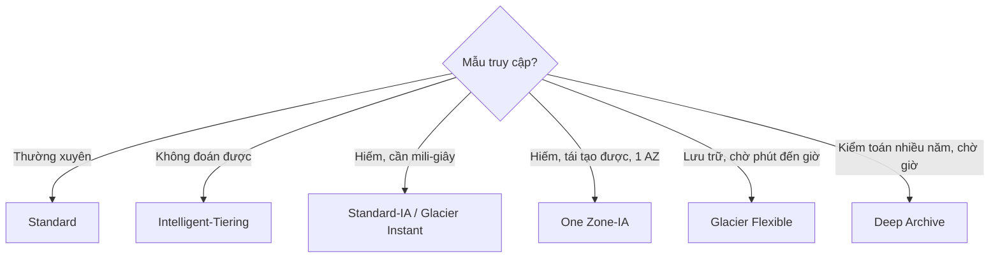

## 1. Core Concept

**S3 Storage Classes** cho phép trả đúng giá cho đúng mức độ truy cập: dữ liệu nóng ở tầng đắt nhưng nhanh, dữ liệu nguội ở tầng rẻ nhưng có phí truy xuất hoặc thời gian chờ. **Lifecycle Configuration** tự động chuyển và xoá object theo tuổi để bạn không phải làm tay.

**Mental model:** như **kho hàng nhiều tầng**: hàng bán chạy để sát cửa (Standard), hàng ít bán xếp vào kho sâu hơn (IA, Glacier) — gửi vào rẻ, lấy ra thì tốn công hoặc tốn tiền, và có **thời gian gửi tối thiểu** dù bạn rút sớm.

## 2. How It Works

**Các class → Giá, độ trễ, độ bền**
- **Standard**: truy cập thường xuyên, ≥3 AZ, không phí truy xuất.
- **Intelligent-Tiering**: tự chuyển object giữa các tầng theo mẫu truy cập (Frequent → Infrequent sau 30 ngày không đụng → Archive Instant sau 90 ngày), **không phí truy xuất** nhưng **phí monitoring theo object**; object nhỏ hơn 128 KB không được tự động tiering.
- **Standard-IA**: truy cập hiếm nhưng cần nhanh, tính phí truy xuất theo GB, **tối thiểu 128 KB/object** và **30 ngày**.
- **One Zone-IA**: như IA nhưng **chỉ 1 AZ** (mất dữ liệu nếu AZ bị phá huỷ), rẻ hơn ~20%; hợp bản sao tái tạo được.
- **Glacier Instant Retrieval**: lưu trữ lâu, lấy ra **mili-giây**, tối thiểu 90 ngày.
- **Glacier Flexible Retrieval**: Expedited **1–5 phút**, Standard **3–5 giờ**, Bulk **5–12 giờ**; tối thiểu 90 ngày.
- **Glacier Deep Archive**: rẻ nhất, Standard **≤ 12 giờ**, Bulk **≤ 48 giờ**; tối thiểu **180 ngày**.

**Lifecycle → Tự động hoá**
- **Transition actions** đổi storage class theo tuổi; **Expiration actions** xoá object, **noncurrent version** hoặc **multipart upload dở dang**.
- Chuyển chỉ đi **xuống tầng lạnh hơn** (waterfall), không tự quay ngược; Standard → IA/One Zone-IA yêu cầu object đã ở Standard ít nhất **30 ngày**.

```xml
<Rule><Status>Enabled</Status>
  <Transition><Days>30</Days><StorageClass>STANDARD_IA</StorageClass></Transition>
  <Transition><Days>180</Days><StorageClass>DEEP_ARCHIVE</StorageClass></Transition>
  <AbortIncompleteMultipartUpload><DaysAfterInitiation>7</DaysAfterInitiation></AbortIncompleteMultipartUpload>
</Rule>
```

**Ví dụ chi phí ngầm:** 1 triệu file 10 KB chuyển sang Standard-IA bị tính như 128 KB mỗi file, nên có thể **đắt hơn** Standard.

## 3. Visual Diagram



## 4. Rules of Thumb & Trade-offs

| Tình huống / Nhu cầu | Chọn gì |
| --- | --- |
| Truy cập thường xuyên | Standard |
| Mẫu truy cập không đoán được, không muốn phí truy xuất | Intelligent-Tiering |
| Hiếm truy cập nhưng cần nhanh | Standard-IA hoặc Glacier Instant |
| Bản sao thứ cấp, tái tạo được | One Zone-IA |
| Log kiểm toán 7 năm, chờ nhiều giờ chấp nhận được | Glacier Deep Archive |

- **Được gì:** chi phí lưu trữ giảm mạnh. **Mất gì:** phí truy xuất, thời gian chờ, thời gian lưu tối thiểu và phí monitoring/transition.

## 5. Must Remember / Production Pitfalls

- **Chuyển file nhỏ sang IA → bị tính tối thiểu 128 KB mỗi object → chi phí tăng → gộp file hoặc giữ Standard**.
- **Xoá hoặc chuyển sớm hơn thời gian tối thiểu → vẫn bị tính đủ ngày** (IA 30, Glacier 90, Deep Archive 180).
- **Dung lượng "ma" tăng → multipart upload dở dang không được dọn → thêm rule AbortIncompleteMultipartUpload**.
- **Object cũ của bucket có versioning phình → version noncurrent không bị expire → rule expire noncurrent version**.
- **Cần lấy dữ liệu Glacier gấp → tốn phí Expedited hoặc phải chờ → dùng Glacier Instant nếu có nhu cầu đọc bất chợt**.
- Exam trap: "mẫu truy cập không đoán được" → **Intelligent-Tiering**; "log 7 năm hiếm đọc, chấp nhận chờ nhiều giờ, rẻ nhất" → **Deep Archive**.

## 6. Search Hooks

- `S3 storage classes comparison` — so sánh giá, độ trễ, số AZ các class.
- `S3 Intelligent-Tiering` — tự chuyển tầng, không phí truy xuất.
- `S3 Glacier retrieval options` — Expedited, Standard, Bulk của Glacier.
- `S3 Lifecycle configuration` — rule transition và expiration.
- `S3 minimum storage duration charge` — thời gian lưu tối thiểu theo class.
