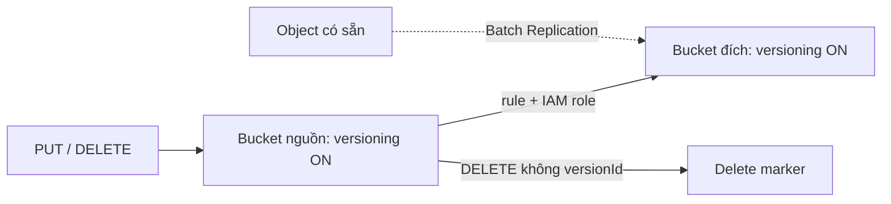

## 1. Core Concept

**S3 Versioning** giữ mọi phiên bản của một object trong cùng bucket để khôi phục khi ghi đè hoặc xoá nhầm. **S3 Replication** sao chép bất đồng bộ object sang bucket khác (cùng hoặc khác Region/account) để DR, giảm latency hoặc đáp ứng compliance.

**Mental model:** Versioning là **nút Undo** trong một bucket (bảo vệ khỏi lỗi của con người); Replication là **bản sao ở tòa nhà khác** (bảo vệ khỏi mất cả bucket hoặc Region) — nhưng nó sao chép cả lỗi ghi đè nên **không phải backup**.

## 2. How It Works

**Versioning → Undo**
- Bucket có ba trạng thái: **Unversioned → Enabled → Suspended**. Đã bật thì **không thể về Unversioned**, chỉ Suspend; version cũ vẫn được giữ và vẫn tính phí.
- Mỗi lần ghi tạo `versionId` mới; `GET` không kèm `versionId` trả **latest version**. Version cũ đọc được bằng `GET ?versionId=...` nếu có quyền `s3:GetObjectVersion`.
- **Quyền theo từng version:** public hoá latest version **không** làm version cũ public.
- `DELETE` không kèm `versionId` chỉ chèn **delete marker**; xoá marker là "undelete". Xoá vĩnh viễn phải chỉ định `versionId`.
- **MFA Delete** yêu cầu MFA của root để xoá vĩnh viễn version hoặc đổi trạng thái versioning.
- **Ví dụ chi phí:** object 1 GB ghi đè 10 lần chiếm **10 GB**; dùng Lifecycle để expire **noncurrent versions** sau N ngày.

**Replication → Bản sao bất đồng bộ**
- **CRR** (Cross-Region) và **SRR** (Same-Region). Bắt buộc **bật versioning ở cả nguồn và đích** và có **IAM role** cho S3 thực hiện sao chép.
- Rule chỉ áp cho object **mới** sau khi tạo; object có sẵn dùng **S3 Batch Replication** (cũng dùng để chạy lại object replicate lỗi).
- Xoá có `versionId` **không bao giờ** được replicate (chống xoá có chủ đích lan sang bản sao); delete marker có thể bật tuỳ chọn. **Không bắc cầu**: A→B và B→C thì object từ A không tự sang C.
- **Replication Time Control (RTC)** cam kết 99,99% object trong **15 phút**, có thêm phí.
- Object mã hoá **SSE-C** không replicate được; **SSE-KMS** cần cấu hình key ở đích.

```bash
aws s3api put-bucket-versioning --bucket src \
  --versioning-configuration Status=Enabled
```

## 3. Visual Diagram



## 4. Rules of Thumb & Trade-offs

| Tình huống / Nhu cầu | Chọn gì |
| --- | --- |
| Phục hồi khi xoá/ghi đè nhầm | Versioning (+ MFA Delete) |
| DR, compliance, user ở Region khác | CRR |
| Gom log, đồng bộ prod/test cùng Region | SRR |
| Sao chép dữ liệu đã tồn tại | Batch Replication |
| Cần SLA 15 phút | Replication Time Control |
| Dữ liệu phải bất biến | Versioning + Object Lock |

- **Được gì:** khôi phục và độ bền cao. **Mất gì:** phí lưu trữ cho mọi version, phí truyền dữ liệu giữa Region và độ trễ replicate.

## 5. Must Remember / Production Pitfalls

- **Bật replication nhưng dữ liệu cũ không sang → rule chỉ áp cho object mới → dùng S3 Batch Replication**.
- **Hoá đơn lưu trữ tăng đều → mọi version đều tính phí, kể cả khi Suspend → Lifecycle expire noncurrent version**.
- **Xoá nhầm nhưng "mất" object → thực ra chỉ có delete marker → xoá delete marker để khôi phục**.
- **Nghĩ replication là backup → ghi đè sai vẫn bị nhân bản sang đích → kết hợp versioning, Object Lock và backup có thời điểm**.
- **Replication lỗi với object KMS → thiếu key hoặc quyền ở đích → cấu hình key đích và quyền cho replication role**.
- Exam trap: "bật replication, object cũ không sang" → **S3 Batch Replication**; "yêu cầu bật replication" → **versioning ở cả hai bucket và IAM role** (đích có thể cùng hoặc khác Region).

## 6. Search Hooks

- `S3 Versioning suspended state` — hành vi khi tạm dừng versioning.
- `S3 delete marker` — cơ chế xoá mềm khi bucket có versioning.
- `S3 MFA Delete` — bắt buộc MFA khi xoá vĩnh viễn version.
- `S3 Cross-Region Replication requirements` — điều kiện để CRR/SRR hoạt động.
- `S3 Batch Replication existing objects` — sao chép object đã có trước khi tạo rule.
- `S3 Replication Time Control` — SLA replicate trong 15 phút.
