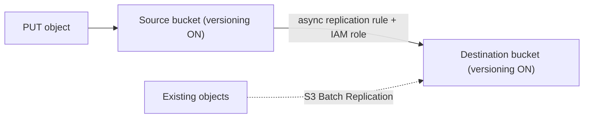

## 1. Core Concept

**S3 Versioning** giữ mọi phiên bản của một object trong cùng bucket, giúp khôi phục khi ghi đè hoặc xoá nhầm. **S3 Replication** sao chép bất đồng bộ object sang bucket khác (cùng hoặc khác region/account) để backup, giảm latency hoặc đáp ứng compliance. Mental model: *Versioning bảo vệ khỏi lỗi của con người trong một bucket; Replication bảo vệ khỏi mất cả bucket/region.*

## 2. How It Works

- Bucket có 3 trạng thái: **Unversioned** → **Enabled** → **Suspended**. Đã bật thì **không thể quay về Unversioned**, chỉ có thể Suspend; các version cũ vẫn được giữ.
- Mỗi lần ghi tạo một `versionId` mới; `GET` không kèm `versionId` trả về **latest version**.
- Version cũ vẫn đọc được bằng `GET ?versionId=...` nếu principal có quyền `s3:GetObjectVersion`. Mỗi version có quyền riêng: public hoá latest version **không** làm các version cũ thành public (đây là ý "version cũ bị access denied").
- `DELETE` không kèm versionId chỉ chèn **delete marker**; xoá delete marker là "undelete". Xoá hẳn phải chỉ định versionId.
- **MFA Delete**: yêu cầu MFA của root để xoá vĩnh viễn version hoặc đổi trạng thái versioning.
- **Replication**: **CRR** (Cross-Region) hoặc **SRR** (Same-Region). Bắt buộc **bật versioning ở cả source và destination**, kèm IAM role cho S3.
  - Chỉ object **mới** sau khi tạo rule mới được replicate; object có sẵn dùng **S3 Batch Replication**.
  - Delete marker không replicate mặc định (có thể bật); xoá có versionId **không bao giờ** được replicate (chống xoá có chủ đích lan sang bản backup).
  - Không bắc cầu: A→B, B→C thì object từ A không tự sang C.

## 3. Visual Diagram

## 4. Rules of Thumb & Trade-offs

- Bật versioning cho dữ liệu quan trọng; kết hợp **Lifecycle** để expire *noncurrent versions* sau N ngày, nếu không chi phí tăng theo số version.
- **CRR**: disaster recovery, compliance, giảm latency cho user ở region khác. **SRR**: gom log, sao chép dữ liệu giữa môi trường prod/test cùng region.
- Cần SLA thời gian replicate (99.99% object trong 15 phút) → bật **Replication Time Control (RTC)**, có thêm phí.
- Trade-off: đổi chi phí lưu trữ + phí truyền dữ liệu lấy độ bền và khả năng khôi phục.

## 5. Must Remember / Production Pitfalls

- Versioning tính tiền cho **mọi** version: object 1 GB ghi đè 10 lần = 10 GB.
- Bucket bị Suspend: object mới có `versionId = null`, version cũ vẫn còn và vẫn tính phí.
- Replication không thay thế backup point-in-time: object bị ghi đè sai vẫn bị replicate. Kết hợp versioning + **Object Lock** cho dữ liệu cần immutable.
- Object mã hoá SSE-C không replicate được; SSE-KMS cần cấu hình key ở destination.
- Exam trap: "bật replication nhưng dữ liệu cũ không sang" → cần **S3 Batch Replication**.

## 6. Search Hooks

- `S3 Versioning suspended state` — hành vi khi tạm dừng versioning.
- `S3 delete marker` — cơ chế "xoá mềm" khi bucket có versioning.
- `S3 MFA Delete` — bắt buộc MFA khi xoá vĩnh viễn version.
- `S3 Cross-Region Replication requirements` — điều kiện để CRR/SRR hoạt động.
- `S3 Batch Replication existing objects` — sao chép object đã tồn tại trước khi tạo rule.
- `S3 Replication Time Control` — SLA replicate trong 15 phút.
