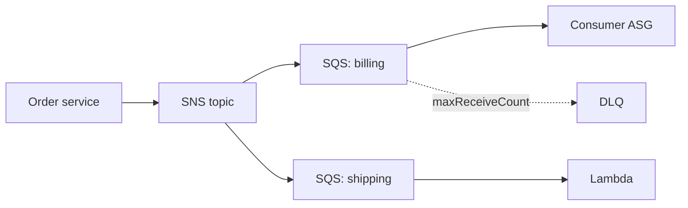

## 1. Core Concept

**SQS** (hàng đợi), **SNS** (pub/sub) và **EventBridge** (event bus) là bộ ba **decoupling**: tách producer khỏi consumer để mỗi phía scale và lỗi độc lập. Chúng giải quyết việc service gọi trực tiếp nhau bị nghẽn hoặc mất request khi một phía quá tải. Mental model: *SQS = hộp thư để lấy dần; SNS = loa phát thanh tới nhiều người; EventBridge = bộ định tuyến sự kiện theo luật.*

## 2. How It Works

- **SQS Standard**: throughput gần như không giới hạn, **at-least-once** (có thể trùng), thứ tự **best-effort**.
- **SQS FIFO**: thứ tự đúng theo **message group**, **exactly-once processing**; tên queue kết thúc bằng `.fifo`; throughput mặc định thấp hơn (300 msg/giây, 3,000 khi batching), có chế độ high throughput.
- Consumer **poll**; message đang xử lý bị ẩn trong **visibility timeout** (mặc định **30 giây**); xử lý xong phải **xoá message**, nếu không nó hiện lại.
- **Long polling** (`WaitTimeSeconds` tối đa 20 giây) giảm request rỗng và chi phí; **retention** mặc định 4 ngày (tối đa 14 ngày); **delay queue** tối đa 15 phút.
- **Dead-letter queue (DLQ)**: message vượt `maxReceiveCount` được chuyển sang đó để điều tra.
- **SNS**: publisher gửi vào **topic**, tất cả subscriber (SQS, Lambda, HTTP, email, SMS) nhận bản sao; **filter policy** lọc theo thuộc tính. **Fan-out**: SNS → nhiều SQS.
- **EventBridge**: **rule** khớp event pattern → target (Lambda, SQS, Step Functions…); nhận event từ dịch vụ AWS, SaaS partner và app tự phát; có **scheduler** và **schema registry**.

## 3. Visual Diagram

## 4. Rules of Thumb & Trade-offs

- Một consumer pool xử lý công việc nền, cần đệm tải đột biến → **SQS** (có thể scale ASG theo độ dài hàng đợi).
- Một sự kiện cần tới nhiều hệ thống → **SNS fan-out** tới các SQS.
- Định tuyến theo nội dung/nguồn, tích hợp SaaS, lịch chạy → **EventBridge**.
- Cần thứ tự/không trùng (giao dịch tài chính) → **FIFO**; cần throughput tối đa → **Standard** + consumer idempotent.
- Trade-off: *Decoupling & độ bền* đổi lấy *độ trễ và độ phức tạp theo dõi luồng*.

## 5. Must Remember / Production Pitfalls

- **Standard SQS có thể giao trùng** → consumer phải **idempotent**.
- Visibility timeout ngắn hơn thời gian xử lý sẽ khiến message bị xử lý **hai lần**; dài quá thì lỗi phục hồi chậm.
- Luôn cấu hình **DLQ** và cảnh báo độ dài DLQ, nếu không "poison message" lặp mãi.
- SNS không lưu message cho subscriber offline (cần SQS đứng giữa để có độ bền).
- Exam trap: "tách web tier khỏi worker tier" → SQS; "một event → nhiều queue" → SNS + SQS fan-out; "thứ tự đúng" → FIFO.

## 6. Search Hooks

- `SQS Standard vs FIFO` — hai loại queue và đánh đổi giữa thứ tự và throughput.
- `SQS visibility timeout` — thời gian message bị ẩn khi đang được xử lý.
- `SQS dead-letter queue maxReceiveCount` — nơi chứa message xử lý thất bại nhiều lần.
- `SNS SQS fan-out pattern` — một sự kiện phát tới nhiều hàng đợi.
- `Amazon EventBridge rules event bus` — định tuyến sự kiện theo luật.
- `Idempotent consumer` — xử lý trùng message vẫn cho cùng kết quả.
