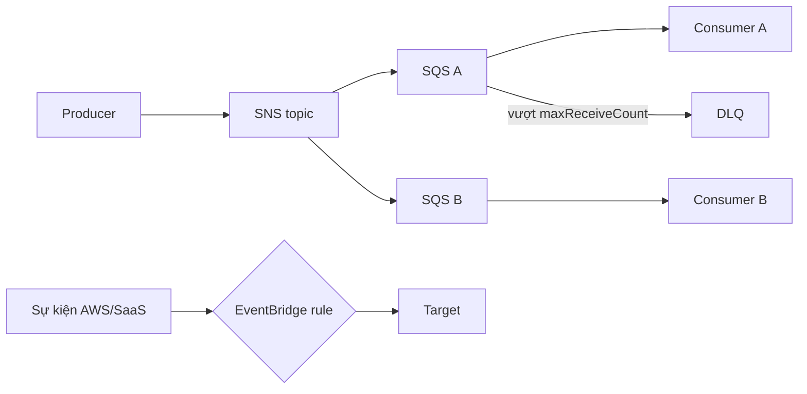

## 1. Core Concept

**SQS** (hàng đợi), **SNS** (pub/sub) và **EventBridge** (event bus) là ba dịch vụ messaging của AWS để **tách rời (decouple)** producer khỏi consumer: producer gửi xong là xong, consumer xử lý theo tốc độ của mình, lỗi một bên không kéo sập bên kia. Chúng giải quyết nỗi đau coupling đồng bộ và đột biến tải.

**Mental model:** SQS là **hộp thư có người đứng chờ lấy từng thư** (mỗi thư một người xử lý), SNS là **loa phát thanh** (một thông báo, nhiều người nghe), EventBridge là **bưu điện phân loại** (đọc nội dung sự kiện rồi chuyển đúng chỗ theo luật).

## 2. How It Works

**SQS Standard vs FIFO → Thứ tự và độ trùng**
- **Standard**: throughput gần như vô hạn, **at-least-once** (có thể giao trùng), thứ tự best-effort.
- **FIFO**: thứ tự đúng **theo message group** (`MessageGroupId`), **chống trùng** trong cửa sổ 5 phút (`MessageDeduplicationId`), tên queue kết thúc `.fifo`; throughput thấp hơn (khoảng 300 msg/s mỗi API action, 3.000 khi batch).

**Visibility Timeout → Tránh hai consumer cùng xử lý**
- Khi consumer nhận message, nó **ẩn** khỏi consumer khác trong visibility timeout (**mặc định 30 giây**, tối đa 12 giờ). Xử lý xong phải **xoá message**; quá hạn thì message **hiện lại** và có thể bị xử lý trùng.
- Ví dụ: xử lý mất 60 giây nhưng timeout 30 giây → message bị xử lý hai lần.

**Dead-Letter Queue (DLQ) → Cô lập poison message**
- Message vượt **`maxReceiveCount`** được chuyển sang DLQ để điều tra thay vì lặp vô hạn chặn luồng chính.

**Vận hành SQS**
- **Long polling** (`WaitTimeSeconds` tới 20 giây) giảm request rỗng và chi phí; retention mặc định **4 ngày** (tối đa 14); kích thước message tối đa **256 KB**; delay queue tới 15 phút.

**SNS + SQS Fan-out → Một sự kiện, nhiều consumer**
- Publish một lần vào **SNS topic**, SNS gửi bản sao tới nhiều **SQS queue** (hoặc Lambda, HTTP, email). Mỗi consumer xử lý độc lập và có độ bền của hàng đợi; dùng **filter policy** để mỗi subscriber chỉ nhận loại sự kiện cần.

**EventBridge → Định tuyến theo nội dung**
- Nhận sự kiện từ **dịch vụ AWS, SaaS và ứng dụng**, **rule** khớp **event pattern** rồi gửi tới **target**; có **Scheduler**, **schema registry**, **archive và replay**.

**Idempotent Consumer → Bắt buộc**
- Vì giao hàng at-least-once nên consumer phải chịu được xử lý lặp (bảng `processed_message_id` hoặc upsert theo business key).

## 3. Visual Diagram

## 4. Rules of Thumb & Trade-offs

| Tình huống / Nhu cầu | Chọn gì |
| --- | --- |
| Đệm tải, mỗi message một worker | SQS |
| Một sự kiện tới nhiều hệ thống độc lập | SNS fan-out tới nhiều SQS |
| Cần thứ tự và không trùng | SQS FIFO |
| Định tuyến theo nội dung, sự kiện SaaS/AWS, lịch | EventBridge |
| Throughput cao nhất, chấp nhận trùng | SQS Standard |

- **Được gì:** decoupling, chịu đột biến, retry tự nhiên. **Mất gì:** eventual consistency, phải xử lý trùng/thứ tự, FIFO giới hạn throughput.

## 5. Must Remember / Production Pitfalls

- **Message bị xử lý hai lần → visibility timeout ngắn hơn thời gian xử lý → đặt timeout ≥ thời gian xử lý** (hoặc gia hạn khi đang xử lý) và làm consumer idempotent.
- **Một message lỗi chặn cả luồng → poison message lặp mãi → DLQ với `maxReceiveCount` hợp lý và cảnh báo trên DLQ**.
- **Dữ liệu trùng khi dùng Standard → at-least-once → dedup theo business key**, hoặc dùng FIFO khi thật sự cần.
- **Hoá đơn SQS cao với queue rỗng → short polling liên tục → bật long polling**.
- **Message mất sau 4 ngày → retention mặc định → tăng retention hoặc giữ DLQ**.
- Exam trap: "một sự kiện tới nhiều hệ thống" → **SNS fan-out tới nhiều SQS**; "thứ tự đúng và không trùng" → **SQS FIFO**; "SQS Standard" → **at-least-once, có thể trùng, không đảm bảo thứ tự**.

## 6. Search Hooks

- `SQS Standard vs FIFO` — thứ tự, trùng lặp và throughput.
- `SQS visibility timeout` — vì sao message bị xử lý trùng.
- `SQS dead-letter queue maxReceiveCount` — cô lập poison message.
- `SNS SQS fan-out pattern` — một sự kiện tới nhiều consumer độc lập.
- `Amazon EventBridge event bus` — định tuyến sự kiện theo pattern.
- `idempotent consumer` — xử lý an toàn khi nhận message lặp.
