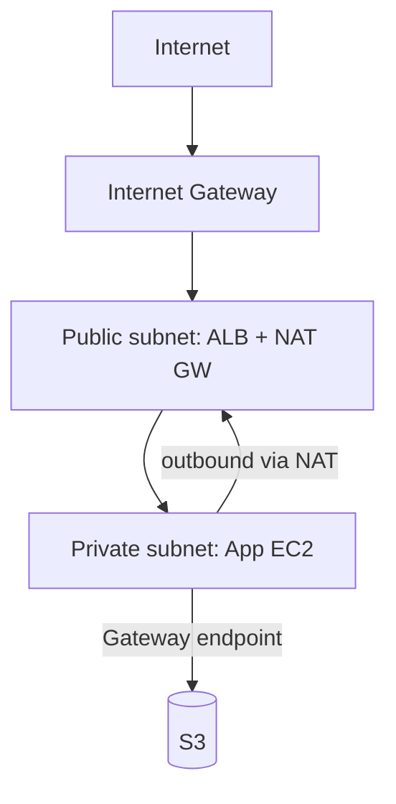

## 1. Core Concept

**Amazon VPC (Virtual Private Cloud)** là mạng ảo cô lập về mặt logic trong một Region, nơi bạn tự định nghĩa dải IP (**CIDR**), **subnet**, route và cổng ra Internet. VPC giải quyết bài toán kiểm soát chặt "ai nói chuyện với ai" cho workload trên AWS. Mental model: *VPC là data center riêng của bạn; subnet chỉ "public" khi route table trỏ ra Internet Gateway.*

## 2. How It Works

- **CIDR**: VPC từ `/16` đến `/28`; mỗi **subnet** nằm trong đúng **một AZ**. AWS giữ **5 IP** mỗi subnet (4 đầu + 1 cuối).
- **Public subnet**: route table có `0.0.0.0/0 → Internet Gateway (IGW)` và instance có public/Elastic IP. **Private subnet**: không có route trực tiếp ra IGW.
- **NAT Gateway**: đặt trong **public subnet**, cho private subnet đi ra Internet (chỉ chiều ra); cần **một NAT Gateway mỗi AZ** để chịu lỗi AZ. IPv6 dùng **Egress-only Internet Gateway**.
- **Firewall hai lớp**: **Security Group** (stateful, cấp ENI) và **NACL** (stateless, cấp subnet, có Deny, đánh số rule).
- **VPC Endpoint** giữ traffic trong mạng AWS:
  - **Gateway endpoint**: chỉ **S3** và **DynamoDB**, miễn phí, thêm route vào route table.
  - **Interface endpoint** (**PrivateLink**): ENI có private IP, tính phí, dùng cho hầu hết dịch vụ khác.
- **Kết nối nhiều mạng**: **VPC Peering** (1-1, **không bắc cầu**, CIDR không được chồng lấn); **Transit Gateway** (hub-and-spoke, transitive); **Site-to-Site VPN** (qua Internet) và **Direct Connect** (đường riêng).
- **VPC Flow Logs** ghi metadata traffic để troubleshoot/audit.

## 3. Visual Diagram

## 4. Rules of Thumb & Trade-offs

- Tầng web/ALB ở public subnet; app và database ở **private subnet**; chia **≥ 2 AZ**.
- Truy cập S3/DynamoDB từ private subnet: ưu tiên **Gateway endpoint** (rẻ hơn NAT, không đi Internet).
- Nhiều VPC/account cần định tuyến phức tạp → **Transit Gateway**; chỉ vài VPC → Peering.
- Trade-off: NAT Gateway đổi **chi phí theo giờ + theo GB** lấy sự tiện lợi và độ sẵn sàng; NAT instance rẻ hơn nhưng phải tự vận hành.

## 5. Must Remember / Production Pitfalls

- **Peering không transitive**: A↔B và B↔C không có nghĩa A↔C.
- Một NAT Gateway cho nhiều AZ → AZ đó chết là mất egress, và traffic cross-AZ bị tính phí.
- Quên route đến NAT/IGW là nguyên nhân phổ biến của "instance không ra được Internet".
- Chặn một IP cụ thể → **NACL**; NACL stateless nên phải mở cả **ephemeral ports** chiều về.
- Exam trap: "truy cập S3 không qua Internet, chi phí thấp nhất" → **Gateway endpoint**; "hàng trăm VPC nối với on-premises" → **Transit Gateway**.

## 6. Search Hooks

- `VPC subnet route table Internet Gateway` — điều kiện để subnet là public.
- `NAT Gateway vs NAT instance` — so sánh tính sẵn sàng, băng thông, chi phí.
- `VPC Gateway endpoint vs Interface endpoint` — hai kiểu endpoint và khi nào dùng.
- `VPC Peering transitive routing` — giới hạn không bắc cầu của Peering.
- `AWS Transit Gateway hub and spoke` — kết nối hàng loạt VPC và on-premises.
- `VPC Flow Logs` — ghi log traffic để audit và gỡ lỗi.
