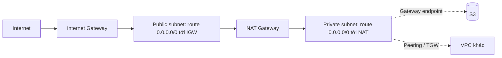

## 1. Core Concept

**Amazon VPC** là mạng ảo riêng của bạn trong AWS: bạn tự chọn dải IP (CIDR), chia subnet theo AZ, quyết định đường đi bằng route table và cổng ra/vào Internet. Nó giải quyết bài toán **cô lập và kiểm soát mạng** cho mọi dịch vụ chạy trong account.

**Mental model:** VPC là **một khu phức hợp có tường bao**; subnet là các tòa nhà (mỗi tòa nằm trong đúng một AZ); route table là **biển chỉ đường**; Internet Gateway là **cổng chính**, NAT Gateway là **cổng ra một chiều**.

## 2. How It Works

**Subnet và Route Table → Public hay private**
- Một subnet là **public** khi route table có `0.0.0.0/0` trỏ tới **Internet Gateway (IGW)** và tài nguyên có IP public/Elastic IP. Không có route đó thì là **private**.
- Mỗi subnet nằm trong **đúng một AZ**, và AWS giữ **5 IP** trong mỗi subnet (địa chỉ mạng, router, DNS, dự phòng, broadcast). Ví dụ: subnet `/24` có 256 địa chỉ, dùng được **251**.

**NAT Gateway → Ra Internet một chiều**
- Đặt trong **public subnet**, cho instance ở private subnet **đi ra** (cập nhật gói) mà không cho kết nối từ ngoài đi vào. Nó **gắn với một AZ**: cần **một NAT Gateway mỗi AZ** để chịu lỗi. IPv6 dùng **Egress-only Internet Gateway**.

**VPC Endpoint → Không đi qua Internet**
- **Gateway endpoint** chỉ cho **S3 và DynamoDB**, **miễn phí**, thêm route vào route table. **Interface endpoint (PrivateLink)** dùng ENI trong subnet, tính phí theo giờ và GB, hỗ trợ hầu hết dịch vụ khác.
- Tác động: traffic S3 qua NAT tốn phí xử lý theo GB, còn qua Gateway endpoint thì miễn phí.

**Kết nối nhiều VPC → Peering hay Transit Gateway**
- **VPC Peering** là quan hệ 1-1, **không bắc cầu** (non-transitive), hai VPC **không được chồng lấn CIDR**, hoạt động cross-Region và cross-account.
- **Transit Gateway** là hub-and-spoke có **định tuyến transitive**, thay cho mạng lưới peering chằng chịt khi có nhiều VPC.

**Lọc lưu lượng**
- **Security Group** (stateful, chỉ Allow, cấp instance) và **NACL** (stateless, có Deny, cấp subnet).

```bash
aws ec2 create-route --route-table-id rtb-public \
  --destination-cidr-block 0.0.0.0/0 --gateway-id igw-123
```

## 3. Visual Diagram



## 4. Rules of Thumb & Trade-offs

| Tình huống / Nhu cầu | Chọn gì |
| --- | --- |
| Private subnet truy cập S3/DynamoDB, rẻ nhất | Gateway endpoint |
| Private subnet cần cập nhật gói từ Internet | NAT Gateway ở public subnet |
| Truy cập dịch vụ AWS khác riêng tư | Interface endpoint |
| 2–3 VPC kết nối trực tiếp | VPC Peering |
| Nhiều VPC cần bắc cầu | Transit Gateway |
| Chặn một IP | NACL |

- **Được gì:** cô lập, kiểm soát đường đi, giảm chi phí NAT bằng endpoint. **Mất gì:** NAT Gateway tính phí theo giờ và GB; Transit Gateway tốn phí hơn Peering.

## 5. Must Remember / Production Pitfalls

- **A peering B, B peering C mà A không tới C → Peering không bắc cầu → peering trực tiếp A–C hoặc dùng Transit Gateway**.
- **Hai VPC chồng lấn CIDR không peering được → thiết kế CIDR không trùng ngay từ đầu** (đặc biệt khi nối on-prem).
- **Mất đường ra Internet khi một AZ lỗi → chỉ có một NAT Gateway → mỗi AZ một NAT, route theo AZ**.
- **Hoá đơn NAT cao → traffic S3 đi qua NAT → dùng Gateway endpoint**.
- **Instance trong public subnet vẫn không ra Internet → thiếu IP public hoặc thiếu route 0.0.0.0/0 tới IGW → kiểm tra cả hai**.
- Exam trap: "private subnet truy cập S3 không qua Internet, rẻ nhất" → **Gateway endpoint**; "A–B, B–C có tới được C không" → **không**; "hai VPC chồng lấn CIDR có peering được không" → **không**.

## 6. Search Hooks

- `VPC subnet route table public private` — điều gì làm subnet thành public.
- `NAT Gateway high availability per AZ` — một NAT mỗi AZ để chịu lỗi.
- `VPC gateway endpoint vs interface endpoint` — hai loại endpoint.
- `VPC peering transitive routing` — vì sao Peering không bắc cầu.
- `AWS Transit Gateway` — hub nối nhiều VPC và on-prem.
- `security group vs network ACL` — hai lớp lọc lưu lượng.
