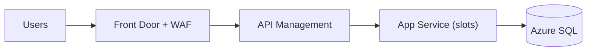

## 1. Core Concept

**App Service** là PaaS chạy web app/API không quản server; **API Management (APIM)** là cổng API (auth, throttle, transform, versioning); **Front Door/Application Gateway** là cân bằng tải L7. Mental model: *App Service là nơi chạy, APIM là cửa vào, Front Door là điểm vào toàn cầu.*

## 2. How It Works

- **App Service Plan**: quyết định **kích cỡ và scale** (Free/Basic/Standard/Premium/Isolated); nhiều app chia sẻ một plan; **scale up** (to hơn) vs **scale out** (nhiều instance, autoscale theo luật).
- **Deployment slots** (Standard+): staging/production, **slot swap** không downtime, cấu hình "slot setting" dính theo slot.
- **Container/Linux/Windows**, VNet integration, **managed identity**, Always On.
- **APIM**: **policies** (rate-limit, validate-jwt, cache, rewrite), **products/subscriptions**, versions/revisions, developer portal; tầng Consumption/Developer/Standard/Premium.
- **Application Gateway** (L7 trong Region, WAF), **Front Door** (L7 toàn cầu, CDN, WAF, failover), **Traffic Manager** (DNS-based), **Load Balancer** (L4).

## 3. Visual Diagram

## 4. Rules of Thumb & Trade-offs

| Cần | Chọn |
| --- | --- |
| Web app PaaS, không quản server | App Service |
| Chính sách API, quota, versioning | APIM |
| Cân bằng tải L7 toàn cầu + WAF | Front Door |
| Cân bằng tải L7 trong Region | Application Gateway |
| L4 | Load Balancer |

- Trade-off: **tiện lợi PaaS** vs **kiểm soát thấp hơn** so với VM/AKS.

## 5. Must Remember / Production Pitfalls

- Plan Free/Shared không có **Always On**/slots; app ngủ khiến request đầu chậm.
- Quên đánh dấu **slot setting** → swap mang cấu hình staging lên production.
- Scale out nhưng state lưu trong bộ nhớ instance → lỗi; dùng Redis/DB.
- APIM Developer tier không dùng cho production (không SLA).
- Interview trap: "Triển khai không downtime trên App Service?" → deployment slot swap.

## 6. Search Hooks

- `Azure App Service deployment slots swap` — triển khai không downtime.
- `App Service plan scale up vs scale out` — hai kiểu mở rộng.
- `Azure API Management policies` — chính sách cổng API.
- `Azure Front Door vs Application Gateway` — L7 toàn cầu vs trong Region.
- `Azure Traffic Manager` — cân bằng tải bằng DNS.
