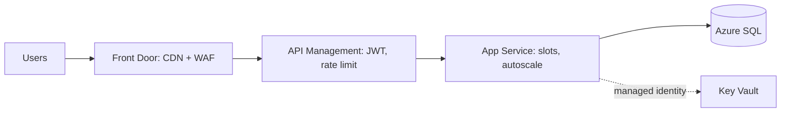

## 1. Core Concept

**App Service** là nơi chạy web app/API dạng PaaS (không quản server), **API Management (APIM)** là cổng API áp chính sách (xác thực, giới hạn tốc độ, biến đổi, versioning), còn **Front Door/Application Gateway** là cân bằng tải L7 đứng trước. Ba lớp này giải quyết ba nỗi đau: **chạy ứng dụng ít vận hành**, **công bố và bảo vệ API nhất quán**, và **đưa traffic vào đúng nơi, an toàn, toàn cầu**.

**Mental model:** App Service là **toà nhà văn phòng cho thuê sẵn** (bạn chỉ mang đồ nghề vào), APIM là **quầy lễ tân của cả toà** (kiểm tra thẻ, giới hạn số lượt, chuyển tiếp), Front Door là **cổng vào của cả khu phức hợp** phân luồng khách tới đúng toà theo vị trí và có bảo vệ.

## 2. How It Works

**App Service → PaaS cho web/API**
- Chạy trong **App Service Plan** (tier **Free/Shared/Basic/Standard/Premium/Isolated**) quyết định tài nguyên và tính năng; nhiều app có thể chia sẻ một plan. **Scale up** (đổi kích cỡ) vs **scale out** (thêm instance, **autoscale** từ Standard theo metric/lịch).
- **Deployment slot** (từ Standard): staging và production cùng app, **swap** không downtime sau warm-up; setting đánh dấu **slot setting** thì dính theo slot. **Always On** giữ app không ngủ (không có ở Free/Shared).
- **Mạng**: **VNet integration** cho **outbound** từ app ra VNet; **Private Endpoint** cho **inbound** riêng tư; **App Service Environment** (Isolated) cho cô lập hoàn toàn. Lấy secret bằng **Key Vault reference** và **managed identity**.

**API Management → Cổng API**
- Ba phần: **gateway** (xử lý request), **management plane**, **developer portal**. **Policy** chạy theo bốn giai đoạn `inbound → backend → outbound → on-error`: `rate-limit-by-key`, `quota`, `validate-jwt`, `set-header`, `cache-lookup`, `rewrite-uri`, `mock-response`.
- **Product + subscription key** quản lý ai được gọi API nào; **named value** lưu cấu hình/secret; **version** (thay đổi phá vỡ, đường dẫn riêng) khác **revision** (thay đổi an toàn). **Tier**: Consumption, **Developer (không SLA, không dùng production)**, Basic, Standard, **Premium** (đa Region, VNet).

**Cân bằng tải L7 và định tuyến**
- **Application Gateway** (trong Region): WAF, routing theo URL/host, **SSL offload**, autoscale. **Front Door** (toàn cầu): anycast, **CDN + WAF**, caching, failover đa Region, **Private Link** tới origin. **Traffic Manager**: DNS-based, chỉ trả endpoint, phụ thuộc TTL; **Load Balancer**: L4.

```xml
<inbound>
  <validate-jwt header-name="Authorization" failed-validation-httpcode="401">
    <openid-config url="https://login.microsoftonline.com/{tenant}/v2.0/.well-known/openid-configuration" />
  </validate-jwt>
  <rate-limit-by-key calls="100" renewal-period="60" counter-key="@(context.Subscription.Id)" />
</inbound>
```

## 3. Visual Diagram



## 4. Rules of Thumb & Trade-offs

| Tình huống / Nhu cầu | Chọn gì |
| --- | --- |
| Web app PaaS, không quản server | App Service |
| Triển khai không downtime | Deployment slot swap |
| Rate limit, JWT, quota, versioning cho API | API Management |
| L7 toàn cầu, CDN, WAF, failover đa Region | Front Door |
| L7 trong một Region, WAF, routing theo URL | Application Gateway |
| Định tuyến DNS, mọi giao thức | Traffic Manager |
| L4 TCP/UDP | Load Balancer |

- **Được gì:** ít vận hành, chính sách API nhất quán. **Mất gì:** kiểm soát thấp hơn VM/AKS; APIM và Front Door tốn chi phí và thêm độ trễ một hop.

## 5. Must Remember / Production Pitfalls

- **Swap xong production dùng cấu hình staging → quên slot setting → đánh dấu setting riêng từng môi trường**.
- **App ngủ, request đầu chậm → Free/Shared không có Always On → dùng Basic trở lên và bật Always On**.
- **Scale out nhưng mất state → lưu trong bộ nhớ instance → Redis/DB bên ngoài**.
- **APIM Developer tier chạy production → không SLA → dùng Standard/Premium**.
- **Backend lộ ra Internet, bỏ qua APIM → origin vẫn public → giới hạn truy cập chỉ từ APIM/Front Door (Private Link, IP restriction)**.
- Exam trap: "triển khai không downtime trên App Service" → **slot swap**; "cân bằng tải L7 toàn cầu có WAF" → **Front Door**; "rate limit và JWT cho API" → **API Management policies**.

## 6. Search Hooks

- `Azure App Service deployment slots swap` — triển khai không downtime.
- `App Service plan scale up vs scale out` — hai kiểu mở rộng.
- `Azure API Management policies` — chính sách cổng API.
- `Azure Front Door vs Application Gateway` — L7 toàn cầu vs trong Region.
- `Azure Traffic Manager` — cân bằng tải bằng DNS.
