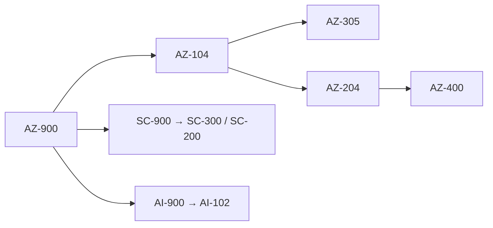

## 1. Core Concept

Chứng chỉ Microsoft Azure chia theo **vai trò và cấp độ**: **Fundamentals** (AZ-900 Azure, AI-900 AI, DP-900 dữ liệu, SC-900 bảo mật), **Associate** (AZ-104 Administrator, AZ-204 Developer, AI-102 AI Engineer, SC-200/SC-300…), **Expert** (AZ-305 Solutions Architect, AZ-400 DevOps). Mã đề và danh sách thay đổi theo thời gian (ví dụ DP-203 đã được thay thế bởi chứng chỉ Fabric Data Engineer), nên **luôn đối chiếu Microsoft Learn** trước khi chọn.

**Mental model:** chọn theo **vai trò công việc**, rồi học theo bảng **"skills measured"** (domain và tỷ trọng) trong study guide của đề; Azure thường hỏi bạn chọn **dịch vụ đúng** dưới các ràng buộc về **chi phí, SLA, tuân thủ và độ phức tạp vận hành**.

## 2. How It Works

**Lộ trình gợi ý**
- AZ-900 (nền tảng) → **AZ-104** (quản trị: identity/governance, storage, compute, networking, monitor) → **AZ-305** (thiết kế giải pháp) hoặc **AZ-204** (lập trình) → **AZ-400** (DevOps).
- **Nhánh dữ liệu/AI**: DP-900 → chứng chỉ data engineer; AI-900 → AI-102. **Nhánh bảo mật**: SC-900 → SC-300 (identity), SC-200 (SecOps), SC-100 (architect).

**Dạng đề**
- Khoảng 40–60 câu, thang 1000 điểm, mốc đạt thường **700**; có **case study** (nhiều câu dựa trên một tình huống), **kéo thả**, **yes/no** theo chuỗi và câu nhiều đáp án. Hãy kiểm tra thông số trong study guide hiện hành.

**Bản đồ bài học trong Playbook**
- **Nền tảng**: core architecture, governance/cost. **Identity/security**: Entra ID/RBAC, Key Vault/Defender. **Compute**: VM, App Service/Functions/containers. **Networking**: VNet, load balancing, hybrid. **Data**: Storage, SQL/Cosmos, data platform, messaging. **DevOps**: Bicep/Azure DevOps. **Monitor**: Azure Monitor.

**Tính SLA tổng hợp**
- Dịch vụ **nối tiếp**: nhân SLA (ví dụ 99,95% × 99,99% ≈ **99,94%**). Dự phòng **song song**: xác suất lỗi nhân với nhau (hai instance mỗi cái 99,9% → khoảng 99,9999%). Thêm dịch vụ phụ thuộc làm SLA tổng **giảm**.

**Kỹ thuật làm đề**
- Gạch từ khoá ràng buộc (rẻ nhất, ít vận hành nhất, tuân thủ, độ trễ), loại đáp án vi phạm, ưu tiên **PaaS/managed** khi đề không nói khác; làm **practice assessment** trên Microsoft Learn và thực hành trong sandbox.

## 3. Visual Diagram

## 4. Rules of Thumb & Trade-offs

| Tình huống / Nhu cầu | Chọn gì |
| --- | --- |
| Mới bắt đầu với Azure | AZ-900 |
| Quản trị hạ tầng Azure | AZ-104 |
| Thiết kế giải pháp | AZ-305 |
| Lập trình ứng dụng cloud | AZ-204 |
| DevOps/CI-CD | AZ-400 |
| Bảo mật | SC-series |

- **Được gì:** lộ trình rõ, học có trọng tâm. **Mất gì:** học rộng tốn thời gian vs học sâu domain trọng số cao; tài liệu cũ dễ lỗi thời.

## 5. Must Remember / Production Pitfalls

- **Nhầm Availability Zone với Region pair → chọn AZ cho bài toán mất cả Region → AZ chịu lỗi datacenter, DR cần Region khác**.
- **Nhầm Entra roles với Azure RBAC roles → chọn sai loại role → Entra quản danh tính, RBAC quản tài nguyên**.
- **Nhầm Azure Policy với RBAC → ép Region/tag bằng role → Policy kiểm soát tài nguyên, RBAC kiểm soát ai làm gì**.
- **Học theo tên cũ (Azure AD, Blueprints…) → lỗi thời → đối chiếu study guide hiện hành**.
- **Bỏ qua SLA tổng hợp → tính sai độ sẵn sàng khi nối tiếp nhiều dịch vụ → nhân SLA các thành phần nối tiếp**.
- Exam trap: "ngăn tạo tài nguyên ngoài Region cho phép" → **Azure Policy**, không phải RBAC; "chịu lỗi datacenter" → **Availability Zone**; "SLA của hai dịch vụ nối tiếp" → **nhân SLA, thấp hơn từng cái**.

## 6. Search Hooks

- `Azure certification paths` — lộ trình theo vai trò.
- `AZ-104 skills measured` — các domain của AZ-104.
- `AZ-305 solutions architect case study` — dạng đề kiến trúc.
- `Microsoft Learn practice assessment` — đánh giá thử chính thức.
- `Azure composite SLA calculation` — tính SLA tổng hợp.
