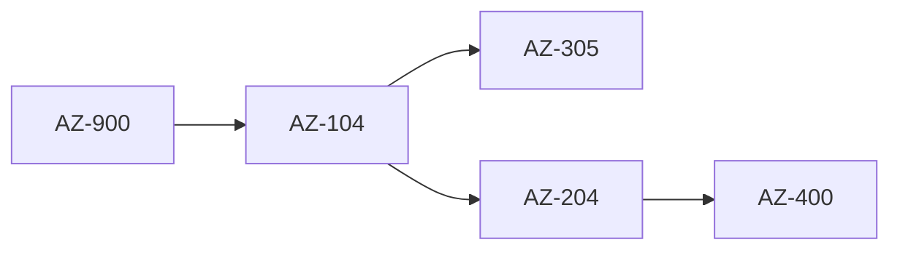

## 1. Core Concept

Chứng chỉ Microsoft Azure chia theo vai trò: **Fundamentals** (AZ-900 Azure, AI-900 AI, DP-900 Data, SC-900 Security), **Associate** (AZ-104 Administrator, AZ-204 Developer, DP-203/Fabric Data Engineer, AI-102 AI Engineer, SC-200/300), **Expert** (AZ-305 Solutions Architect, AZ-400 DevOps). Mã và danh sách đổi theo thời gian: đối chiếu trang Microsoft Learn. Mental model: *chọn theo vai trò, học theo bản đồ kỹ năng (skills measured).*

## 2. How It Works

- **Lộ trình gợi ý**: AZ-900 → **AZ-104** (quản trị) → **AZ-305** (kiến trúc) hoặc **AZ-204** (lập trình) → AZ-400 (DevOps).
- **Nhánh dữ liệu/AI**: DP-900 → data engineer/AI-102; AI-900 là nền AI.
- **Nhánh bảo mật**: SC-900 → SC-300 (identity), SC-200 (SecOps), SC-100 (architect).
- **Bản đồ bài học trong Playbook**: kiến trúc lõi, compute/serverless, networking, storage, Entra ID/RBAC, monitor/security, governance/cost, database, messaging, IaC/DevOps, data platform, hybrid, App Service.
- **Kỹ thuật làm đề**: đọc kỹ ràng buộc (chi phí, SLA, tuân thủ, vận hành), đề có **case study** nhiều câu và câu **yes/no** chuỗi; **Microsoft Learn** có đánh giá thử và sandbox.
- **SLA tổng hợp**: nối tiếp các dịch vụ **nhân** SLA; dự phòng song song tăng SLA.

## 3. Visual Diagram

## 4. Rules of Thumb & Trade-offs

- Học **hiểu vì sao chọn dịch vụ**; thực hành trong subscription thử nghiệm.
- Ưu tiên giải pháp **PaaS, managed, ít vận hành** khi đề không nói khác.
- Trade-off: **học rộng** vs **sâu ở domain trọng số cao**.

## 5. Must Remember / Production Pitfalls

- Nhầm **Availability Zone** (trong Region) với **Region pair/geo-redundancy**.
- Nhầm **Entra ID roles** (thư mục) với **Azure RBAC roles** (tài nguyên).
- Nhầm **Azure Policy** (ép quy tắc) với **RBAC** (ai làm được gì).
- Học theo dịch vụ cũ/tên cũ (Azure AD → Entra ID).
- Interview trap: "Ngăn tạo tài nguyên ngoài Region cho phép?" → **Azure Policy**, không phải RBAC.

## 6. Search Hooks

- `Azure certification paths` — lộ trình theo vai trò.
- `AZ-104 skills measured` — các domain của AZ-104.
- `AZ-305 solutions architect case study` — dạng đề kiến trúc.
- `Microsoft Learn practice assessment` — đánh giá thử chính thức.
- `Azure composite SLA calculation` — tính SLA tổng hợp.
