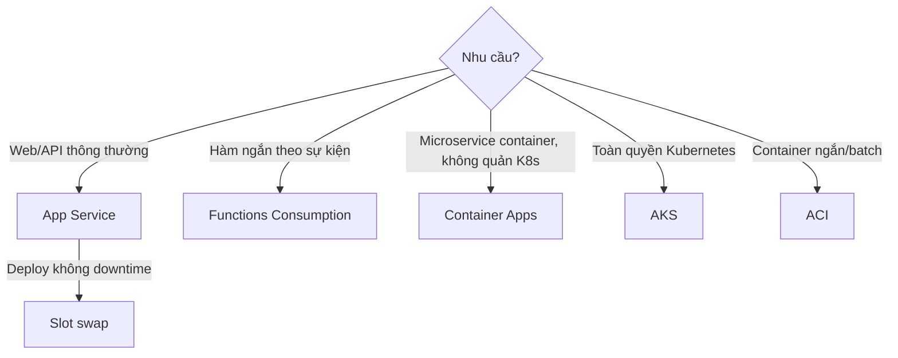

## 1. Core Concept

Ngoài VM, Azure có cả một phổ compute **ít vận hành hơn**: **App Service** (PaaS cho web/API), **Azure Functions** (serverless theo sự kiện), **Container Apps/ACI** (container không quản cluster) và **AKS** (Kubernetes managed). Chọn đúng bậc quyết định bạn gánh bao nhiêu **vận hành** đổi lấy bao nhiêu **kiểm soát**.

**Mental model:** như một **chiếc thang**: ở dưới cùng bạn tự quản mọi thứ (VM, AKS), lên cao hơn Azure lo dần phần hạ tầng (Container Apps, App Service) và trên cùng bạn chỉ viết hàm và trả tiền theo lần chạy (Functions). Đi lên một nấc là **bớt kiểm soát nhưng bớt việc**.

## 2. How It Works

**App Service → PaaS cho web/API**
- Chạy .NET, Java, Node.js, Python… trong **App Service Plan** (quyết định tier **Free/Shared/Basic/Standard/Premium/Isolated**, kích cỡ và scale); nhiều app chia sẻ một plan nên chia sẻ tài nguyên và hoá đơn.
- **Deployment slot** (từ tier **Standard**): môi trường staging cùng app, **swap** sang production **không downtime** sau khi warm-up. Cấu hình đánh dấu **slot setting** sẽ "dính" ở slot không bị swap theo. **Scale up** (đổi kích cỡ) vs **scale out** (thêm instance, autoscale từ Standard).

**Azure Functions → Serverless theo sự kiện**
- Hàm gắn với **trigger** (HTTP, Timer, Queue, Blob, Event Grid, Service Bus) và **binding** (đọc/ghi dữ liệu khai báo sẵn, ít code). **Plan:** **Consumption** (trả theo lần chạy, **scale về 0**, có **cold start**, timeout mặc định ngắn), **Flex Consumption/Premium** (instance khởi động sẵn, **hỗ trợ VNet**, tránh cold start) và **Dedicated** (chạy trên App Service Plan). **Durable Functions** cho workflow có trạng thái (fan-out/fan-in, chờ người duyệt).

**Container → ACI, Container Apps, AKS**
- **ACI**: chạy container đơn lẻ nhanh, **trả theo giây**, không cluster; hợp tác vụ ngắn/batch.
- **Container Apps**: nền tảng container serverless (dựa Kubernetes), scale theo HTTP/sự kiện bằng **KEDA**, **scale về 0**, hỗ trợ revision và chia traffic, hợp microservices.
- **AKS**: Kubernetes managed — Azure quản **control plane**, bạn quản **node pool** (autoscaler, nâng cấp, vá node); cần khi muốn toàn quyền Kubernetes (operator, mạng tuỳ biến).
- **ACR** lưu image (SKU Basic/Standard/Premium, geo-replication ở Premium).

**Liên quan**
- **Logic Apps** (workflow tích hợp ít code), **Service Bus/Event Grid/Event Hubs** (messaging và sự kiện).

```python
import azure.functions as func
app = func.FunctionApp()

@app.blob_trigger(arg_name="blob", path="uploads/{name}", connection="Storage")
def on_upload(blob: func.InputStream):
    print(f"New blob {blob.name} ({blob.length} bytes)")
```

## 3. Visual Diagram



## 4. Rules of Thumb & Trade-offs

| Tình huống / Nhu cầu | Chọn gì |
| --- | --- |
| Web/API thông thường, ít vận hành | App Service |
| Chạy code khi có blob mới, trả theo lần chạy | Azure Functions |
| Cần VNet và không cold start | Functions Premium/Flex |
| Microservices container, không quản Kubernetes | Container Apps |
| Toàn quyền Kubernetes | AKS |
| Một container ngắn/batch | ACI |
| Triển khai không downtime | Deployment slot |

- **Được gì:** ít vận hành, scale tự động, trả theo dùng. **Mất gì:** serverless có cold start và giới hạn thời gian/ngữ cảnh chạy; AKS linh hoạt nhất nhưng tốn công vận hành nhất.

## 5. Must Remember / Production Pitfalls

- **Hàm đầu tiên sau lúc rảnh bị chậm → cold start của Consumption → Premium/Flex hoặc giữ instance nóng**.
- **Swap slot làm production dùng cấu hình staging → quên đánh dấu slot setting → đánh dấu setting riêng của từng môi trường**.
- **Nhiều app chung App Service Plan tranh tài nguyên → một app ngốn CPU kéo cả nhóm → tách plan cho app quan trọng**.
- **Node AKS không tự vá OS → rủi ro bảo mật tích luỹ → bật auto-upgrade/node image upgrade**.
- **Dùng AKS cho ứng dụng đơn giản → vận hành thừa → Container Apps hoặc App Service**.
- Exam trap: "chạy code khi có file mới trong Blob, trả tiền theo lần chạy" → **Functions**; "triển khai không downtime" → **deployment slots**; "container không quản cluster" → **Container Apps**.

## 6. Search Hooks

- `Azure App Service plan deployment slots` — hosting web PaaS và swap không downtime.
- `Azure Functions triggers and bindings` — cách Functions kết nối sự kiện và dữ liệu.
- `Azure Functions Consumption vs Premium plan` — đánh đổi giữa chi phí, cold start và VNet.
- `Azure Container Apps vs AKS` — container serverless so với Kubernetes tự quản.
- `Azure Container Instances` — chạy container đơn lẻ nhanh, không cần cluster.
- `Durable Functions orchestration` — workflow có trạng thái trên Functions.
