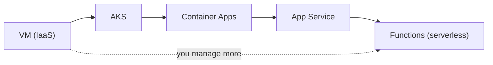

## 1. Core Concept

Ngoài VM, Azure có phổ compute **ít vận hành hơn**: **App Service** (PaaS cho web/API), **Azure Functions** (serverless theo sự kiện), **Container Apps/ACI** và **AKS** (container). Chúng giải quyết nhu cầu chạy code mà không quản lý OS, thậm chí không quản lý server. Mental model: *càng đi từ VM → AKS → Container Apps → App Service → Functions, bạn quản lý càng ít và Azure lo càng nhiều.*

## 2. How It Works

- **App Service**: nền tảng PaaS chạy web app/API/mobile backend (.NET, Java, Node.js, Python…) trong **App Service Plan** (quyết định tier, kích cỡ, scale); có **deployment slot** (staging → swap không downtime), autoscale, custom domain/TLS, tích hợp Entra ID.
- **Azure Functions**: code gắn với **trigger** (HTTP, Timer, Queue, Blob, Event Grid, Service Bus) và **binding** (đọc/ghi dữ liệu khai báo sẵn). Các plan: **Consumption** (trả theo lần chạy, scale về 0), **Flex Consumption**, **Premium** (tránh cold start, VNet), **Dedicated**. **Durable Functions** điều phối workflow có trạng thái.
- **Azure Container Instances (ACI)**: chạy container đơn lẻ nhanh, trả theo giây, không cần cluster.
- **Azure Container Apps**: nền tảng container serverless (dựa Kubernetes), scale theo HTTP/sự kiện (**KEDA**), hỗ trợ microservices.
- **Azure Kubernetes Service (AKS)**: Kubernetes được quản lý — Azure quản **control plane**, bạn quản **node pool**; cần khi muốn toàn quyền Kubernetes.
- **Azure Container Registry (ACR)** lưu image; **Logic Apps** cho workflow tích hợp ít code; **Service Bus/Event Grid/Event Hubs** cho messaging và sự kiện.

## 3. Visual Diagram

## 4. Rules of Thumb & Trade-offs

| Nhu cầu | Chọn |
| --- | --- |
| Web/API thông thường, ít vận hành | **App Service** |
| Tác vụ ngắn theo sự kiện, tải thất thường | **Functions (Consumption/Flex)** |
| Microservices dạng container, không muốn quản K8s | **Container Apps** |
| Cần toàn quyền Kubernetes (operator, mạng tuỳ biến) | **AKS** |
| Chạy một container ngắn/batch | **ACI** |

- Trade-off: serverless rẻ khi tải thưa nhưng có **cold start** và giới hạn thời gian chạy; AKS linh hoạt nhất nhưng **tốn công vận hành nhất**.

## 5. Must Remember / Production Pitfalls

- Plan **Consumption** có **cold start** và timeout mặc định ngắn; cần VNet/không cold start → **Premium**.
- Nhiều App Service app **chia sẻ một App Service Plan** sẽ dùng chung tài nguyên và hoá đơn.
- Dùng **deployment slot** để swap an toàn; nhớ đánh dấu setting nào "slot-sticky".
- AKS: node pool không tự vá hệ điều hành trừ khi bật auto-upgrade/node image upgrade.
- Exam trap: "chạy code khi có file mới trong Blob, trả tiền theo lần chạy" → **Functions**; "triển khai không downtime" → **Deployment slots**.

## 6. Search Hooks

- `Azure App Service plan deployment slots` — hosting web PaaS và swap không downtime.
- `Azure Functions triggers and bindings` — cách Functions kết nối sự kiện và dữ liệu.
- `Azure Functions Consumption vs Premium plan` — đánh đổi giữa chi phí, cold start và VNet.
- `Azure Container Apps vs AKS` — container serverless so với Kubernetes tự quản.
- `Azure Container Instances` — chạy container đơn lẻ nhanh, không cần cluster.
- `Durable Functions orchestration` — workflow có trạng thái trên Functions.
