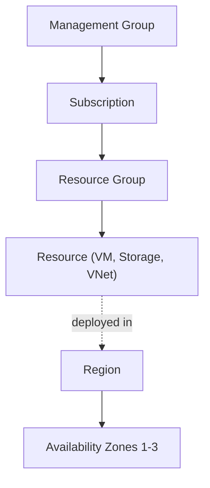

## 1. Core Concept

Kiến trúc nền của Azure gồm hai trục: **hạ tầng vật lý** (Geography → Region → Availability Zone) và **cấu trúc quản trị** (Management Group → Subscription → Resource Group → Resource). Nắm trục này là điều kiện để chọn nơi đặt tài nguyên cho latency, tuân thủ và độ sẵn sàng. Mental model: *Region là "thành phố", Availability Zone là "toà nhà độc lập" trong thành phố, còn Subscription/Resource Group là "sổ sách" gom tài nguyên và hoá đơn.*

## 2. How It Works

- **Region**: nhóm data center trong vùng độ trễ thấp. **Region pair**: mỗi Region ghép với một Region khác cùng geography (cách xa) để phục vụ DR; Azure ưu tiên cập nhật lần lượt từng Region trong cặp.
- **Availability Zone (AZ)**: các vị trí vật lý riêng (nguồn điện, làm mát, mạng độc lập) trong một Region; Region hỗ trợ AZ có **tối thiểu 3 zone**. Dịch vụ có thể là **zonal** (ghim vào một zone) hoặc **zone-redundant** (tự nhân bản qua các zone).
- **Cấu trúc quản trị** (kế thừa chính sách và quyền từ trên xuống):
  - **Management Group**: gom nhiều subscription để áp **Azure Policy/RBAC** hàng loạt.
  - **Subscription**: ranh giới **thanh toán** và **giới hạn (quota)**.
  - **Resource Group**: container logic cho tài nguyên cùng vòng đời; mỗi resource thuộc **đúng một** resource group.
- **Azure Resource Manager (ARM)**: lớp quản lý mọi thao tác (portal, CLI, PowerShell, SDK) và triển khai **ARM template/Bicep** theo kiểu khai báo (**IaC**).
- **Mô hình trách nhiệm chung**: on-premises → **IaaS** → **PaaS** → **SaaS**, càng lên cao Azure quản lý càng nhiều.

## 3. Visual Diagram

## 4. Rules of Thumb & Trade-offs

- Chọn Region theo: **latency tới người dùng**, **data residency/compliance**, **dịch vụ có sẵn** và **giá**.
- Cần chịu lỗi data center → triển khai **zone-redundant** trên ≥ 2 AZ; chịu lỗi cả Region → dùng **region pair**/DR.
- Tách **subscription** theo môi trường (prod/dev) hoặc theo đơn vị để kiểm soát chi phí và quyền.
- Trade-off: nhiều subscription/management group giúp cách ly nhưng thêm công quản trị.

## 5. Must Remember / Production Pitfalls

- Xoá **Resource Group** sẽ xoá **toàn bộ** tài nguyên bên trong.
- Resource Group không phải ranh giới mạng: tài nguyên ở các group khác nhau vẫn giao tiếp qua VNet.
- Không phải Region nào cũng có AZ, và không phải dịch vụ nào cũng hỗ trợ AZ.
- **Quota** áp theo subscription và theo Region: triển khai lớn có thể bị chặn nếu chưa tăng quota.
- Exam trap: "gom nhiều subscription để áp chính sách" → **Management Group**; "ranh giới thanh toán" → **Subscription**; "lỗi cấp data center" → **Availability Zone**.

## 6. Search Hooks

- `Azure regions and availability zones` — hạ tầng vật lý và cách chọn Region/AZ.
- `Azure region pairs` — cặp Region phục vụ DR và cập nhật tuần tự.
- `Azure management groups subscriptions resource groups` — thứ bậc quản trị và kế thừa chính sách.
- `Azure Resource Manager ARM Bicep` — lớp quản lý và IaC khai báo của Azure.
- `Azure shared responsibility IaaS PaaS SaaS` — phân chia trách nhiệm theo mô hình dịch vụ.
