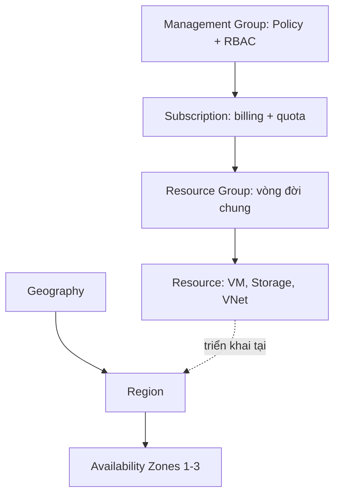

## 1. Core Concept

Kiến trúc nền của Azure có **hai trục** bạn phải tách bạch: **hạ tầng vật lý** (Geography → Region → Availability Zone) quyết định **độ trễ, khả năng chịu lỗi và nơi đặt dữ liệu**, còn **cấu trúc quản trị** (Management Group → Subscription → Resource Group → Resource) quyết định **ai trả tiền, ai được làm gì và chính sách nào áp dụng**. Mọi thiết kế Azure, từ thi AZ-900 đến kiến trúc thật, đều bắt đầu bằng việc đặt đúng hai trục này.

**Mental model:** như một **tập đoàn có nhiều chi nhánh**: Region là thành phố đặt chi nhánh, Availability Zone là các toà nhà độc lập trong thành phố, còn Management Group/Subscription/Resource Group là **sơ đồ tổ chức và sổ kế toán** — quy định phòng ban nào được chi tiền và tuân theo nội quy nào.

## 2. How It Works

**Hạ tầng vật lý → Chọn nơi đặt tài nguyên**
- **Region** là nhóm datacenter trong một vùng độ trễ thấp; Region thuộc một **Geography** (ranh giới dữ liệu và tuân thủ, như châu Âu hay Việt Nam/Đông Nam Á). Chọn Region theo **độ trễ tới người dùng**, **data residency/compliance**, **dịch vụ sẵn có** và **giá** (cùng một VM giá có thể khác giữa Region).
- **Availability Zone (AZ)** là các vị trí vật lý riêng (nguồn điện, làm mát, mạng độc lập) trong **một Region**; Region hỗ trợ AZ có **tối thiểu 3 zone**. Dịch vụ có thể **zonal** (ghim vào một zone, bạn tự nhân bản) hoặc **zone-redundant** (Azure tự trải qua các zone).
- **Region pair**: nhiều Region được ghép với Region khác cùng geography (thường cách xa) cho DR; Azure **cập nhật tuần tự** từng Region trong cặp và ưu tiên khôi phục trong cặp. Không phải Region nào cũng có cặp hay AZ.
- **Ví dụ SLA:** VM đơn với Premium SSD khoảng **99,9%**, hai VM trong availability set **99,95%**, hai VM ở hai AZ khác nhau **99,99%**.

**Cấu trúc quản trị → Chính sách và quyền kế thừa từ trên xuống**
- **Management Group** gom nhiều subscription để áp **Azure Policy/RBAC** hàng loạt (lồng tới 6 cấp).
- **Subscription** là ranh giới **thanh toán** và **quota** (ví dụ giới hạn vCPU theo Region và theo họ VM). Tách theo môi trường prod/dev hoặc đơn vị kinh doanh.
- **Resource Group (RG)** là container logic cho tài nguyên **cùng vòng đời**; mỗi resource thuộc **đúng một** RG, RG **không lồng nhau**, và có thể chuyển resource giữa các RG.
- **Azure Resource Manager (ARM)** là lớp quản lý mọi thao tác (portal, CLI, SDK) và triển khai **ARM template/Bicep** theo kiểu khai báo (IaC). Mọi truy cập quản lý đều đi qua ARM nên RBAC, Policy, lock đều áp dụng ở đây.

**Bảo vệ tài nguyên**
- **Resource lock** (`CanNotDelete`, `ReadOnly`) chặn xoá/sửa nhầm; **tag** để gán chi phí (không tự kế thừa trừ khi dùng Policy).

**Mô hình trách nhiệm chung (Shared Responsibility)**
- Từ on-premises → **IaaS** → **PaaS** → **SaaS**, càng lên cao Azure quản lý càng nhiều, nhưng **dữ liệu, danh tính và quyền truy cập luôn là trách nhiệm của khách hàng**.

```bash
az group create --name rg-orders-prod --location southeastasia
az lock create --name nodelete --lock-type CanNotDelete --resource-group rg-orders-prod
```

## 3. Visual Diagram



## 4. Rules of Thumb & Trade-offs

| Tình huống / Nhu cầu | Chọn gì |
| --- | --- |
| Chịu lỗi một datacenter | Zone-redundant trên ít nhất 2 AZ |
| Chịu lỗi cả Region | Region pair / DR sang Region khác |
| Gom nhiều subscription để áp policy | Management Group |
| Ranh giới thanh toán và quota | Subscription |
| Nhóm tài nguyên cùng vòng đời | Resource Group |
| Chặn xoá nhầm | Resource lock CanNotDelete |

- **Được gì:** quản trị tập trung, chi phí và quyền rõ ràng, chịu lỗi theo từng cấp. **Mất gì:** nhiều subscription/management group cách ly tốt nhưng tăng công quản trị; zone-redundant tốn thêm chi phí và độ trễ liên zone nhỏ.

## 5. Must Remember / Production Pitfalls

- **Xoá Resource Group → mất toàn bộ tài nguyên bên trong → dùng resource lock CanNotDelete và tách RG theo vòng đời**.
- **Nhầm RG là ranh giới mạng → tài nguyên ở RG khác vẫn nói chuyện qua VNet → kiểm soát mạng bằng VNet/NSG, không bằng RG**.
- **Triển khai lớn bị chặn → quota theo subscription và Region → xin tăng quota trước khi triển khai**.
- **Mong Region nào cũng có AZ → không phải Region/dịch vụ nào cũng hỗ trợ → kiểm tra bảng hỗ trợ AZ trước khi thiết kế**.
- **Nhầm Availability Zone với Region pair → tưởng AZ chịu được sự cố cả Region → AZ chỉ chịu lỗi datacenter, DR theo Region cần cặp/Region khác**.
- Exam trap: "gom nhiều subscription để áp chính sách" → **Management Group**; "ranh giới thanh toán" → **Subscription**; "lỗi cấp datacenter" → **Availability Zone**; "mỗi resource thuộc bao nhiêu RG" → **đúng một**.

## 6. Search Hooks

- `Azure regions and availability zones` — hạ tầng vật lý và cách chọn Region/AZ.
- `Azure region pairs` — cặp Region phục vụ DR và cập nhật tuần tự.
- `Azure management groups subscriptions resource groups` — thứ bậc quản trị và kế thừa chính sách.
- `Azure Resource Manager ARM Bicep` — lớp quản lý và IaC khai báo của Azure.
- `Azure shared responsibility IaaS PaaS SaaS` — phân chia trách nhiệm theo mô hình dịch vụ.
