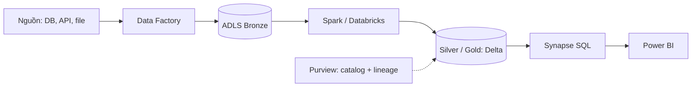

## 1. Core Concept

Nền tảng dữ liệu Azure xoay quanh **data lake** trên **ADLS Gen2**: **Data Factory** nạp và điều phối, **Synapse/Databricks** biến đổi và phân tích, **Power BI** trực quan hoá, **Purview** quản trị, và **Microsoft Fabric** gói tất cả thành nền tảng SaaS hợp nhất. Chúng giải quyết bài toán gom dữ liệu rời rạc về một chỗ rẻ tiền rồi dùng engine phù hợp cho từng nhu cầu.

**Mental model:** lake là **kho nguyên liệu khổng lồ**; ADF là **xe tải + lịch giao hàng** đưa nguyên liệu về; Spark/Databricks là **xưởng chế biến**; Synapse SQL là **quầy bán thành phẩm** cho analyst; và **medallion** (Bronze → Silver → Gold) là cách xếp kệ từ nguyên liệu thô tới thành phẩm đã kiểm định.

## 2. How It Works

**ADLS Gen2 → Lake**
- Là **Blob Storage + hierarchical namespace** (thư mục thật, đổi tên/xoá thư mục nhanh), hỗ trợ **ACL kiểu POSIX** cùng RBAC, truy cập qua `abfss://`. Chia lớp **medallion**: **Bronze** (thô), **Silver** (làm sạch), **Gold** (mô hình phục vụ BI).

**Data Factory → Nạp và điều phối**
- **Pipeline** gồm các **activity** (Copy, Data Flow, Lookup, ForEach…), **linked service** (kết nối), **dataset**. **Integration runtime**: Azure IR, **self-hosted IR** để kết nối on-prem, Azure-SSIS. **Trigger**: lịch, tumbling window, sự kiện. **Mapping data flow** chạy trên Spark.

**Synapse Analytics → Warehouse và query lake**
- **Dedicated SQL pool** (MPP, 60 distribution; kiểu phân phối **hash/round-robin/replicated**; **tính tiền khi chạy**, có thể **pause**) và **serverless SQL pool** (truy vấn trực tiếp file trên lake bằng T-SQL, **trả theo dữ liệu xử lý**, không dựng cluster). Ngoài ra có Spark pool và pipeline.

**Databricks → Spark và lakehouse**
- Spark managed, notebook, job; **Delta Lake** thêm **giao dịch ACID**, schema enforcement, **time travel** và `MERGE` lên file Parquet; **Unity Catalog** quản trị tập trung.

**Fabric → Hợp nhất**
- **OneLake** (một lake logic cho cả tổ chức), Lakehouse, Warehouse, Data Factory, Real-Time Intelligence và Power BI chung một nền tảng theo **capacity**; **Direct Lake** cho Power BI đọc trực tiếp từ lake.

**Streaming và quản trị**
- **Event Hubs + Stream Analytics/Spark** cho dữ liệu thời gian thực; **Purview** catalog, lineage, phân loại dữ liệu.

```sql
-- Synapse serverless: truy vấn Parquet trên lake, trả theo dữ liệu quét
SELECT TOP 10 country, SUM(amount) AS total
FROM OPENROWSET(BULK 'https://lake.dfs.core.windows.net/gold/sales/*.parquet',
                FORMAT = 'PARQUET') AS r
GROUP BY country ORDER BY total DESC;
```

## 3. Visual Diagram



## 4. Rules of Thumb & Trade-offs

| Tình huống / Nhu cầu | Chọn gì |
| --- | --- |
| Điều phối ETL theo lịch/sự kiện | Data Factory |
| Truy vấn nhanh Parquet trên lake, không dựng cluster | Synapse serverless SQL |
| Warehouse MPP, tải BI đều | Synapse dedicated pool |
| Spark/ML lakehouse, Delta Lake | Databricks |
| Nền tảng hợp nhất ít vận hành | Microsoft Fabric |
| Catalog, lineage, phân loại dữ liệu | Purview |

- **Được gì:** lưu rẻ, engine linh hoạt theo nhu cầu. **Mất gì:** nhiều dịch vụ tách rời tăng độ phức tạp; Fabric đơn giản hơn nhưng gắn chặt nền tảng và mô hình capacity.

## 5. Must Remember / Production Pitfalls

- **Hoá đơn Synapse cao → dedicated pool vẫn chạy khi không dùng → pause pool hoặc dùng serverless**.
- **Join/aggregate chậm trên dedicated pool → distribution key sai gây data movement → hash theo cột join, replicated cho bảng nhỏ**.
- **Truy vấn lake chậm → quá nhiều file nhỏ → gộp file (compaction), Delta Lake OPTIMIZE**.
- **Lake lộn xộn, ai cũng đọc/ghi → thiếu ACL/RBAC → phân quyền theo container/thư mục**.
- **Pipeline ADF chạy lại tạo dữ liệu trùng → không idempotent → ghi theo partition/overwrite hoặc upsert**.
- Exam trap: "truy vấn Parquet trên lake không dựng cluster" → **Synapse serverless SQL**; "ACID trên data lake" → **Delta Lake**; "orchestrate ETL theo lịch" → **Data Factory**.

## 6. Search Hooks

- `Azure Data Lake Storage Gen2 hierarchical namespace` — lake trên Blob.
- `medallion architecture bronze silver gold` — các lớp dữ liệu.
- `Azure Synapse dedicated vs serverless SQL pool` — hai chế độ SQL.
- `Delta Lake ACID` — giao dịch trên data lake.
- `Microsoft Fabric OneLake` — nền tảng dữ liệu hợp nhất.
