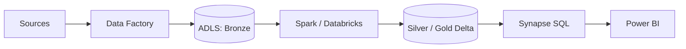

## 1. Core Concept

Nền tảng dữ liệu Azure: **ADLS Gen2** (data lake trên Blob), **Azure Data Factory** (orchestration/ETL), **Synapse Analytics** (warehouse + Spark), **Azure Databricks** (Spark/lakehouse) và **Microsoft Fabric** (nền tảng SaaS hợp nhất). Mental model: *lake rẻ ở giữa; ingest bằng ADF; biến đổi bằng Spark/SQL; phục vụ BI qua Power BI.*

## 2. How It Works

- **ADLS Gen2**: Blob + **hierarchical namespace**, ACL kiểu POSIX, phân vùng thư mục; phân lớp **Bronze/Silver/Gold** (medallion).
- **Data Factory**: **pipeline**, **activity**, **dataset/linked service**, **integration runtime** (kết nối on-prem), trigger theo lịch/sự kiện; **mapping data flows** (Spark).
- **Synapse**: **dedicated SQL pool** (MPP, **distribution**: hash/round-robin/replicated), **serverless SQL** (truy vấn lake, trả theo dữ liệu quét), Spark pool.
- **Databricks**: Spark managed, **Delta Lake** (ACID trên lake), notebook, **Unity Catalog** (quản trị).
- **Event Hubs/Stream Analytics** cho streaming.
- **Fabric**: OneLake, Lakehouse, Warehouse, Data Factory, Power BI trong một nền tảng.
- **Purview**: catalog và governance.

## 3. Visual Diagram

## 4. Rules of Thumb & Trade-offs

| Nhu cầu | Chọn |
| --- | --- |
| Orchestrate ETL | Data Factory |
| Spark/ML lakehouse | Databricks |
| Warehouse MPP, SQL | Synapse dedicated pool |
| Hợp nhất, ít vận hành | Fabric |

- Trade-off: **dịch vụ tách rời** linh hoạt vs **Fabric hợp nhất** đơn giản nhưng ràng buộc nền tảng.

## 5. Must Remember / Production Pitfalls

- Synapse dedicated pool **tính tiền khi chạy**; quên tạm dừng là tốn.
- **Distribution key sai** gây data movement.
- Quá nhiều **file nhỏ** làm chậm; gộp.
- Không đặt ACL/RBAC rõ trên lake.
- Pipeline ADF không idempotent khi rerun.
- Interview trap: "Truy vấn nhanh file Parquet trên lake, không dựng cluster?" → Synapse serverless SQL.

## 6. Search Hooks

- `Azure Data Lake Storage Gen2 hierarchical namespace` — lake trên Blob.
- `medallion architecture bronze silver gold` — các lớp dữ liệu.
- `Azure Synapse dedicated vs serverless SQL pool` — hai chế độ SQL.
- `Delta Lake ACID` — giao dịch trên data lake.
- `Microsoft Fabric OneLake` — nền tảng dữ liệu hợp nhất.
