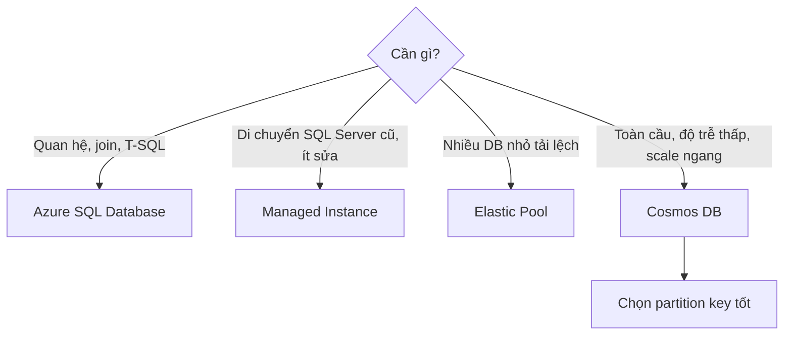

## 1. Core Concept

Azure có hai trụ cột dữ liệu chính: **Azure SQL** (họ relational managed: SQL Database, Managed Instance, SQL Server trên VM) và **Cosmos DB** (NoSQL đa mô hình phân tán toàn cầu). Chúng giải quyết hai bài toán khác nhau: **giao dịch và quan hệ với T-SQL** (Azure SQL) và **scale ngang, độ trễ thấp ở nhiều Region với mức nhất quán chỉnh được** (Cosmos DB).

**Mental model:** Azure SQL là **sổ cái kế toán** (quan hệ chặt, giao dịch ACID, truy vấn linh hoạt); Cosmos DB là **hệ thống tủ hồ sơ nhân bản ở nhiều thành phố** (truy cập rất nhanh theo khoá, mỗi tủ có hạn mức đọc ghi — **RU/s** — và bạn chọn mức "đồng bộ" giữa các tủ).

## 2. How It Works

**Azure SQL → Chọn dạng triển khai và mô hình mua**
- **SQL Database** (PaaS, một DB là một đơn vị, **serverless** có auto-pause), **Elastic Pool** (nhiều DB chia sẻ tài nguyên, hợp tải lệch nhau), **Managed Instance** (tương thích SQL Server gần như đầy đủ, dễ **lift-and-shift**), **SQL trên VM** (IaaS toàn quyền).
- **Mô hình mua**: **DTU** (gói gộp) vs **vCore** (chọn riêng compute/storage). **Tier**: General Purpose, **Business Critical** (replica đọc, độ trễ thấp), **Hyperscale** (storage tới 100 TB, restore nhanh).
- **HA/DR**: backup tự động và **PITR** (mặc định 7 ngày, tới 35), **long-term retention** tới 10 năm, **zone redundancy**, **active geo-replication** và **auto-failover group** (endpoint đọc-ghi và chỉ-đọc ổn định qua failover).
- **Bảo mật**: **TDE** mặc định, **Always Encrypted**, **dynamic data masking**, **Entra ID auth**, **Private Endpoint**, auditing, Defender for SQL.

**Cosmos DB → Mô hình tài nguyên và throughput**
- Cấu trúc **account → database → container → item**; nhiều API (**NoSQL**, MongoDB, Cassandra, Gremlin, Table, PostgreSQL). **Index tự động** mọi thuộc tính.
- **Partition key** quyết định dữ liệu và tải chia thế nào: item cùng key thuộc một **logical partition** (tối đa 20 GB). **Key tốt**: cardinality cao, phân bố đều, **xuất hiện trong hầu hết truy vấn**.
- **RU/s (Request Units)** là đơn vị throughput: đọc điểm một item 1 KB tốn khoảng **1 RU**, ghi tốn nhiều hơn, truy vấn **cross-partition** tốn nhiều hơn. Vượt hạn mức nhận **HTTP 429**. Chế độ: **provisioned** (manual hoặc **autoscale**) và **serverless**.
- **Năm mức nhất quán**: **Strong, Bounded Staleness, Session** (mặc định), **Consistent Prefix, Eventual** — càng mạnh càng tốn độ trễ/RU và giảm khả dụng đa Region. Ghi **đa Region** xử lý xung đột mặc định theo **last-writer-wins**.
- **Change feed** là luồng thay đổi theo thứ tự để kích hoạt xử lý/đồng bộ.

```csharp
var resp = await container.ReadItemAsync<Order>(
    id: "o-1001", partitionKey: new PartitionKey("customer-42"));
Console.WriteLine(resp.RequestCharge); // ~1 RU cho point read
```

## 3. Visual Diagram



## 4. Rules of Thumb & Trade-offs

| Tình huống / Nhu cầu | Chọn gì |
| --- | --- |
| Ứng dụng mới quan hệ, giao dịch | Azure SQL Database |
| Di chuyển SQL Server on-prem ít sửa đổi | Managed Instance |
| Nhiều DB nhỏ tải lệch nhau | Elastic Pool |
| Tải thưa, chịu auto-pause | SQL serverless |
| Toàn cầu, key-value/document, scale lớn | Cosmos DB |
| Mức nhất quán mặc định hợp lý | Session |

- **Được gì:** SQL cho truy vấn và ràng buộc mạnh; Cosmos cho scale và độ trễ nhất quán toàn cầu. **Mất gì:** **Strong** consistency tốn RU và độ trễ; Cosmos kém ở truy vấn cross-partition và join.

## 5. Must Remember / Production Pitfalls

- **Cosmos trả 429 dù tổng RU còn dư → hot partition do key lệch → chọn key phân bố đều, cardinality cao**.
- **Truy vấn tốn RU cao → cross-partition → đưa partition key vào điều kiện truy vấn**.
- **Hoá đơn Cosmos cao với tải thưa → RU/s đặt cố định cao → autoscale hoặc serverless**.
- **Failover group không chuyển ứng dụng → ứng dụng trỏ thẳng server chính → dùng endpoint của failover group**.
- **Nhầm Managed Instance và SQL Database → thiếu tính năng instance-level (SQL Agent, cross-DB) → chọn MI khi cần tương thích gần đầy đủ**.
- Exam trap: "mức nhất quán mặc định Cosmos" → **Session**; "di chuyển SQL Server on-prem ít sửa nhất" → **Managed Instance**; "Cosmos 429 thường xuyên" → **hot partition hoặc RU không đủ**.

## 6. Search Hooks

- `Cosmos DB consistency levels` — năm mức nhất quán.
- `Cosmos DB partition key request units` — thiết kế partition và RU.
- `Azure SQL elastic pool vs managed instance` — chọn dạng triển khai.
- `Azure SQL failover groups` — failover đa Region.
- `Cosmos DB change feed` — luồng thay đổi dữ liệu.
