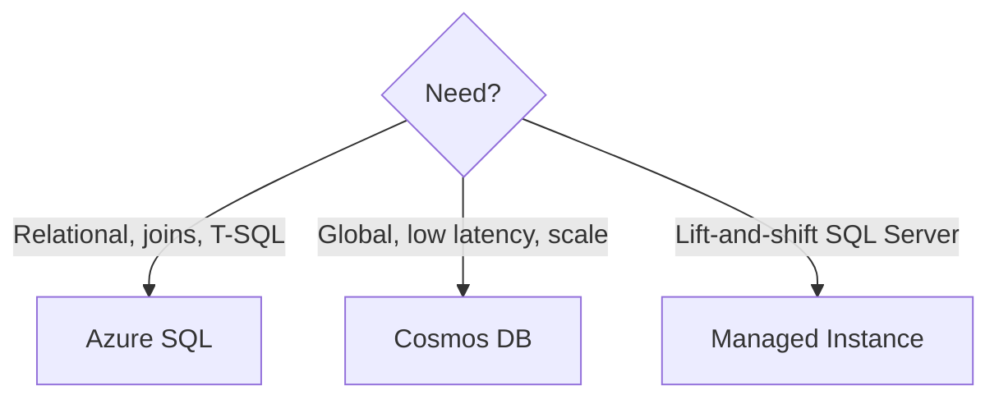

## 1. Core Concept

Azure có hai trụ cột dữ liệu chính: **Azure SQL** (relational managed: SQL Database, Managed Instance, SQL trên VM) và **Cosmos DB** (NoSQL đa mô hình phân tán toàn cầu). Mental model: *SQL cho giao dịch/quan hệ; Cosmos cho scale ngang, độ trễ thấp ở mọi Region, với mức nhất quán chỉnh được.*

## 2. How It Works

- **Azure SQL**: **Database** (PaaS, mỗi DB một đơn vị), **Elastic Pool** (nhiều DB chia sẻ tài nguyên), **Managed Instance** (tương thích SQL Server gần như đầy đủ, dễ lift-and-shift); mô hình **DTU** vs **vCore**; **Hyperscale**; **geo-replication/failover group**.
- **Cosmos DB**: API **NoSQL (Core)**, MongoDB, Cassandra, Gremlin, Table; **RU/s** (Request Units) là đơn vị throughput; **partition key** quyết định phân bổ; ghi **đa Region**.
- **5 mức nhất quán**: **Strong, Bounded Staleness, Session** (mặc định), **Consistent Prefix, Eventual** — đổi nhất quán lấy độ trễ/khả dụng.
- **Autoscale** throughput, **serverless** mode, **change feed** (luồng thay đổi).
- **PostgreSQL/MySQL Flexible Server** managed.
- Bảo mật: **Private Endpoint**, **Entra ID auth**, **TDE** mã hoá, **Always Encrypted**.

## 3. Visual Diagram

## 4. Rules of Thumb & Trade-offs

| Cần | Chọn |
| --- | --- |
| Ứng dụng mới quan hệ | Azure SQL Database |
| Di chuyển SQL Server cũ | Managed Instance |
| Nhiều DB nhỏ tải lệch | Elastic Pool |
| Global, key-value/document | Cosmos DB |

- Trade-off: **Strong** consistency tốn độ trễ/RU; **Session** thường đủ.

## 5. Must Remember / Production Pitfalls

- **Partition key kém** (hot partition) làm RU đắt và bị throttle (**429**).
- Truy vấn **cross-partition** tốn RU.
- RU/s đặt cao liên tục rất đắt; dùng autoscale/serverless cho tải thưa.
- Failover group cần chuỗi kết nối nhóm, không trỏ thẳng server.
- Interview trap: "Chọn mức nhất quán Cosmos mặc định?" → **Session**.

## 6. Search Hooks

- `Cosmos DB consistency levels` — năm mức nhất quán.
- `Cosmos DB partition key request units` — thiết kế partition và RU.
- `Azure SQL elastic pool vs managed instance` — chọn dạng triển khai.
- `Azure SQL failover groups` — failover đa Region.
- `Cosmos DB change feed` — luồng thay đổi dữ liệu.
