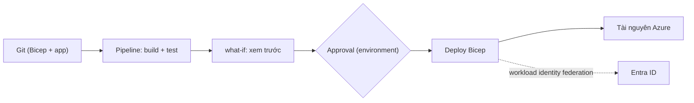

## 1. Core Concept

Trên Azure, **Infrastructure as Code (IaC)** dùng **ARM template** (JSON gốc), **Bicep** (DSL gọn biên dịch ra ARM) hoặc **Terraform**; **Azure DevOps** hoặc **GitHub Actions** chạy pipeline CI/CD để triển khai tự động. Chúng giải quyết nỗi đau dựng hạ tầng bằng tay: không lặp lại được, không review được, không kiểm thử được.

**Mental model:** template là **bản vẽ khai báo trạng thái mong muốn**; Azure Resource Manager là **người thi công** so sánh bản vẽ với công trình rồi chỉ sửa chỗ khác; `what-if` là **bản xem trước thay đổi**; pipeline là **dây chuyền** đưa bản vẽ qua kiểm tra rồi mới thi công, có cổng duyệt.

## 2. How It Works

**Bicep và ARM → Khai báo hạ tầng**
- Bicep có `param`, `var`, `resource`, `module`, `output`, vòng lặp và điều kiện; biên dịch ra ARM JSON. Triển khai idempotent ở nhiều **scope**: resource group, subscription, management group, tenant (`az deployment group|sub|mg create`).
- **`what-if`** hiển thị tài nguyên sẽ được tạo/sửa/xoá trước khi áp dụng.
- **Deployment mode**: **Incremental** (mặc định, chỉ thêm/sửa) vs **Complete** (xoá tài nguyên **không có** trong template — nguy hiểm). Có **template specs** và **deployment stacks** để đóng gói và quản lý vòng đời.

```bicep
param location string = resourceGroup().location
resource sa 'Microsoft.Storage/storageAccounts@2023-01-01' = {
  name: 'st${uniqueString(resourceGroup().id)}'
  location: location
  sku: { name: 'Standard_LRS' }
  kind: 'StorageV2'
}
```

**Azure DevOps → CI/CD**
- **Repos, Boards, Pipelines, Artifacts, Test Plans**. **YAML pipeline** gồm `trigger`, `pool`, **stages → jobs → steps**, `variables`, **template** tái dùng; **environments** gắn **approval và check** trước khi triển khai; **agent** Microsoft-hosted hoặc self-hosted (truy cập mạng nội bộ).
- **Service connection** tới Azure ưu tiên **workload identity federation** (không lưu secret, tránh secret hết hạn) thay cho client secret. **Variable group** liên kết Key Vault để không đặt secret trong pipeline.
- **Chiến lược triển khai**: `runOnce`, `rolling`, `canary`; với App Service dùng **slot swap**. GitHub Actions cũng dùng được với OIDC.

**Guardrail**
- **Azure Policy**/**landing zone** ép chuẩn; kết hợp **what-if** trong PR để review thay đổi hạ tầng.

```yaml
stages:
- stage: Deploy
  jobs:
  - deployment: infra
    environment: prod        # có approval check
    strategy:
      runOnce:
        deploy:
          steps:
          - task: AzureCLI@2
            inputs: { azureSubscription: 'wif-prod', scriptType: bash, scriptLocation: inlineScript,
                      inlineScript: 'az deployment group what-if -g rg-app -f main.bicep' }
```

## 3. Visual Diagram



## 4. Rules of Thumb & Trade-offs

| Tình huống / Nhu cầu | Chọn gì |
| --- | --- |
| IaC chỉ cho Azure | Bicep |
| IaC đa cloud | Terraform |
| Xem trước thay đổi trước khi deploy | `what-if` |
| Triển khai ứng dụng web không downtime | Slot swap |
| Pipeline truy cập Azure không lưu secret | Workload identity federation |
| Cổng duyệt trước production | Environment approvals |

- **Được gì:** hạ tầng có version, review, lặp lại được. **Mất gì:** Bicep gắn Azure; Terraform thêm công cụ và quản lý state; pipeline cần quản lý quyền và secret cẩn thận.

## 5. Must Remember / Production Pitfalls

- **Tài nguyên bị xoá ngoài ý muốn → dùng Complete mode → dùng Incremental và `what-if` trước**.
- **Pipeline sập khi secret hết hạn → service principal secret → workload identity federation hoặc managed identity**.
- **Secret nằm trong biến pipeline → lộ trong log/repo → Key Vault + variable group**.
- **Tên storage trùng gây lỗi → tên toàn cục → `uniqueString(resourceGroup().id)`**.
- **Quyền của service connection quá rộng → pipeline bị chiếm là mất subscription → RBAC tối thiểu theo scope**.
- Exam trap: "xem trước thay đổi trước khi triển khai" → **what-if**; "IaC đa cloud" → **Terraform**; "pipeline truy cập Azure không lưu secret" → **workload identity federation**.

## 6. Search Hooks

- `Bicep vs ARM templates` — ngôn ngữ IaC của Azure.
- `az deployment what-if` — xem trước thay đổi.
- `Azure DevOps YAML pipelines` — CI/CD trên Azure DevOps.
- `workload identity federation Azure DevOps` — xác thực không cần secret.
- `Azure Policy landing zone` — guardrail và landing zone.
