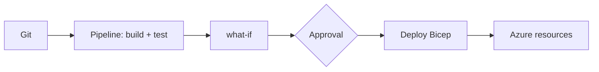

## 1. Core Concept

Trên Azure, **IaC** dùng **ARM template** (JSON gốc), **Bicep** (DSL gọn biên dịch ra ARM) hoặc **Terraform**; **Azure DevOps / GitHub Actions** chạy pipeline CI/CD. Mental model: *template khai báo trạng thái mong muốn, Resource Manager làm cho thực tế khớp.*

## 2. How It Works

- **Resource Manager**: mọi thao tác đi qua ARM API; **deployment** idempotent, phạm vi: resource group, subscription, management group, tenant.
- **Bicep**: `param`, `var`, `resource`, `module`, `output`; `az deployment group create`; `what-if` xem trước thay đổi.
- **Deployment mode**: **Incremental** (mặc định, chỉ thêm/sửa) vs **Complete** (xoá tài nguyên không có trong template).
- **Azure DevOps**: Repos, **Pipelines** (YAML: stages/jobs/steps), Boards, Artifacts, **environments + approvals**; service connection dùng **workload identity federation**/managed identity.
- **Chiến lược triển khai**: slot swap (App Service), blue/green, canary.
- **Azure Policy** và **Blueprints/Landing zones** để guardrail.

```bicep
param location string = resourceGroup().location
resource sa 'Microsoft.Storage/storageAccounts@2023-01-01' = {
  name: 'st${uniqueString(resourceGroup().id)}'
  location: location
  sku: { name: 'Standard_LRS' }
  kind: 'StorageV2'
}
```

## 3. Visual Diagram



## 4. Rules of Thumb & Trade-offs

- Dùng **Bicep** cho Azure thuần; **Terraform** khi đa cloud.
- Luôn chạy **what-if** trước khi deploy production.
- Trade-off: Bicep tích hợp Azure tốt, Terraform quản lý state và đa cloud nhưng thêm công cụ.

## 5. Must Remember / Production Pitfalls

- **Complete mode** có thể xoá tài nguyên ngoài ý muốn.
- Secret trong pipeline variable thay vì **Key Vault**.
- Service principal secret hết hạn; ưu tiên federated credentials.
- Tên tài nguyên toàn cục (storage) trùng gây lỗi; dùng `uniqueString`.
- Interview trap: "Xem trước thay đổi trước khi áp dụng?" → `what-if`.

## 6. Search Hooks

- `Bicep vs ARM templates` — ngôn ngữ IaC của Azure.
- `az deployment what-if` — xem trước thay đổi.
- `Azure DevOps YAML pipelines` — CI/CD trên Azure DevOps.
- `workload identity federation Azure DevOps` — xác thực không cần secret.
- `Azure Policy landing zone` — guardrail và landing zone.
