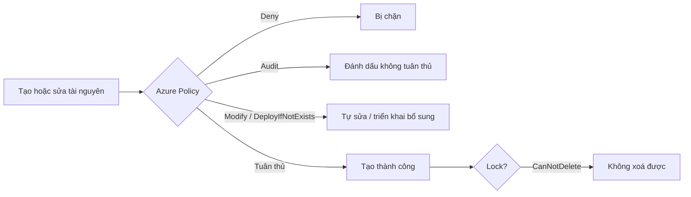

## 1. Core Concept

**Governance** trên Azure là bộ công cụ để **đặt luật**, **bảo vệ tài nguyên** và **kiểm soát chi phí** ở quy mô nhiều subscription: **Azure Policy** (luật về tài nguyên), **resource lock** (chặn xoá/sửa nhầm), **tag** (phân loại và gán chi phí) và **Cost Management** (đo và cảnh báo chi phí). Điều hay bị nhầm nhất là phân biệt **Policy** (tài nguyên được phép trông thế nào) với **RBAC** (người dùng được làm gì).

**Mental model:** RBAC là **thẻ ra vào của nhân viên**; Policy là **quy chuẩn xây dựng của toà nhà** (không ai, kể cả giám đốc, được xây trái quy chuẩn); Lock là **niêm phong** lên thiết bị quan trọng; Budget là **đồng hồ điện báo động** khi vượt ngân sách nhưng không tự cắt điện.

## 2. How It Works

**Azure Policy → Đặt luật và đánh giá tuân thủ**
- Một **policy definition** (JSON) có `rule` (điều kiện) và **effect** (hành động). Gom nhiều policy thành **initiative** và **gán (assignment)** ở bất kỳ scope (management group, subscription, resource group), có thể **loại trừ** một số scope.
- Các **effect**: `Deny` (chặn tạo/sửa không tuân thủ), `Audit` (chỉ đánh dấu), `AuditIfNotExists`, `Append`/`Modify` (thêm hoặc sửa thuộc tính như tag), `DeployIfNotExists` (tự triển khai tài nguyên thiếu, ví dụ bật diagnostic settings) và `Disabled`.
- Đánh giá khi **tạo/cập nhật** tài nguyên và định kỳ (khoảng 24 giờ). `Deny` **không sửa tài nguyên đã tồn tại**; để đưa tài nguyên cũ về tuân thủ cần **remediation task** (dùng managed identity) cho `Modify`/`DeployIfNotExists`.

**Resource lock → Bảo vệ khỏi thao tác nhầm**
- `CanNotDelete` (sửa được, không xoá được) và `ReadOnly` (không sửa, không xoá). Áp ở subscription/resource group/resource, **kế thừa xuống tài nguyên con** và **áp dụng cả với Owner** (muốn gỡ phải có quyền quản lý lock).

**Tag → Phân loại và gán chi phí**
- Cặp key-value (`env=prod`, `costCenter=1234`); **không tự kế thừa** từ resource group xuống resource, nên dùng Policy `Modify`/`Append` để ép hoặc kế thừa tag.

**Cost Management → Nhìn thấy và kiểm soát chi phí**
- Phân tích chi phí theo **scope và tag**, dự báo; **Budget** đặt ngưỡng và **alert** (có thể gắn Action Group để chạy automation); **Azure Advisor** gợi ý tối ưu (cost, security, reliability, performance). Chi phí chịu ảnh hưởng bởi loại tài nguyên, Region, kích cỡ, **băng thông ra (egress)** và mô hình giá (Reserved, Spot, Hybrid Benefit).
- **Pricing Calculator** ước tính chi phí dịch vụ Azure trước khi triển khai; **TCO Calculator** so sánh tổng chi phí sở hữu với hạ tầng tại chỗ.

**Tuân thủ**
- **Microsoft Purview** quản trị dữ liệu; **Service Trust Portal** chứa tài liệu tuân thủ; **Defender for Cloud** đánh giá theo chuẩn quy định.

```json
{ "policyRule": {
    "if":   { "field": "tags['costCenter']", "exists": "false" },
    "then": { "effect": "deny" } } }
```

## 3. Visual Diagram



## 4. Rules of Thumb & Trade-offs

| Tình huống / Nhu cầu | Chọn gì |
| --- | --- |
| Bắt buộc mọi tài nguyên có tag, chỉ cho Region cụ thể | Azure Policy `Deny` |
| Rà soát trước khi chặn | Policy `Audit` |
| Tự bật diagnostic settings cho tài nguyên mới | Policy `DeployIfNotExists` |
| Ngăn xoá nhầm database production | CanNotDelete lock |
| Chia chi phí theo dự án/bộ phận | Tag + Cost Management |
| Cảnh báo vượt ngân sách | Budget + alert |
| Ước tính chi phí trước khi triển khai | Pricing Calculator |

- **Được gì:** tuân thủ có hệ thống, ít sai sót, chi phí minh bạch. **Mất gì:** Policy `Deny` quá chặt làm chậm đội phát triển — nên bắt đầu bằng `Audit` rồi siết dần.

## 5. Must Remember / Production Pitfalls

- **Owner vẫn bị chặn tạo tài nguyên → Policy Deny không phụ thuộc quyền → sửa policy hoặc exemption, không phải cấp thêm role**.
- **Lock `ReadOnly` gây lỗi khó hiểu (không stop được VM, không đọc được key) → thao tác tưởng là đọc lại cần ghi → dùng `CanNotDelete` trừ khi thật sự cần ReadOnly**.
- **Báo cáo chi phí thiếu → tag không kế thừa từ resource group → Policy ép/kế thừa tag**.
- **Budget vượt nhưng tài nguyên vẫn chạy → budget chỉ cảnh báo → gắn Action Group/automation nếu muốn tắt**.
- **Tài nguyên cũ vẫn không tuân thủ sau khi gán policy → chỉ áp cho thao tác mới → remediation task**.
- Exam trap: "bắt buộc mọi tài nguyên có tag" → **Policy**; "ngăn xoá nhầm" → **Lock**; "ước tính chi phí trước khi triển khai" → **Pricing Calculator**; "so sánh với on-premises" → **TCO Calculator**.

## 6. Search Hooks

- `Azure Policy effects deny audit modify` — các effect của Azure Policy.
- `Azure Policy initiative remediation` — nhóm policy và sửa tài nguyên không tuân thủ.
- `Azure resource locks CanNotDelete ReadOnly` — chặn xoá/sửa nhầm tài nguyên.
- `Azure tags inheritance policy` — tag không tự kế thừa, ép bằng Policy.
- `Azure Cost Management budgets alerts` — theo dõi và cảnh báo chi phí.
- `Azure Pricing Calculator vs TCO Calculator` — ước tính chi phí Azure và so sánh với on-premises.
