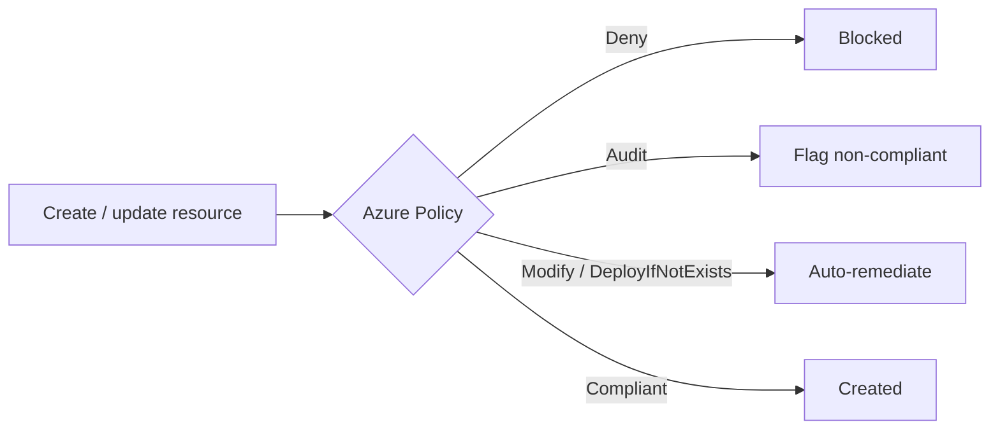

## 1. Core Concept

**Governance** trên Azure là bộ công cụ để **đặt luật**, **bảo vệ tài nguyên** và **kiểm soát chi phí** ở quy mô nhiều subscription: **Azure Policy**, **resource lock**, **tag**, **Cost Management**. Mental model: *RBAC quyết định ai được làm gì; Policy quyết định tài nguyên được phép trông như thế nào; Lock chặn thao tác nguy hiểm; Cost Management báo "bao nhiêu tiền".*

## 2. How It Works

- **Azure Policy**: đánh giá tài nguyên với **policy definition** (JSON); gom nhiều policy thành **initiative**; gán ở bất kỳ scope. Các **effect**: `Deny` (chặn tạo/sửa), `Audit` (chỉ ghi nhận), `Append`, `Modify` (thêm/sửa thuộc tính như tag), `DeployIfNotExists` (tự triển khai tài nguyên bổ sung). Có **remediation task** sửa tài nguyên cũ không tuân thủ.
- **Resource lock**: `CanNotDelete` (sửa được, không xoá được) và `ReadOnly` (không sửa, không xoá); áp ở subscription/resource group/resource và **kế thừa xuống**; lock thắng cả quyền Owner cho đến khi gỡ lock.
- **Tag**: cặp key-value để phân loại (`env=prod`, `costCenter=...`); **không tự kế thừa** từ resource group xuống resource (dùng Policy `Modify`/`Append` để ép).
- **Cost Management + Billing**: phân tích chi phí theo scope/tag, **budget** + **alert**, dự báo; **Azure Advisor** gợi ý tối ưu (cost, security, reliability, performance); **Azure Pricing Calculator** (ước tính trước) và **TCO Calculator** (so sánh với on-premises).
- Các yếu tố ảnh hưởng chi phí: loại tài nguyên, Region, kích cỡ, **băng thông ra (egress)**, mô hình giá (Reserved, Spot, Hybrid Benefit).
- **Microsoft Purview** quản trị dữ liệu và **Service Trust Portal** chứa tài liệu tuân thủ.

## 3. Visual Diagram

## 4. Rules of Thumb & Trade-offs

- Muốn **ép tuân thủ** (chỉ cho Region cụ thể, bắt buộc tag, cấm public IP) → **Policy** với `Deny`; muốn **rà soát** trước → `Audit`.
- Bảo vệ tài nguyên quan trọng (database prod, VNet hub) khỏi xoá nhầm → **CanNotDelete lock**.
- Chia chi phí theo dự án/bộ phận → **tag + Cost Management**; không kiểm soát được hoá đơn → **budget + alert**.
- Trade-off: Policy `Deny` quá chặt làm chậm đội phát triển; bắt đầu bằng `Audit` rồi siết dần.

## 5. Must Remember / Production Pitfalls

- **Policy ≠ RBAC**: Owner vẫn bị Policy `Deny` chặn; ngược lại có Policy không cấp thêm quyền cho ai.
- **Lock** có thể gây lỗi khó hiểu: `ReadOnly` lock chặn cả thao tác đọc key hoặc stop VM (do cần thao tác ghi).
- Tag không kế thừa là bẫy kinh điển khi báo cáo chi phí.
- Budget chỉ **cảnh báo**, không tự tắt tài nguyên (trừ khi gắn Action Group/automation).
- Exam trap: "bắt buộc mọi tài nguyên có tag" → Policy; "ngăn xoá nhầm" → Lock; "ước tính chi phí trước khi triển khai" → Pricing Calculator.

## 6. Search Hooks

- `Azure Policy effects deny audit modify` — các effect của Azure Policy.
- `Azure Policy initiative remediation` — nhóm policy và sửa tài nguyên không tuân thủ.
- `Azure resource locks CanNotDelete ReadOnly` — chặn xoá/sửa nhầm tài nguyên.
- `Azure tags inheritance policy` — tag không tự kế thừa, ép bằng Policy.
- `Azure Cost Management budgets alerts` — theo dõi và cảnh báo chi phí.
- `Azure Pricing Calculator vs TCO Calculator` — ước tính chi phí Azure và so sánh với on-premises.
