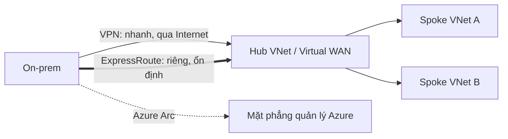

## 1. Core Concept

Kết nối on-premises với Azure dùng **VPN Gateway** (IPsec qua Internet), **ExpressRoute** (đường riêng), **Virtual WAN** (hub toàn cầu), cùng **Azure Arc** (kéo quản trị Azure ra tài nguyên ngoài Azure) và các công cụ di chuyển (**Azure Migrate, Site Recovery, Data Box**). Chúng giải quyết hai câu hỏi: **đường nào đi** và **quản lý/di chuyển tài nguyên lai ra sao**.

**Mental model:** VPN là **đường công cộng có mã hoá** — dựng nhanh, rẻ, nhưng chất lượng phụ thuộc Internet; ExpressRoute là **đường cao tốc riêng** — ổn định, nhưng đắt và mất thời gian xây; Arc là **ăng-ten nối bảng điều khiển Azure** tới server ở mọi nơi để quản lý như tài nguyên Azure.

## 2. How It Works

**VPN Gateway → Nhanh, rẻ, qua Internet**
- **Site-to-Site** (mạng-mạng), **Point-to-Site** (máy người dùng), **VNet-to-VNet**; mã hoá **IPsec**, hỗ trợ **BGP** và **active-active**; SKU quyết định băng thông. Dựng trong **vài chục phút**.

**ExpressRoute → Riêng tư, ổn định**
- Kết nối riêng qua nhà cung cấp (hoặc ExpressRoute Direct), **không đi qua Internet**, độ trễ ổn định, SLA cao. **Private peering** (tới VNet), **Microsoft peering** (M365, dịch vụ công khai); **Global Reach** nối hai site qua backbone Microsoft. **Không mã hoá mặc định**; thời gian lắp **vài tuần**; nên có **hai kết nối/hai peering location** hoặc **VPN dự phòng**.

**Hub-and-spoke và Virtual WAN → Bắc cầu**
- **VNet Peering** **không bắc cầu**; mô hình **hub-and-spoke** đặt dịch vụ chung (Firewall, Gateway) ở hub, spoke dùng **gateway transit**. **Virtual WAN** là hub managed cho nhiều site/VNet theo kiểu any-to-any.

**Azure Arc → Quản trị lai**
- Gắn server, Kubernetes, SQL ngoài Azure vào mặt phẳng quản lý Azure để áp **Policy, Defender, Monitor, RBAC** như tài nguyên Azure.

**Di chuyển và DR**
- **Azure Migrate** (khám phá, đánh giá, di chuyển), **Site Recovery** (DR cho VM), **Data Box** (thiết bị vật lý cho dữ liệu lớn), **AzCopy**, **Azure File Sync**, **DNS Private Resolver**.
- **Private Endpoint** (IP riêng trong VNet) khác **Service Endpoint** (mở rộng danh tính VNet nhưng vẫn dùng IP công cộng của dịch vụ).

```bash
az network vnet-gateway create -g rg-net -n vpngw --vnet hub-vnet \
  --gateway-type Vpn --vpn-type RouteBased --sku VpnGw2 --public-ip-address vpngw-ip
```

## 3. Visual Diagram



## 4. Rules of Thumb & Trade-offs

| Tình huống / Nhu cầu | Chọn gì |
| --- | --- |
| Kết nối nhanh, rẻ | VPN Gateway |
| Băng thông lớn, ổn định, riêng tư | ExpressRoute (+ VPN dự phòng) |
| Nhiều site/VNet toàn cầu | Virtual WAN |
| Quản lý server ngoài Azure bằng Policy/Defender | Azure Arc |
| Dữ liệu cực lớn, băng thông thấp | Data Box |
| DR cho VM | Site Recovery |

- **Được gì:** đúng công cụ cho băng thông/độ ổn định. **Mất gì:** VPN phụ thuộc Internet; ExpressRoute đắt và lead time dài; hub-and-spoke cần quản lý định tuyến.

## 5. Must Remember / Production Pitfalls

- **Không nối được VNet/on-prem → địa chỉ chồng lấn → quy hoạch CIDR không trùng ngay từ đầu**.
- **ExpressRoute chết là mất kết nối → một circuit là điểm lỗi đơn → hai circuit/peering location hoặc VPN backup**.
- **Spoke A không tới spoke B → peering không transitive → định tuyến qua Firewall/NVA ở hub hoặc Virtual WAN**.
- **Tưởng ExpressRoute đã mã hoá → không mã hoá mặc định → VPN over ExpressRoute hoặc MACsec nếu cần**.
- **Nhầm Service Endpoint với Private Endpoint → PaaS vẫn dùng IP công cộng → Private Endpoint cho IP riêng**.
- Exam trap: "kết nối ngay trong khi ExpressRoute mất tuần" → **VPN trước**; "quản lý server on-prem bằng Azure Policy" → **Azure Arc**; "kết nối riêng ổn định không qua Internet" → **ExpressRoute**.

## 6. Search Hooks

- `ExpressRoute vs VPN Gateway` — chọn kết nối lai.
- `Azure hub and spoke topology` — mô hình mạng chuẩn.
- `Azure Virtual WAN` — hub toàn cầu.
- `Azure Arc enabled servers` — quản lý server ngoài Azure.
- `Private Endpoint vs Service Endpoint` — hai cách truy cập PaaS.
