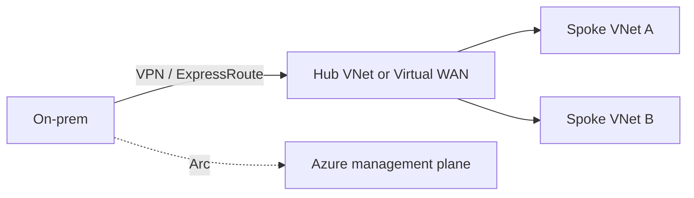

## 1. Core Concept

Kết nối on-premises với Azure dùng **VPN Gateway** (IPsec qua Internet), **ExpressRoute** (đường riêng), **Virtual WAN** (hub toàn cầu), và **Azure Arc** (quản lý tài nguyên ngoài Azure). Mental model: *VPN nhanh và rẻ, ExpressRoute ổn định và riêng tư; Arc kéo mặt phẳng quản trị Azure ra mọi nơi.*

## 2. How It Works

- **VPN Gateway**: **Site-to-Site** (mạng-mạng), **Point-to-Site** (máy người dùng), **VNet-to-VNet**; **active-active**, BGP; SKU theo băng thông.
- **ExpressRoute**: qua nhà cung cấp, **không đi qua Internet**, SLA, **private peering** (VNet) và **Microsoft peering** (M365/PaaS); có thể thêm VPN dự phòng; **Global Reach** nối các site.
- **VNet Peering**: nối VNet (**không bắc cầu** mặc định); **Gateway transit**; **hub-and-spoke** với **Virtual WAN** hoặc hub VNet.
- **Azure Arc**: gắn server/K8s/SQL ngoài Azure để áp **Policy, Defender, Monitor**.
- **Azure Migrate**, **Data Box** (chuyển dữ liệu vật lý), **Azure File Sync**, **DNS Private Resolver**.
- **Private Endpoint/Service Endpoint**: truy cập PaaS riêng tư.

## 3. Visual Diagram

## 4. Rules of Thumb & Trade-offs

| Cần | Chọn |
| --- | --- |
| Kết nối nhanh, rẻ | VPN Gateway |
| Băng thông lớn, ổn định, riêng tư | ExpressRoute |
| Nhiều site/VNet toàn cầu | Virtual WAN |
| Quản lý server ngoài Azure | Azure Arc |

- Trade-off: **chi phí và thời gian dựng** vs **hiệu năng và độ tin cậy**.

## 5. Must Remember / Production Pitfalls

- **Địa chỉ chồng lấn** giữa on-prem và VNet làm không định tuyến được.
- Một ExpressRoute circuit không dự phòng; thiết kế redundancy.
- Peering không bắc cầu: cần hub/Firewall/Virtual WAN.
- Service Endpoint khác Private Endpoint (đường đi và IP).
- Interview trap: "Cần kết nối ngay trong khi ExpressRoute mất tuần?" → VPN trước.

## 6. Search Hooks

- `ExpressRoute vs VPN Gateway` — chọn kết nối lai.
- `Azure hub and spoke topology` — mô hình mạng chuẩn.
- `Azure Virtual WAN` — hub toàn cầu.
- `Azure Arc enabled servers` — quản lý server ngoài Azure.
- `Private Endpoint vs Service Endpoint` — hai cách truy cập PaaS.
