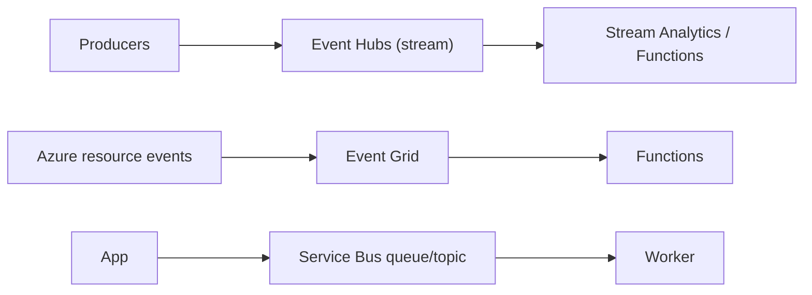

## 1. Core Concept

Azure có ba dịch vụ messaging khác mục đích: **Service Bus** (message broker doanh nghiệp: queue/topic, giao dịch), **Event Grid** (phân phối sự kiện reactive), **Event Hubs** (ingest streaming khối lượng lớn, tương thích Kafka). Mental model: *Service Bus = lệnh cần xử lý đúng; Event Grid = thông báo "chuyện đã xảy ra"; Event Hubs = dòng dữ liệu lớn.*

## 2. How It Works

- **Service Bus**: **Queue** (point-to-point), **Topic/Subscription** (pub/sub có filter); **dead-letter queue**, **sessions** (FIFO theo nhóm), **duplicate detection**, **transactions**, **peek-lock** (xử lý xong mới xoá); at-least-once.
- **Event Grid**: sự kiện từ Azure services/custom topics đẩy tới handler (Functions, Logic Apps, webhook), **push**, filter theo subject, retry và dead-letter.
- **Event Hubs**: **partition**, **consumer group**, **checkpoint**, retention 1–90 ngày, **Capture** vào Blob/ADLS, endpoint **Kafka**; throughput theo **throughput units/processing units**.
- **Storage Queue**: queue đơn giản rẻ, không giao dịch/topic.
- Xử lý: Azure Functions trigger từ cả ba.

## 3. Visual Diagram

## 4. Rules of Thumb & Trade-offs

| Nhu cầu | Chọn |
| --- | --- |
| Lệnh/đơn hàng, giao dịch, thứ tự | Service Bus |
| Phản ứng với sự kiện hệ thống | Event Grid |
| Log/telemetry khối lượng lớn, replay | Event Hubs |
| Queue đơn giản, rẻ | Storage Queue |

- Trade-off: **tính năng broker** (Service Bus) vs **throughput và rẻ** (Event Hubs).

## 5. Must Remember / Production Pitfalls

- At-least-once → consumer phải **idempotent**.
- **Poison message** lặp mãi nếu không dùng dead-letter và `MaxDeliveryCount`.
- Event Hubs: một partition lệch → consumer chậm; thứ tự chỉ trong partition.
- Event Grid **không giữ lâu** như Event Hubs, không replay.
- Interview trap: "Cần FIFO và xử lý đúng một lần ngữ nghĩa?" → Service Bus sessions + duplicate detection.

## 6. Search Hooks

- `Azure Service Bus queues topics dead-letter` — broker doanh nghiệp.
- `Azure Event Grid vs Event Hubs vs Service Bus` — so sánh ba dịch vụ.
- `Event Hubs partitions consumer groups` — mô hình streaming.
- `Event Hubs Kafka endpoint` — dùng Kafka client với Event Hubs.
- `Service Bus sessions duplicate detection` — thứ tự và chống trùng.
