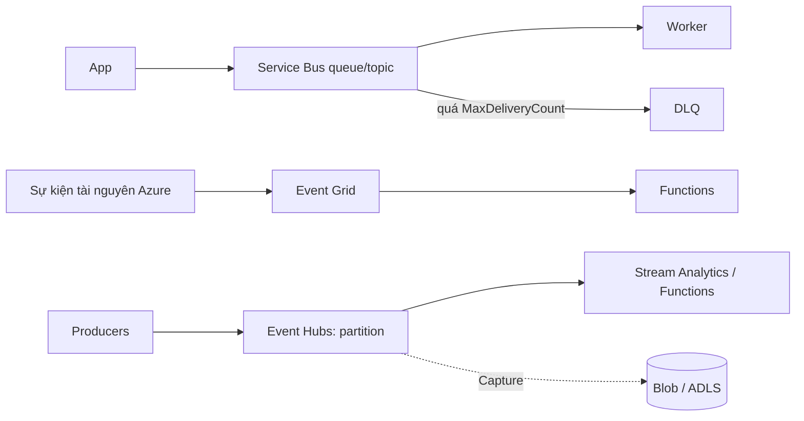

## 1. Core Concept

Azure có ba dịch vụ messaging **khác mục đích** (và một bản đơn giản là Storage Queue): **Service Bus** (message broker doanh nghiệp cho lệnh và giao dịch), **Event Grid** (phân phối sự kiện reactive "chuyện đã xảy ra") và **Event Hubs** (ingest streaming khối lượng lớn, tương thích Kafka). Chọn sai là lỗi thiết kế phổ biến nhất khi làm bài toán decoupling trên Azure.

**Mental model:** Service Bus là **bưu điện có sổ ký nhận** (một thư tới đúng người, có thể bảo đảm thứ tự, thư hỏng vào thùng riêng); Event Grid là **loa thông báo** ("tệp vừa được tải lên!") cho ai đã đăng ký; Event Hubs là **băng chuyền chạy liên tục** nhận hàng triệu bản ghi và giữ lại để ai cần cũng đọc lại được.

## 2. How It Works

**Service Bus → Broker doanh nghiệp**
- **Queue** (point-to-point) và **Topic/Subscription** (pub/sub có **filter**). Nhận theo **peek-lock** (khoá message, xử lý xong mới `complete`; khoá hết hạn thì message hiện lại) hoặc receive-and-delete.
- **Dead-letter queue (DLQ)** nhận message quá `MaxDeliveryCount` (mặc định **10**) hoặc hết TTL; **sessions** cho FIFO theo nhóm; **duplicate detection** chống trùng trong một cửa sổ thời gian; **scheduled message**, **transactions**. Tầng Basic/Standard/Premium (Premium: cô lập, message lớn tới 100 MB). Mặc định **at-least-once**.

**Event Grid → Sự kiện reactive**
- Nguồn (dịch vụ Azure qua **system topic**, hoặc **custom topic**) đẩy sự kiện tới **handler** (Functions, Logic Apps, webhook) theo cơ chế **push**, lọc theo subject/loại sự kiện, **retry** theo backoff (tới 24 giờ) và **dead-letter** sang Blob. At-least-once, **không giữ lâu để replay**.

**Event Hubs → Streaming**
- Dữ liệu chia **partition**; **consumer group** cho phép nhiều ứng dụng đọc độc lập; **checkpoint** (thường lưu trong Blob) đánh dấu vị trí đọc; **retention** theo ngày (có thể replay trong thời hạn); **Capture** ghi tự động ra Blob/ADLS; endpoint **Kafka** để dùng client Kafka sẵn có. Thứ tự chỉ đảm bảo **trong một partition**; throughput theo throughput/processing units.

**Storage Queue**
- Queue đơn giản, rẻ, dung lượng lớn nhưng **không có topic, session, DLQ tích hợp** như Service Bus.

```python
# Service Bus: peek-lock, xử lý xong mới complete
with client.get_queue_receiver("orders") as r:
    for m in r.receive_messages(max_message_count=10):
        try:
            handle(m); r.complete_message(m)
        except Exception:
            r.abandon_message(m)   # tăng delivery count, sau 10 lần vào DLQ
```

## 3. Visual Diagram



## 4. Rules of Thumb & Trade-offs

| Tình huống / Nhu cầu | Chọn gì |
| --- | --- |
| Lệnh/đơn hàng cần giao dịch, thứ tự, DLQ | Service Bus |
| Phản ứng với sự kiện hệ thống ("blob vừa được tạo") | Event Grid |
| Telemetry/log khối lượng lớn, replay, Kafka | Event Hubs |
| Queue đơn giản, rẻ, không cần tính năng broker | Storage Queue |
| FIFO theo nhóm, chống trùng | Service Bus sessions + duplicate detection |

- **Được gì:** decoupling, chịu đột biến. **Mất gì:** Service Bus tính năng phong phú nhưng throughput thấp hơn Event Hubs; Event Grid không replay; Event Hubs không có DLQ/ack từng message.

## 5. Must Remember / Production Pitfalls

- **Xử lý hai lần cùng một message → at-least-once và lock hết hạn → consumer idempotent, đặt lock duration phù hợp**.
- **Một message lỗi lặp mãi → poison message → DLQ và `MaxDeliveryCount`, cảnh báo trên DLQ**.
- **Consumer Event Hubs chậm, thứ tự lệch → một partition quá tải hoặc không đọc hết → thêm consumer theo partition, chọn partition key đều**.
- **Cần replay sự kiện nhưng dùng Event Grid → không giữ lâu → dùng Event Hubs hoặc lưu vào Blob**.
- **Mong thứ tự toàn cục → chỉ có thứ tự trong partition/session → thiết kế theo key**.
- Exam trap: "FIFO, giao dịch, DLQ" → **Service Bus**; "phản ứng với sự kiện tài nguyên Azure" → **Event Grid**; "telemetry khối lượng lớn" → **Event Hubs**.

## 6. Search Hooks

- `Azure Service Bus queues topics dead-letter` — broker doanh nghiệp.
- `Azure Event Grid vs Event Hubs vs Service Bus` — so sánh ba dịch vụ.
- `Event Hubs partitions consumer groups` — mô hình streaming.
- `Event Hubs Kafka endpoint` — dùng Kafka client với Event Hubs.
- `Service Bus sessions duplicate detection` — thứ tự và chống trùng.
