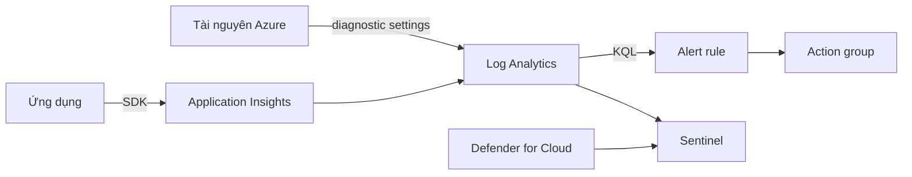

## 1. Core Concept

**Azure Monitor** thu thập và phân tích **metrics, logs và traces** để bạn biết hệ thống chạy thế nào; **Microsoft Defender for Cloud** đánh giá và bảo vệ **tư thế bảo mật**; **Key Vault** giữ **secret, key, certificate** an toàn; **Sentinel** là SIEM phát hiện và phản ứng sự cố. Chúng giải quyết ba nỗi đau: không thấy hệ thống đang làm gì, không biết cấu hình yếu ở đâu, và bí mật nằm lung tung trong code.

**Mental model:** Monitor là **bảng đồng hồ và camera** của toà nhà; Defender là **kiểm toán viên an ninh** chấm điểm và chỉ chỗ yếu; Key Vault là **két sắt có sổ ghi** ai mở; Sentinel là **phòng giám sát trung tâm** gom mọi camera lại để phát hiện kẻ đột nhập.

## 2. How It Works

**Azure Monitor → Quan sát**
- **Metrics**: số liệu nhẹ, gần real-time (CPU, request/giây), lưu khoảng **93 ngày**, dùng cho dashboard và alert nhanh.
- **Logs**: dữ liệu chi tiết lưu trong **Log Analytics workspace**, truy vấn bằng **KQL** (Kusto Query Language). **Activity Log** ghi thao tác control-plane ở mức subscription; **resource log** chỉ có sau khi bạn cấu hình **diagnostic settings** (đẩy sang Log Analytics, Storage, Event Hubs).
- **Application Insights**: APM cho ứng dụng (request, dependency, exception, **distributed tracing**).
- **Alert rule** (metric, log search, activity log) → **Action group** (email, SMS, webhook, Logic App, Function). Alert không có action group thì không ai nhận được thông báo.

**Defender for Cloud → Tư thế bảo mật**
- **CSPM**: đánh giá cấu hình, **Secure Score**, khuyến nghị, tuân thủ theo chuẩn; **CWP/Defender plans** bảo vệ workload (Servers, Storage, SQL, Containers, Key Vault). Hỗ trợ **đa cloud** (AWS/GCP). **Just-in-time VM access** giảm bề mặt tấn công.

**Sentinel → SIEM/SOAR**
- Gom log toàn tổ chức qua **data connector**, **analytics rule** phát hiện, **incident**, **playbook (Logic Apps)** tự động phản ứng, **hunting** săn mối đe doạ.

**Key Vault → Giữ bí mật**
- Lưu **secret**, **key** (có thể HSM) và **certificate** (tự gia hạn). Truy cập qua **Azure RBAC** (khuyên dùng) hoặc access policy; ứng dụng lấy bí mật bằng **managed identity**, không lưu secret trong code. Bật **soft delete** (mặc định, giữ 7–90 ngày) và **purge protection** (không cho xoá vĩnh viễn trong thời gian giữ). Hạn chế mạng bằng firewall/**Private Endpoint**.

**Sức khoẻ dịch vụ**
- **Service Health** (sự cố của Azure), **Resource Health** (tài nguyên của bạn), **Azure Advisor** (khuyến nghị tối ưu).

```kusto
AppRequests
| where TimeGenerated > ago(1h) and Success == false
| summarize failures = count() by Name
| order by failures desc
```

## 3. Visual Diagram



## 4. Rules of Thumb & Trade-offs

| Tình huống / Nhu cầu | Chọn gì |
| --- | --- |
| Cảnh báo nhanh theo ngưỡng (CPU > 80%) | Metric alert |
| Phát hiện mẫu phức tạp trong log | Log search alert (KQL) |
| Theo dõi request/dependency của ứng dụng | Application Insights |
| Đánh giá cấu hình, đề xuất cải thiện | Defender for Cloud / Secure Score |
| Phát hiện tấn công, điều tra, tự động hoá phản ứng | Sentinel |
| Lưu secret, key, certificate | Key Vault + managed identity |

- **Được gì:** thấy rõ hệ thống, bảo mật chủ động. **Mất gì:** lưu nhiều log lâu làm **tăng chi phí ingestion/retention** của Log Analytics — chỉ thu thập log cần thiết.

## 5. Must Remember / Production Pitfalls

- **Không có log tài nguyên để điều tra → chưa cấu hình diagnostic settings → bật diagnostic settings (có thể ép bằng Policy)**.
- **Mất secret vĩnh viễn sau khi xoá vault → không bật purge protection → bật soft delete + purge protection cho production**.
- **Alert kích hoạt mà không ai biết → thiếu action group → gắn action group và kiểm tra kênh nhận**.
- **Nhầm Service Health, Resource Health và Advisor → tìm sai nơi khi sự cố → Service Health cho sự cố Azure, Resource Health cho tài nguyên của bạn, Advisor cho khuyến nghị**.
- **Hoá đơn Log Analytics tăng → thu thập mọi log chi tiết → lọc theo bảng, đặt retention, dùng Basic logs cho dữ liệu ít truy vấn**.
- Exam trap: "truy vấn log bằng ngôn ngữ nào" → **KQL**; "đánh giá độ an toàn cấu hình và đề xuất" → **Defender for Cloud**; "quản lý secret an toàn" → **Key Vault**.

## 6. Search Hooks

- `Azure Monitor metrics vs logs` — hai loại dữ liệu quan sát và khi nào dùng.
- `Log Analytics workspace KQL` — truy vấn log bằng Kusto Query Language.
- `Application Insights distributed tracing` — APM theo dõi request và dependency.
- `Azure Monitor alerts action groups` — quy tắc cảnh báo và kênh thông báo.
- `Microsoft Defender for Cloud Secure Score` — điểm đánh giá tư thế bảo mật.
- `Azure Key Vault soft delete purge protection` — chống xoá nhầm secret và key.
