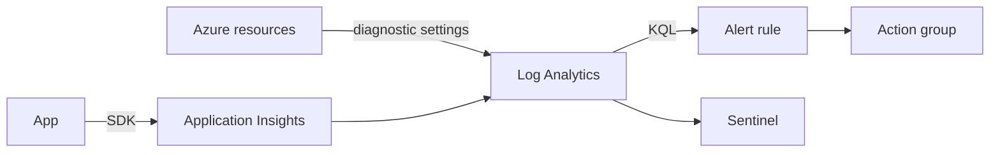

## 1. Core Concept

**Azure Monitor** thu thập và phân tích **metrics, logs, traces** để quan sát hệ thống; **Microsoft Defender for Cloud** đánh giá và bảo vệ tư thế bảo mật; **Key Vault** giữ bí mật (secret, key, certificate). Mental model: *Monitor cho biết "chuyện gì đang xảy ra", Defender cho biết "chỗ nào yếu", Key Vault cất "chìa khoá".*

## 2. How It Works

- **Azure Monitor**:
  - **Metrics**: số liệu nhẹ, gần thời gian thực (CPU, request/giây), lưu khoảng 93 ngày.
  - **Logs**: dữ liệu chi tiết trong **Log Analytics workspace**, truy vấn bằng **KQL** (Kusto Query Language).
  - **Application Insights**: APM cho ứng dụng (request, dependency, exception, distributed tracing).
  - **Alert rule** → **Action group** (email, SMS, webhook, Logic App, Functions); **Diagnostic settings** đẩy log tài nguyên về Log Analytics/Storage/Event Hubs.
- **Microsoft Defender for Cloud**: **CSPM** (đánh giá cấu hình, **Secure Score**, khuyến nghị) và **CWP** (bảo vệ workload — VM, container, SQL, Storage); hỗ trợ đa cloud (AWS/GCP).
- **Microsoft Sentinel**: **SIEM/SOAR** cloud-native, gom log toàn tổ chức để phát hiện và phản ứng sự cố.
- **Azure Key Vault**: lưu **secret**, **key** (có thể HSM), **certificate**; truy cập qua **Azure RBAC** hoặc access policy; bật **soft delete** và **purge protection**; app lấy bí mật bằng **managed identity**.
- Các dịch vụ bảo mật khác: **Azure Firewall**, **DDoS Protection**, **WAF**, **Azure Advisor**, **Service Health** (sự cố của Azure) và **Resource Health** (sức khoẻ tài nguyên của bạn).

## 3. Visual Diagram

## 4. Rules of Thumb & Trade-offs

- Cảnh báo nhanh theo ngưỡng (CPU > 80%) → **metric alert**; phát hiện mẫu phức tạp trong log → **log search alert (KQL)**.
- Không lưu secret trong code/config → **Key Vault + managed identity**.
- Muốn biết cấu hình đang yếu ở đâu → **Defender for Cloud/Secure Score**; cần phát hiện tấn công, điều tra → **Sentinel**.
- Trade-off: lưu log lâu và nhiều làm **tăng chi phí ingestion/retention** của Log Analytics; chỉ thu thập log cần thiết.

## 5. Must Remember / Production Pitfalls

- Log tài nguyên **không tự bật**: phải cấu hình **diagnostic settings**.
- Key Vault bị xoá không bật **purge protection** có thể mất bí mật vĩnh viễn sau thời gian soft-delete.
- **Service Health** (sự cố Azure) khác **Resource Health** (tài nguyên của bạn) khác **Azure Advisor** (khuyến nghị).
- Alert không có **action group** thì không ai nhận được thông báo.
- Exam trap: "truy vấn log bằng ngôn ngữ nào" → **KQL**; "đánh giá độ an toàn cấu hình và đề xuất" → **Defender for Cloud**; "quản lý secret an toàn" → **Key Vault**.

## 6. Search Hooks

- `Azure Monitor metrics vs logs` — hai loại dữ liệu quan sát và khi nào dùng.
- `Log Analytics workspace KQL` — truy vấn log bằng Kusto Query Language.
- `Application Insights distributed tracing` — APM theo dõi request và dependency.
- `Azure Monitor alerts action groups` — quy tắc cảnh báo và kênh thông báo.
- `Microsoft Defender for Cloud Secure Score` — điểm đánh giá tư thế bảo mật.
- `Azure Key Vault soft delete purge protection` — chống xoá nhầm secret và key.
