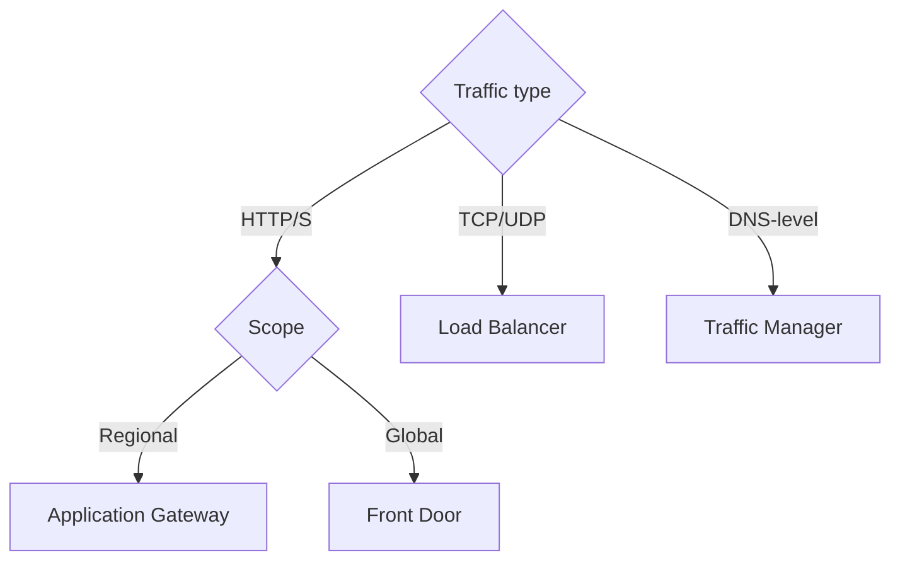

## 1. Core Concept

Mạng Azure xoay quanh **Virtual Network (VNet)**: mạng riêng, cô lập, chia **subnet**; bảo vệ bằng **NSG**; nối các mạng bằng **Peering/VPN/ExpressRoute**; phân phối traffic bằng bốn dịch vụ load balancing. Mental model: *VNet là vành đai, NSG là cổng kiểm soát, và chọn load balancer là chọn theo "layer nào" và "phạm vi nào".*

## 2. How It Works

- **VNet**: không gian địa chỉ **CIDR**, thuộc một Region; subnet gom tài nguyên; mặc định các subnet trong VNet **giao tiếp được với nhau**.
- **NSG (Network Security Group)**: rule **allow/deny** theo 5-tuple, gắn vào **subnet hoặc NIC**; xử lý theo **priority (số nhỏ chạy trước)**, từ 100 đến 4096; có rule mặc định (cho phép trong VNet, từ load balancer, chặn Internet vào). **Application Security Group** gom VM theo vai trò để viết rule gọn.
- **Kết nối**: **VNet Peering** (cùng/khác Region, traffic qua backbone Microsoft, **không bắc cầu**); **VPN Gateway** (site-to-site/point-to-site qua Internet, mã hoá); **ExpressRoute** (đường riêng, **không đi qua Internet**); **Virtual WAN** cho hub-and-spoke quy mô lớn.
- **Private Link / Private Endpoint**: truy cập PaaS (Storage, SQL) bằng IP private trong VNet; **Service Endpoint** mở rộng định danh VNet tới dịch vụ.
- **Bốn dịch vụ cân bằng tải**:
  - **Load Balancer**: **L4** (TCP/UDP), theo Region.
  - **Application Gateway**: **L7** (HTTP/S), theo Region, có **WAF**, routing theo URL.
  - **Front Door**: **L7 toàn cầu**, CDN + WAF + failover đa Region.
  - **Traffic Manager**: **DNS-based**, toàn cầu, chỉ trả về endpoint.
- **Azure Firewall** (dịch vụ firewall tập trung), **Bastion** (RDP/SSH qua trình duyệt không lộ public IP), **DDoS Protection**.

## 3. Visual Diagram

## 4. Rules of Thumb & Trade-offs

| Nhu cầu | Chọn |
| --- | --- |
| TCP/UDP trong Region | **Load Balancer** |
| Web app một Region, WAF, routing URL | **Application Gateway** |
| Web toàn cầu, tăng tốc, failover đa Region | **Front Door** |
| Định tuyến DNS đa Region, mọi giao thức | **Traffic Manager** |

- Kết nối on-premises: ngân sách vừa → **VPN Gateway**; băng thông/độ ổn định cao → **ExpressRoute**.
- Truy cập PaaS riêng tư → **Private Endpoint**.
- Trade-off: ExpressRoute ổn định, latency thấp nhưng **đắt và lead time dài**.

## 5. Must Remember / Production Pitfalls

- **Peering không transitive**: cần **hub-and-spoke** với Azure Firewall/NVA hoặc Virtual WAN để định tuyến qua hub.
- Không gian địa chỉ VNet **không được chồng lấn** khi peering hoặc nối on-premises.
- NSG gắn cả subnet **và** NIC: traffic phải qua **cả hai**; quên rule Allow thường gây "không kết nối được".
- Traffic Manager chỉ trả DNS: không proxy, không cache, failover phụ thuộc **TTL DNS**.
- Exam trap: "cân bằng tải HTTP toàn cầu có WAF" → **Front Door**; "RDP/SSH an toàn không public IP" → **Bastion**.

## 6. Search Hooks

- `Azure Virtual Network subnets peering` — mạng ảo và kết nối giữa các VNet.
- `Network Security Group rules priority` — thứ tự đánh giá rule của NSG.
- `Azure Load Balancer vs Application Gateway vs Front Door` — chọn load balancer theo layer và phạm vi.
- `Azure Traffic Manager routing methods` — định tuyến toàn cầu ở tầng DNS.
- `ExpressRoute vs VPN Gateway` — đường riêng so với VPN qua Internet.
- `Azure Private Endpoint Private Link` — truy cập dịch vụ PaaS bằng IP private.
