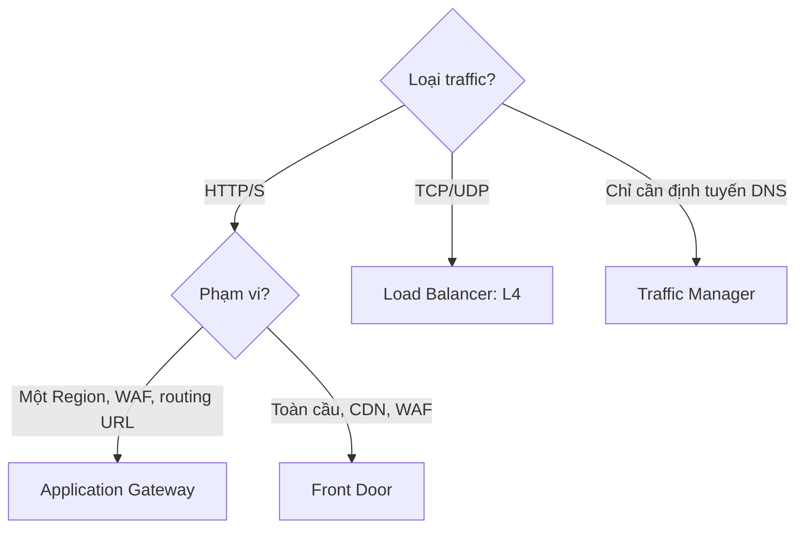

## 1. Core Concept

Mạng Azure xoay quanh **Virtual Network (VNet)**: mạng riêng cô lập, chia **subnet**, bảo vệ bằng **NSG**, nối với nhau/on-prem bằng **Peering, VPN, ExpressRoute**, và phân phối traffic bằng **bốn dịch vụ cân bằng tải** khác tầng, khác phạm vi. Câu hỏi khó nhất trong thiết kế và thi là **chọn đúng dịch vụ theo tầng (L4/L7) và phạm vi (Region/toàn cầu)**.

**Mental model:** VNet là **khu công nghiệp có tường bao**; NSG là **bảo vệ ở từng cổng phòng**; Peering là **đường nội bộ nối hai khu** (không đi vòng qua khu thứ ba); và bốn load balancer là **bốn loại điều phối viên**: một người chia xe theo biển số (L4), một người đọc nội dung đơn hàng (L7), một người điều phối toàn cầu, và một người chỉ đưa địa chỉ rồi đứng ngoài (DNS).

## 2. How It Works

**VNet và NSG → Cô lập và lọc**
- **VNet** có không gian địa chỉ CIDR, thuộc **một Region**; các subnet trong VNet **mặc định giao tiếp được với nhau**; mỗi subnet Azure giữ **5 IP**.
- **NSG (Network Security Group)**: rule allow/deny theo 5-tuple, **stateful**, gắn vào **subnet hoặc NIC**; xử lý theo **priority từ 100 đến 4096, số nhỏ chạy trước**. Rule mặc định: cho phép traffic trong VNet và từ Load Balancer, **chặn Internet vào**, cho phép ra Internet. Traffic phải qua **cả NSG của subnet lẫn của NIC**. Dùng **service tag** và **ASG** để viết rule gọn.

**Kết nối → Peering, VPN, ExpressRoute**
- **VNet Peering**: cùng hoặc khác Region, traffic qua backbone Microsoft, **không bắc cầu**; yêu cầu **không chồng lấn địa chỉ**. Muốn bắc cầu dùng **hub-and-spoke** với Azure Firewall/NVA + **UDR**, hoặc **Virtual WAN**.
- **VPN Gateway**: site-to-site/point-to-site qua Internet, mã hoá IPsec. **ExpressRoute**: kết nối riêng **không đi qua Internet**, ổn định và độ trễ thấp nhưng **đắt và lead time dài**.
- **Private Endpoint (Private Link)**: gắn PaaS (Storage, SQL) vào VNet bằng IP private; **Service Endpoint** chỉ mở rộng định danh VNet tới dịch vụ (vẫn dùng IP công cộng của dịch vụ).

**Bốn dịch vụ cân bằng tải**
- **Load Balancer**: **L4 (TCP/UDP)**, trong **Region**, hiệu năng cao, health probe.
- **Application Gateway**: **L7 (HTTP/S)** trong **Region**, **WAF**, routing theo URL path/host, SSL offload.
- **Front Door**: **L7 toàn cầu** (anycast), **CDN + WAF**, failover đa Region.
- **Traffic Manager**: **DNS-based** toàn cầu, chỉ trả về endpoint tốt nhất theo phương pháp (priority, weighted, performance, geographic), **không proxy traffic**; failover phụ thuộc **TTL DNS**.

**Dịch vụ an ninh mạng**
- **Azure Firewall** (firewall managed tập trung, lọc FQDN), **Bastion** (RDP/SSH qua trình duyệt, không cần public IP), **DDoS Protection**.

```bash
az network nsg rule create -g rg-net --nsg-name nsg-web -n allow-https \
  --priority 100 --access Allow --protocol Tcp --destination-port-ranges 443
```

## 3. Visual Diagram



## 4. Rules of Thumb & Trade-offs

| Tình huống / Nhu cầu | Chọn gì |
| --- | --- |
| TCP/UDP trong Region | Load Balancer |
| Web app một Region, WAF, routing theo URL | Application Gateway |
| Web toàn cầu, tăng tốc, failover đa Region | Front Door |
| Định tuyến DNS đa Region, mọi giao thức | Traffic Manager |
| Nối on-prem nhanh, rẻ | VPN Gateway |
| Nối on-prem ổn định, băng thông lớn | ExpressRoute |
| Truy cập PaaS riêng tư | Private Endpoint |
| RDP/SSH an toàn không public IP | Bastion |

- **Được gì:** cô lập mạng, phân phối tải đúng tầng. **Mất gì:** ExpressRoute đắt và chậm triển khai; Front Door/App Gateway tốn chi phí cao hơn Load Balancer; nhiều lớp mạng tăng độ phức tạp.

## 5. Must Remember / Production Pitfalls

- **A–B, B–C đã peering nhưng A không tới C → peering không transitive → hub-and-spoke với Firewall/NVA hoặc Virtual WAN**.
- **Không nối được VNet/on-prem → địa chỉ chồng lấn → quy hoạch CIDR không trùng từ đầu**.
- **Rule Allow đúng mà vẫn không kết nối → NSG ở cả subnet và NIC → kiểm tra cả hai và thứ tự priority**.
- **Failover Traffic Manager chậm → client cache DNS theo TTL → giảm TTL hoặc dùng Front Door khi cần failover nhanh**.
- **Nhầm Service Endpoint với Private Endpoint → tưởng PaaS đã có IP private → chỉ Private Endpoint cho IP riêng trong VNet**.
- Exam trap: "cân bằng tải HTTP toàn cầu có WAF" → **Front Door**; "NSG xử lý rule theo thứ tự" → **priority nhỏ trước**; "RDP/SSH an toàn không public IP" → **Bastion**.

## 6. Search Hooks

- `Azure Virtual Network subnets peering` — mạng ảo và kết nối giữa các VNet.
- `Network Security Group rules priority` — thứ tự đánh giá rule của NSG.
- `Azure Load Balancer vs Application Gateway vs Front Door` — chọn load balancer theo layer và phạm vi.
- `Azure Traffic Manager routing methods` — định tuyến toàn cầu ở tầng DNS.
- `ExpressRoute vs VPN Gateway` — đường riêng so với VPN qua Internet.
- `Azure Private Endpoint Private Link` — truy cập dịch vụ PaaS bằng IP private.
