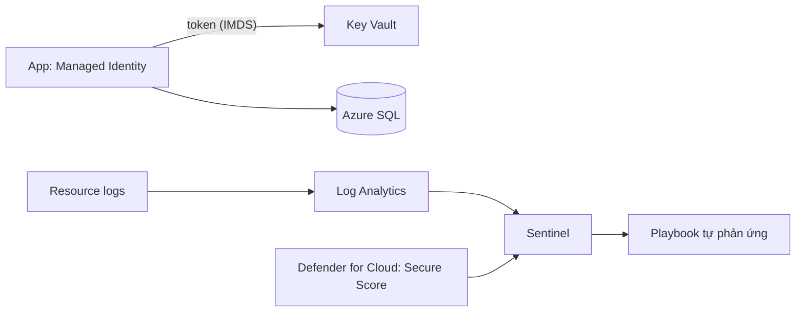

## 1. Core Concept

Bảo mật Azure đi theo nguyên tắc: **loại bỏ secret khi có thể** (Managed Identity), **bảo vệ phần còn lại** (Key Vault, Private Endpoint, WAF), **đánh giá tư thế** (Defender for Cloud) và **phát hiện + phản ứng** (Sentinel). Phần lớn sự cố cloud đến từ **secret bị lộ** và **cấu hình sai**, nên bài này tập trung vào hai việc đó.

**Mental model:** Key Vault là **két sắt có camera**; Managed Identity là **thẻ nhân viên tự cấp** để mở két mà không phải nhớ mật mã; Defender for Cloud là **kiểm toán viên** chấm điểm cấu hình; Sentinel là **phòng giám sát** gom mọi camera và hú còi khi thấy bất thường.

## 2. How It Works

**Managed Identity → Danh tính không secret**
- Azure cấp danh tính cho VM, App Service, Functions…; ứng dụng xin token từ endpoint nội bộ (IMDS) và dùng nó truy cập Key Vault/Storage/SQL mà **không lưu secret**. **System-assigned** gắn vòng đời một tài nguyên (xoá tài nguyên là xoá danh tính); **user-assigned** là tài nguyên độc lập **dùng chung** cho nhiều tài nguyên.

**Key Vault → Secret, key, certificate**
- Lưu **secret**, **key** (RSA/EC, tầng **Premium** có HSM, **Managed HSM** cho yêu cầu cao nhất) và **certificate** (tự gia hạn). Mô hình truy cập khuyên dùng là **Azure RBAC** (Key Vault Secrets User…) thay cho access policy. **Soft delete** (mặc định, giữ 7–90 ngày) cho phép khôi phục; **purge protection** chặn xoá vĩnh viễn trong thời gian giữ. App Service/Functions có thể tham chiếu secret trực tiếp bằng **Key Vault reference**. Hạn chế mạng bằng firewall và **Private Endpoint**; bật log truy cập qua diagnostic settings.

**Defender for Cloud → Tư thế bảo mật**
- **CSPM**: đánh giá cấu hình, **Secure Score**, khuyến nghị, tuân thủ theo chuẩn. **Defender plans** bảo vệ workload (Servers, Storage, SQL, Containers, Key Vault, App Service); hỗ trợ đa cloud. **Just-in-time VM access** chỉ mở cổng quản trị khi cần.

**Sentinel → SIEM/SOAR**
- Gom log qua **data connector**, **analytics rule** tạo incident, **playbook (Logic Apps)** tự phản ứng (khoá tài khoản, tạo ticket), **hunting** và **UEBA**.

**Lớp mạng và dữ liệu**
- **NSG**, **Azure Firewall**, **WAF** (Application Gateway/Front Door), **DDoS Protection**; **Private Endpoint** để PaaS không lộ ra Internet; mã hoá at rest bằng **customer-managed key** khi cần.

```bash
az keyvault create -n kv-orders -g rg-app --enable-rbac-authorization true \
  --enable-purge-protection true --retention-days 90
az role assignment create --assignee-object-id <mi-principal> \
  --role "Key Vault Secrets User" --scope $(az keyvault show -n kv-orders --query id -o tsv)
```

## 3. Visual Diagram



## 4. Rules of Thumb & Trade-offs

| Tình huống / Nhu cầu | Chọn gì |
| --- | --- |
| Ứng dụng truy cập Key Vault không lưu credential | Managed Identity |
| Nhiều tài nguyên dùng chung một danh tính | User-assigned identity |
| Chống xoá vĩnh viễn vault/secret | Soft delete + purge protection |
| Đánh giá cấu hình, gợi ý cải thiện | Defender for Cloud |
| Phát hiện tấn công và tự phản ứng | Sentinel + playbook |
| PaaS không lộ ra Internet | Private Endpoint |

- **Được gì:** giảm secret phải quản lý, phát hiện sớm. **Mất gì:** Defender plans và Sentinel tính phí theo tài nguyên/log; thêm cấu hình RBAC/mạng cần kỷ luật.

## 5. Must Remember / Production Pitfalls

- **Secret nằm trong app settings/code → lộ qua repo/log → Key Vault + managed identity**.
- **Xoá nhầm vault hoặc secret → mất vĩnh viễn nếu không purge protection → bật soft delete và purge protection trên production**.
- **Cấp access quá rộng (Get/List/Set cho mọi thứ) → một danh tính bị chiếm lộ hết → RBAC tối thiểu theo từng secret/vault**.
- **Kỳ vọng Defender tự sửa → nó chủ yếu khuyến nghị và phát hiện → dùng Policy/automation để khắc phục**.
- **PaaS vẫn truy cập được từ Internet → chưa Private Endpoint/firewall → đóng public access và dùng Private Endpoint**.
- Exam trap: "app truy cập Key Vault không lưu credential" → **Managed Identity**; "chống xoá vĩnh viễn" → **soft delete + purge protection**; "system-assigned khác user-assigned" → **vòng đời gắn tài nguyên vs dùng chung**.

## 6. Search Hooks

- `Azure Key Vault soft delete purge protection` — bảo vệ khỏi xoá nhầm.
- `Azure Managed Identity system vs user assigned` — hai loại danh tính.
- `Microsoft Defender for Cloud secure score` — đánh giá tư thế bảo mật.
- `Microsoft Sentinel KQL analytics rules` — SIEM trên Azure.
- `Azure Private Endpoint` — truy cập PaaS riêng tư.
