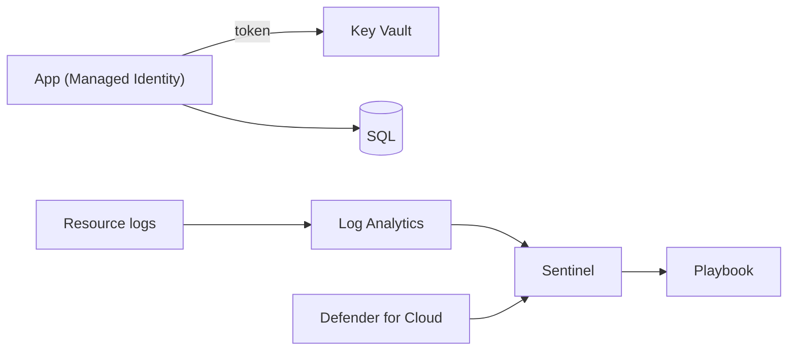

## 1. Core Concept

Bảo mật Azure nhiều lớp: **Key Vault** (khoá, secret, chứng chỉ), **Managed Identity** (danh tính không secret), **Defender for Cloud** (đánh giá tư thế + bảo vệ workload), **Microsoft Sentinel** (SIEM/SOAR), **Azure Firewall/WAF/DDoS Protection**. Mental model: *loại bỏ secret khi có thể, bảo vệ phần còn lại, phát hiện và phản ứng.*

## 2. How It Works

- **Key Vault**: secrets/keys/certificates; truy cập qua **RBAC hoặc access policy**; **soft delete + purge protection**; **HSM-backed** (Premium/Managed HSM); versioning và rotation.
- **Managed Identity**: **system-assigned** (gắn vòng đời tài nguyên) vs **user-assigned** (dùng chung); ứng dụng lấy token từ endpoint nội bộ, không lưu secret.
- **Defender for Cloud**: **Secure Score**, khuyến nghị, **CSPM** + **CWPP** (Defender cho Servers, Storage, SQL, Containers).
- **Sentinel**: thu log (**Log Analytics workspace**), **analytics rules**, **KQL**, **playbook** (Logic Apps) tự động phản ứng.
- **Mạng**: **NSG**, **Azure Firewall**, **WAF** trên Application Gateway/Front Door, **DDoS Protection**, **Private Endpoint**.
- **Mã hoá**: at rest (SSE, customer-managed key), in transit (TLS), **Disk Encryption**.

## 3. Visual Diagram

## 4. Rules of Thumb & Trade-offs

- Mặc định dùng **Managed Identity** thay connection string/secret.
- Bật **purge protection** cho vault production.
- Trade-off: **log đầy đủ** cho phát hiện vs **chi phí ingest**.

## 5. Must Remember / Production Pitfalls

- Secret trong app settings/code thay vì Key Vault.
- Xoá vault/secret nhầm khi không có soft delete/purge protection.
- Access policy quá rộng (`Get/List/Set` cho mọi thứ).
- Defender chỉ **khuyến nghị**, không tự sửa.
- Thiếu **Private Endpoint** khiến dịch vụ PaaS mở public.
- Interview trap: "App truy cập Key Vault không lưu credential?" → Managed Identity.

## 6. Search Hooks

- `Azure Key Vault soft delete purge protection` — bảo vệ khỏi xoá nhầm.
- `Azure Managed Identity system vs user assigned` — hai loại.
- `Microsoft Defender for Cloud secure score` — đánh giá tư thế bảo mật.
- `Microsoft Sentinel KQL analytics rules` — SIEM trên Azure.
- `Azure Private Endpoint` — truy cập PaaS riêng tư.
