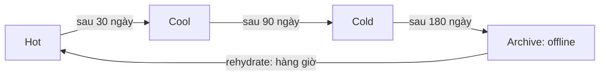

## 1. Core Concept

**Azure Storage** là nhóm dịch vụ lưu trữ trong một **storage account**: **Blob** (object), **Files** (SMB/NFS share), **Queue**, **Table** và **Disk**. Hai quyết định then chốt luôn đi cùng nhau: **mức dự phòng (redundancy)** để chịu lỗi bao xa, và **tầng truy cập (access tier)** để cân bằng chi phí lưu với chi phí đọc.

**Mental model:** như **kho đồ cá nhân**: bạn chọn gửi một bản ở một kho (LRS), ba kho trong cùng thành phố (ZRS) hay thêm một kho ở thành phố khác (GRS); và chọn ngăn **gần cửa** (Hot, thuê đắt, lấy rẻ) hay **ngăn sâu** (Archive, thuê rẻ, lấy mất công và mất phí).

## 2. How It Works

**Redundancy → Chịu lỗi bao xa**
- **LRS**: 3 bản sao trong **một datacenter** (độ bền khoảng 11 số 9). **ZRS**: 3 bản qua **3 AZ** trong Region (12 số 9). **GRS**: LRS ở Region chính + **LRS ở Region thứ hai** (16 số 9). **GZRS**: ZRS ở chính + LRS ở Region thứ hai. **RA-GRS/RA-GZRS** cho phép **đọc** từ Region thứ hai khi Region chính sự cố.
- Sao chép sang Region thứ hai là **bất đồng bộ**: failover có thể **mất dữ liệu chưa kịp replicate** (RPO không bằng 0; xem Last Sync Time).

**Blob access tier → Cân bằng chi phí**
- **Hot** (phí lưu cao nhất, truy cập rẻ nhất), **Cool** (≥ **30 ngày**), **Cold** (≥ **90 ngày**), **Archive** (≥ **180 ngày**, **offline**: phải **rehydrate** trước khi đọc, mất hàng giờ, ưu tiên cao có thể dưới 1 giờ cho blob nhỏ). Xoá hoặc chuyển tier sớm hơn thời gian tối thiểu vẫn bị tính **phí xoá sớm**.
- **Lifecycle management policy** tự chuyển tier hoặc xoá blob theo tuổi/lần truy cập cuối.

**Bảo mật → Mã hoá và truy cập**
- Mã hoá at rest mặc định (AES-256, **Microsoft-managed key** hoặc **customer-managed key** trong Key Vault). Truy cập qua **Entra ID/RBAC** (khuyên dùng, có data role như Storage Blob Data Reader), **SAS** (quyền tạm thời có giới hạn; **user delegation SAS** ký bằng Entra ID an toàn hơn SAS ký bằng account key) hoặc **account key** (toàn quyền, tránh dùng). Chặn bằng **firewall** và **Private Endpoint**.

**Bảo vệ dữ liệu**
- **Soft delete** (blob/container), **blob versioning**, **point-in-time restore**, **immutable storage (WORM)** với time-based retention hoặc legal hold chặn sửa/xoá.

**Công cụ**
- **AzCopy** copy dữ liệu lớn, **Azure Files** thay file server (kèm **Azure File Sync** đồng bộ với on-prem), **Data Box** cho khối lượng cực lớn, **Data Lake Storage Gen2** (hierarchical namespace) cho analytics.

```bash
az storage account create -n stappprod -g rg-app --sku Standard_GZRS --kind StorageV2 \
  --min-tls-version TLS1_2 --allow-blob-public-access false
```

## 3. Visual Diagram



## 4. Rules of Thumb & Trade-offs

| Tình huống / Nhu cầu | Chọn gì |
| --- | --- |
| Chịu lỗi một datacenter, trong Region | ZRS |
| Chịu lỗi cả Region | GRS hoặc GZRS |
| Đọc được dữ liệu khi Region chính sập | RA-GRS / RA-GZRS |
| Dữ liệu nguội, lưu lâu | Lifecycle chuyển Cool/Cold/Archive |
| Chia sẻ tạm thời cho bên ngoài | User delegation SAS, thời hạn ngắn |
| Chặn xoá/sửa trong thời hạn pháp lý | Immutable storage (WORM) |

- **Được gì:** độ bền cao, chi phí lưu giảm theo tầng. **Mất gì:** redundancy cao hơn tốn chi phí sao chép; tier lạnh hơn tăng phí truy cập, độ trễ và phí xoá sớm.

## 5. Must Remember / Production Pitfalls

- **Cần đọc blob Archive ngay → offline, phải rehydrate hàng giờ → dùng Cool/Cold cho dữ liệu có thể cần nhanh**.
- **Bị tính phí xoá sớm → xoá/chuyển tier trước 30/90/180 ngày → lập lifecycle theo đúng thời gian tối thiểu**.
- **Account key bị lộ → toàn quyền với account → tắt shared key, dùng Entra ID/managed identity, xoay key**.
- **Failover GRS mất dữ liệu gần nhất → replicate bất đồng bộ → kiểm tra Last Sync Time, hiểu RPO**.
- **Blob công khai ngoài ý muốn → cho phép anonymous access → tắt public access ở mức account, dùng Private Endpoint**.
- Exam trap: "dữ liệu đọc được khi Region chính sập" → **RA-GRS/RA-GZRS**; "chỉ chịu lỗi AZ trong Region" → **ZRS**; "blob Archive muốn đọc" → **rehydrate**.

## 6. Search Hooks

- `Azure Storage redundancy LRS ZRS GRS GZRS` — các mức dự phòng và độ bền tương ứng.
- `Azure Blob access tiers hot cool cold archive` — phân tầng blob theo tần suất truy cập.
- `Azure Blob lifecycle management` — tự động chuyển tầng hoặc xoá blob.
- `Azure Storage SAS user delegation` — quyền truy cập tạm thời ký bằng Entra ID.
- `Azure Blob soft delete versioning immutable` — bảo vệ dữ liệu khỏi xoá/ghi đè nhầm.
- `Azure Files vs Azure File Sync` — chia sẻ file SMB và đồng bộ với on-premises.
