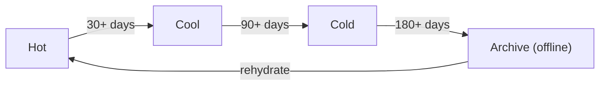

## 1. Core Concept

**Azure Storage** gồm các dịch vụ lưu trữ trong một **storage account**: **Blob** (object), **Files** (SMB/NFS share), **Queue**, **Table** và **Disk**. Hai quyết định then chốt là **mức dự phòng (redundancy)** và **access tier**. Mental model: *redundancy trả lời "dữ liệu sống sót qua sự cố nào", tier trả lời "bao lâu mới truy cập một lần".*

## 2. How It Works

- **Redundancy** (số liệu độ bền tham khảo):
  - **LRS**: 3 bản sao trong **một data center** (11 số 9).
  - **ZRS**: 3 bản sao qua **3 AZ** trong Region (12 số 9).
  - **GRS**: LRS ở Region chính + **LRS ở Region thứ hai** (16 số 9); **GZRS**: ZRS ở chính + LRS ở Region thứ hai.
  - **RA-GRS / RA-GZRS**: như trên nhưng **đọc được** từ Region thứ hai.
- **Blob access tier**:
  - **Hot**: truy cập thường xuyên, phí lưu cao nhất, phí truy cập thấp nhất.
  - **Cool** (≥ 30 ngày), **Cold** (≥ 90 ngày): ít truy cập hơn.
  - **Archive** (≥ 180 ngày): **offline**, phải **rehydrate** (hàng giờ) trước khi đọc.
- **Lifecycle management policy**: tự chuyển tier hoặc xoá blob theo tuổi/lần truy cập cuối.
- **Bảo mật**: mã hoá at rest mặc định (**Microsoft-managed key** hoặc **customer-managed key** trong Key Vault); truy cập qua **Entra ID/RBAC** (khuyên dùng), **SAS token** (quyền tạm thời có giới hạn), hoặc **account key** (toàn quyền, tránh dùng); **private endpoint** và **firewall**.
- **Dữ liệu bảo vệ**: **soft delete**, **blob versioning**, **immutable storage (WORM)**; **AzCopy** để di chuyển dữ liệu số lượng lớn; **Azure Files** thay file server, **Azure File Sync** đồng bộ on-premises.

## 3. Visual Diagram

## 4. Rules of Thumb & Trade-offs

- Chịu lỗi data center → **ZRS**; chịu lỗi cả Region → **GRS/GZRS** (thêm **RA-** nếu cần đọc từ Region phụ khi sự cố).
- Dữ liệu nguội, lưu lâu → **Lifecycle policy** chuyển Cool/Cold/Archive.
- Chia sẻ quyền tạm thời cho bên ngoài → **SAS** (ưu tiên **user delegation SAS** ký bằng Entra ID) với thời hạn ngắn.
- Trade-off: redundancy cao hơn và tier lạnh hơn đều **giảm chi phí lưu** hoặc **tăng độ bền** nhưng đổi lại phí truy cập/độ trễ/chi phí sao chép.

## 5. Must Remember / Production Pitfalls

- Blob **Archive** không đọc trực tiếp: rehydrate mất **hàng giờ**.
- Xoá/chuyển tier sớm hơn thời gian tối thiểu (Cool 30, Cold 90, Archive 180 ngày) vẫn bị tính **phí xoá sớm**.
- **Account key bị lộ** = toàn quyền với account; xoay key và dùng Entra ID/managed identity.
- Failover GRS sang Region phụ có thể **mất dữ liệu chưa kịp replicate** (RPO không bằng 0).
- Exam trap: "dữ liệu phải đọc được khi Region chính sập" → **RA-GRS/RA-GZRS**; "chỉ chịu lỗi AZ trong Region" → **ZRS**.

## 6. Search Hooks

- `Azure Storage redundancy LRS ZRS GRS GZRS` — các mức dự phòng và độ bền tương ứng.
- `Azure Blob access tiers hot cool cold archive` — phân tầng blob theo tần suất truy cập.
- `Azure Blob lifecycle management` — tự động chuyển tầng hoặc xoá blob.
- `Azure Storage SAS user delegation` — quyền truy cập tạm thời ký bằng Entra ID.
- `Azure Blob soft delete versioning immutable` — bảo vệ dữ liệu khỏi xoá/ghi đè nhầm.
- `Azure Files vs Azure File Sync` — chia sẻ file SMB và đồng bộ với on-premises.
