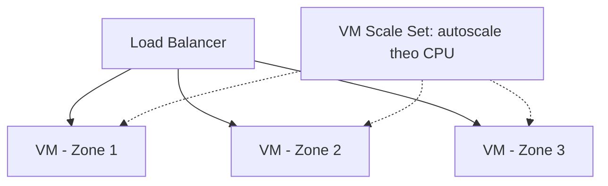

## 1. Core Concept

**Azure Virtual Machines** là compute **IaaS**: bạn kiểm soát hệ điều hành và phần mềm, Azure lo phần cứng và hypervisor. Bài toán thật không phải "tạo VM" mà là ba quyết định: **chọn họ/kích cỡ** hợp workload, **độ sẵn sàng** (SLA bao nhiêu thì cần cấu trúc nào) và **mô hình giá** (trả linh hoạt hay cam kết).

**Mental model:** thuê VM giống **thuê xe**: chọn loại xe theo nhu cầu (kích cỡ), thuê xe dự phòng ở **bãi khác nhau** nếu không muốn kẹt khi một bãi cháy (zone), thuê theo giờ hoặc ký hợp đồng năm để rẻ hơn (reserved), và nhớ **trả xe (deallocate)** chứ đỗ ngoài đường vẫn tính tiền.

## 2. How It Works

**Họ VM → Khớp workload**
- **General purpose** (`D`, tỉ lệ CPU/RAM cân bằng), **compute optimized** (`F`), **memory optimized** (`E`, `M`), **storage optimized** (`L`), **GPU** (`N`), **HPC** (`H`) và **burstable** (`B`, tích credit khi rảnh, hợp tải thấp thỉnh thoảng đột biến).

**Disk → Loại và độ bền**
- **OS disk + data disk** (managed disk): **Standard HDD**, **Standard SSD**, **Premium SSD** (cần SLA đơn VM cao), **Ultra Disk** (IOPS/độ trễ cực cao). **Temporary disk** là bộ nhớ cục bộ **mất dữ liệu** khi VM bị deallocate hoặc di chuyển host; đừng lưu dữ liệu quan trọng ở đó.

**Độ sẵn sàng → SLA tham khảo**
- **VM đơn** dùng Premium SSD/Ultra: **99,9%**. **Availability Set** (nhiều VM chia qua **fault domain** về phần cứng/nguồn và **update domain** về đợt bảo trì, trong một datacenter): **99,95%**. **Availability Zones** (VM ở ≥ 2 zone): **99,99%**.
- **Virtual Machine Scale Sets (VMSS)**: nhóm VM giống nhau, **autoscale** theo metric (CPU) hoặc lịch, đi kèm **Load Balancer/Application Gateway**.

**Mô hình giá → Cam kết hay linh hoạt**
- **Pay-as-you-go**; **Reserved Instances** (1 hoặc 3 năm, gắn cấu hình VM, giảm tới ~72%); **Savings Plan for compute** (cam kết $/giờ, linh hơn); **Spot VM** (tới ~90% rẻ hơn nhưng bị **eviction** khi Azure cần capacity); **Azure Hybrid Benefit** (dùng license Windows Server/SQL Server có Software Assurance).

**Trạng thái và tính phí**
- **Stopped (deallocated)** ngừng tính phí compute nhưng **disk vẫn tính phí**; chỉ tắt từ trong OS (trạng thái **Stopped** không deallocate) thì **vẫn tính phí compute**. Dừng từ portal/CLI thường tự deallocate.

**Vận hành an toàn**
- **Azure Bastion** (RDP/SSH qua trình duyệt, không public IP), **Just-in-time access**, **Azure Backup**, **managed identity** thay secret.

```bash
az vm create -g rg-app -n web1 --image Ubuntu2204 --size Standard_D2s_v5 --zone 1
az vm deallocate -g rg-app -n web1   # ngừng tính phí compute
```

## 3. Visual Diagram



## 4. Rules of Thumb & Trade-offs

| Tình huống / Nhu cầu | Chọn gì |
| --- | --- |
| HA cao nhất cho VM | Availability Zones (99,99%) |
| Region không có AZ | Availability Set |
| Tải thay đổi, tự thêm bớt VM | VMSS |
| Workload ổn định chạy lâu | Reserved Instance / Savings Plan |
| Batch/CI chịu gián đoạn | Spot VM |
| Đã có license Windows/SQL | Azure Hybrid Benefit |
| Có thể dùng PaaS | App Service, Functions, Container Apps (giảm vận hành) |

- **Được gì:** toàn quyền kiểm soát OS và phần mềm. **Mất gì:** bạn chịu trách nhiệm vá lỗi, bảo mật, scale và HA; chi phí vận hành cao hơn PaaS.

## 5. Must Remember / Production Pitfalls

- **Mất dữ liệu sau khi VM di chuyển/deallocate → lưu trên temporary disk → dùng data disk hoặc storage bền**.
- **VM dev/test vẫn tốn tiền → chỉ Stop trong OS, chưa deallocate → deallocate hoặc dùng auto-shutdown**.
- **Spot VM bị thu hồi giữa chừng → eviction bất cứ lúc nào → checkpoint, tải stateless, hoặc On-Demand cho phần quan trọng**.
- **Muốn dùng Availability Set và AZ cùng lúc → không dùng đồng thời cho một VM → chọn một cơ chế**.
- **Hệ thống vẫn sập khi lỗi một zone → các VM cùng zone → trải VMSS/VM qua nhiều zone**.
- Exam trap: "SLA cao nhất cho VM" → **Availability Zones (99,99%)**; "tiết kiệm bằng license sẵn có" → **Azure Hybrid Benefit**; "tự động thêm/bớt VM" → **VMSS**; "Stopped nhưng chưa deallocate" → **vẫn tính phí compute**.

## 6. Search Hooks

- `Azure VM sizes families` — các họ kích cỡ VM và mục đích sử dụng.
- `Azure availability sets fault domain update domain` — chia VM chống lỗi phần cứng và bảo trì.
- `Azure Virtual Machine Scale Sets autoscale` — nhóm VM tự co giãn.
- `Azure Reserved Instances vs Savings Plan` — hai hình thức cam kết giảm giá.
- `Azure Spot VMs eviction` — VM giá rẻ có thể bị thu hồi.
- `Azure Hybrid Benefit` — tận dụng license sẵn có để giảm chi phí.
