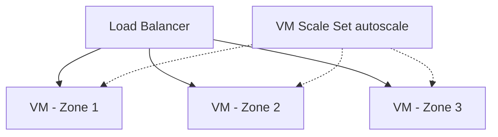

## 1. Core Concept

**Azure Virtual Machines (VM)** là compute **IaaS**: bạn kiểm soát OS và phần mềm, Azure lo phần cứng. Bài toán là chọn đúng **kích cỡ, độ sẵn sàng và mô hình giá**. Mental model: *VM là "máy chủ thuê theo giờ"; độ sẵn sàng đến từ việc rải nhiều VM qua các zone, còn tiền đến từ việc cam kết hoặc chấp nhận bị thu hồi.*

## 2. How It Works

- **Họ VM (size family)**: general purpose (`D`), compute optimized (`F`), memory optimized (`E`), storage optimized (`L`), GPU (`N`), HPC (`H`).
- **Disk**: **OS disk** + **data disk**; loại: **Standard HDD**, **Standard SSD**, **Premium SSD**, **Ultra Disk**; **temporary disk** là bộ nhớ tạm, **mất dữ liệu** khi VM được dời host.
- **Độ sẵn sàng** (SLA tham khảo):
  - **Availability Zones**: VM trải qua ≥ 2 zone → **99.99%**.
  - **Availability Set**: chia VM qua **fault domain** (phần cứng/nguồn) và **update domain** (đợt bảo trì) trong một data center → **99.95%**.
  - VM đơn dùng Premium SSD/Ultra → **99.9%**.
- **Virtual Machine Scale Sets (VMSS)**: nhóm VM giống nhau, **autoscale** theo metric/lịch, kết hợp **Load Balancer** hoặc **Application Gateway**.
- **Mô hình giá**: **Pay-as-you-go**; **Reserved Instances** (cam kết 1 hoặc 3 năm); **Savings Plan for compute**; **Spot VM** (giảm tới ~90%, bị thu hồi khi cần capacity); **Azure Hybrid Benefit** (dùng license Windows Server/SQL Server sẵn có).
- Trạng thái: **Stopped (Deallocated)** ngừng tính phí compute nhưng **disk vẫn tính phí**; chỉ "Stopped" từ trong OS vẫn bị tính phí.

## 3. Visual Diagram

## 4. Rules of Thumb & Trade-offs

- Workload ổn định chạy lâu → **Reserved Instance/Savings Plan**; chịu được gián đoạn (batch, CI) → **Spot**; còn lại → pay-as-you-go.
- HA tối đa → **Availability Zones + VMSS**; Region không có AZ → **Availability Set**.
- Có thể dùng PaaS (App Service, Functions, Container Apps) thì ưu tiên hơn VM để giảm vận hành.
- Trade-off: IaaS cho toàn quyền kiểm soát nhưng **bạn chịu trách nhiệm vá lỗi, bảo mật, scale**.

## 5. Must Remember / Production Pitfalls

- **Temporary disk không bền**: đừng lưu dữ liệu quan trọng ở đó.
- Quên **deallocate** VM dev/test → vẫn trả tiền compute (trạng thái "Stopped" nhưng chưa deallocate).
- Availability Set và Availability Zone **không dùng cùng lúc** cho một VM.
- VM bị **thu hồi Spot** có thể xảy ra bất cứ lúc nào: cần checkpoint hoặc dùng cho tác vụ stateless.
- Exam trap: "đảm bảo SLA cao nhất cho VM" → **Availability Zones (99.99%)**; "tiết kiệm bằng license sẵn có" → **Azure Hybrid Benefit**; "tự động thêm/bớt VM" → **VMSS**.

## 6. Search Hooks

- `Azure VM sizes families` — các họ kích cỡ VM và mục đích sử dụng.
- `Azure availability sets fault domain update domain` — cách chia VM chống lỗi phần cứng và bảo trì.
- `Azure Virtual Machine Scale Sets autoscale` — nhóm VM tự co giãn.
- `Azure Reserved Instances vs Savings Plan` — hai hình thức cam kết giảm giá.
- `Azure Spot VMs eviction` — VM giá rẻ có thể bị thu hồi.
- `Azure Hybrid Benefit` — tận dụng license sẵn có để giảm chi phí.
