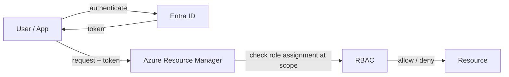

## 1. Core Concept

**Microsoft Entra ID** (trước đây là **Azure Active Directory**) là dịch vụ quản lý danh tính trên cloud: *xác thực* (authentication) người dùng/ứng dụng; còn **Azure RBAC** quyết định *phân quyền* (authorization) trên tài nguyên Azure. Mental model: *Entra ID trả lời "bạn là ai", RBAC trả lời "bạn được làm gì, ở phạm vi nào".*

## 2. How It Works

- **Tenant** là một thực thể Entra ID chứa user, group, app registration; một tenant có thể liên kết nhiều subscription.
- **Xác thực**: **MFA**, **SSO**, **passwordless**, **Conditional Access** (policy "nếu-thì": vị trí, thiết bị, mức rủi ro → yêu cầu MFA hoặc chặn; cần giấy phép **P1**), **Identity Protection** (phát hiện rủi ro; **P2**).
- **Azure RBAC**: một **role assignment** gồm **security principal** (user/group/service principal/managed identity) + **role definition** + **scope**.
- **Role dựng sẵn** cơ bản: **Owner** (toàn quyền, kể cả cấp quyền), **Contributor** (toàn quyền trừ cấp quyền), **Reader** (chỉ xem), **User Access Administrator** (chỉ quản lý quyền). Có thể tạo **custom role**.
- **Scope** theo thứ bậc: management group → subscription → resource group → resource; quyền **kế thừa xuống dưới**.
- **Managed identity**: danh tính do Azure quản lý cho tài nguyên (VM, App Service, Functions), không cần lưu secret trong code; **system-assigned** (gắn vòng đời tài nguyên) hoặc **user-assigned** (dùng chung).
- **Privileged Identity Management (PIM)** (cần **P2**): cấp quyền **just-in-time**, có phê duyệt và hết hạn.

## 3. Visual Diagram

## 4. Rules of Thumb & Trade-offs

- Gán quyền cho **group**, không cho từng user; gán ở **scope nhỏ nhất** đủ dùng (**least privilege**).
- Ứng dụng chạy trên Azure truy cập Key Vault/Storage → **managed identity** thay vì lưu connection string/secret.
- Quản trị viên → dùng **PIM** để có quyền tạm thời thay vì quyền Owner vĩnh viễn.
- Trade-off: Conditional Access/PIM tăng bảo mật nhưng cần giấy phép cao hơn và tăng ma sát khi đăng nhập.

## 5. Must Remember / Production Pitfalls

- **RBAC ≠ Entra roles**: Entra roles (Global Administrator…) quản lý danh tính/tenant; Azure RBAC quản lý tài nguyên Azure.
- **Azure Policy ≠ RBAC**: Policy kiểm soát *tài nguyên được phép trông thế nào*; RBAC kiểm soát *người dùng được làm gì*.
- **Deny assignment** (do Azure/Blueprint tạo) thắng role assignment; role assignment mới có thể mất vài phút để có hiệu lực.
- **Service principal** dùng secret/cert hết hạn là nguyên nhân phổ biến gây sập pipeline; ưu tiên managed identity.
- Exam trap: "ai chỉ được xem, không sửa" → Reader; "app truy cập Key Vault không lưu mật khẩu" → managed identity; "yêu cầu MFA khi đăng nhập từ nước ngoài" → Conditional Access.

## 6. Search Hooks

- `Microsoft Entra ID vs Azure AD` — tên mới của Azure Active Directory.
- `Azure RBAC role assignment scope` — gán role theo principal, role và phạm vi.
- `Entra Conditional Access policies` — chính sách truy cập theo điều kiện.
- `Azure managed identity system-assigned user-assigned` — danh tính cho tài nguyên, không cần secret.
- `Privileged Identity Management just-in-time` — cấp quyền quản trị tạm thời có phê duyệt.
- `Azure RBAC vs Entra roles` — phân biệt quyền tài nguyên và quyền danh tính.
