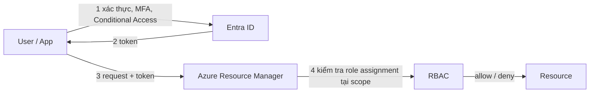

## 1. Core Concept

Trên Azure, **xác thực** (bạn là ai) và **phân quyền** (bạn được làm gì) là hai hệ khác nhau: **Microsoft Entra ID** (trước đây là Azure Active Directory) quản lý **danh tính** và cấp token; **Azure RBAC** quyết định danh tính đó được làm gì trên **tài nguyên Azure** ở phạm vi nào. Nhầm hai hệ này là lỗi kinh điển khi thi và khi cấp quyền thật.

**Mental model:** Entra ID là **phòng cấp thẻ nhân viên** (kiểm tra bạn đúng là bạn, có thể yêu cầu quét vân tay thêm khi ở ngoài văn phòng); RBAC là **bảng phân quyền mở cửa từng phòng** — thẻ hợp lệ chưa đủ, phải có tên trong bảng phân quyền của phòng đó (hoặc của tầng chứa phòng đó).

## 2. How It Works

**Entra ID → Danh tính và xác thực**
- **Tenant** là một thực thể Entra ID chứa user, group, app registration; một tenant có thể liên kết **nhiều subscription**. Giấy phép **Free / P1 / P2** quyết định tính năng.
- **MFA**, **SSO**, **passwordless** tăng độ tin cậy xác thực. **Conditional Access** (cần **P1**) là policy "nếu-thì": nếu thoả điều kiện (vị trí, thiết bị, mức rủi ro) thì **yêu cầu MFA hoặc chặn**; ví dụ "đăng nhập từ nước ngoài → bắt buộc MFA". **Identity Protection** (P2) phát hiện đăng nhập rủi ro.
- Giao thức chuẩn: **OAuth 2.0, OpenID Connect, SAML**; ứng dụng được biểu diễn bằng **app registration/service principal**.

**Azure RBAC → Phân quyền trên tài nguyên**
- Một **role assignment** gồm ba phần: **security principal** (user, group, service principal, managed identity) + **role definition** + **scope**.
- **Role dựng sẵn** cơ bản: **Owner** (toàn quyền, kể cả cấp quyền), **Contributor** (toàn quyền trừ cấp quyền), **Reader** (chỉ xem), **User Access Administrator** (chỉ quản lý quyền). **Custom role** khai báo `Actions`, `NotActions`, `DataActions` và `AssignableScopes`.
- **Control plane vs data plane**: quản lý tài nguyên (tạo storage account) khác đọc dữ liệu bên trong (blob); data plane có role riêng như **Storage Blob Data Reader**.
- **Scope** theo thứ bậc management group → subscription → resource group → resource, quyền **kế thừa xuống dưới**. **Deny assignment** (do Azure/Blueprint tạo) thắng role assignment.

**Managed identity → Không lưu secret**
- Danh tính do Azure quản lý cho VM, App Service, Functions. **System-assigned** gắn vòng đời tài nguyên (xoá tài nguyên là xoá danh tính); **user-assigned** là tài nguyên độc lập dùng chung cho nhiều tài nguyên. Ứng dụng lấy token từ endpoint nội bộ, không cần connection string hay secret trong code.

**PIM → Quyền tạm thời**
- **Privileged Identity Management** (cần **P2**) cấp quyền **just-in-time** theo kiểu **eligible → active**, có phê duyệt, thời hạn và access review; giảm rủi ro quyền Owner vĩnh viễn.

```bash
az role assignment create --assignee <group-object-id> \
  --role "Reader" --scope /subscriptions/<sub>/resourceGroups/rg-orders-prod
```

## 3. Visual Diagram



## 4. Rules of Thumb & Trade-offs

| Tình huống / Nhu cầu | Chọn gì |
| --- | --- |
| Chỉ xem, không sửa | Reader |
| Quản lý tài nguyên nhưng không cấp quyền | Contributor |
| Ứng dụng truy cập Key Vault/Storage không lưu secret | Managed identity |
| Yêu cầu MFA khi đăng nhập từ nước ngoài | Conditional Access |
| Quản trị viên cần quyền tạm thời, có phê duyệt | PIM |
| Ép tài nguyên phải có tag/Region cho phép | Azure Policy (không phải RBAC) |

- **Được gì:** quyền chính xác theo scope, không lộ secret, quyền tạm thời. **Mất gì:** Conditional Access/PIM cần giấy phép cao hơn và tăng ma sát khi đăng nhập; quá nhiều role assignment lẻ khó audit.

## 5. Must Remember / Production Pitfalls

- **Cấp quyền cho từng user → khó audit khi người chuyển team → gán cho group, ở scope nhỏ nhất đủ dùng (least privilege)**.
- **Nhầm Entra roles với Azure RBAC → cấp Global Administrator để quản tài nguyên hoặc ngược lại → Entra roles quản danh tính/tenant, RBAC quản tài nguyên Azure**.
- **Nhầm Policy với RBAC → muốn chặn người tạo tài nguyên sai Region mà dùng role → Policy kiểm soát tài nguyên trông thế nào, RBAC kiểm soát ai làm được gì**.
- **Service principal dùng secret/certificate hết hạn làm sập pipeline → không có cảnh báo hết hạn → dùng managed identity hoặc federated credential**.
- **Vừa gán role xong vẫn bị từ chối → quyền cần vài phút lan truyền và token cũ còn hiệu lực → chờ hoặc lấy token mới**.
- Exam trap: "ai chỉ được xem, không sửa" → **Reader**; "app truy cập Key Vault không lưu mật khẩu" → **managed identity**; "yêu cầu MFA khi đăng nhập từ nước ngoài" → **Conditional Access**.

## 6. Search Hooks

- `Microsoft Entra ID vs Azure AD` — tên mới của Azure Active Directory.
- `Azure RBAC role assignment scope` — gán role theo principal, role và phạm vi.
- `Entra Conditional Access policies` — chính sách truy cập theo điều kiện.
- `Azure managed identity system-assigned user-assigned` — danh tính cho tài nguyên, không cần secret.
- `Privileged Identity Management just-in-time` — cấp quyền quản trị tạm thời có phê duyệt.
- `Azure RBAC vs Entra roles` — phân biệt quyền tài nguyên và quyền danh tính.
