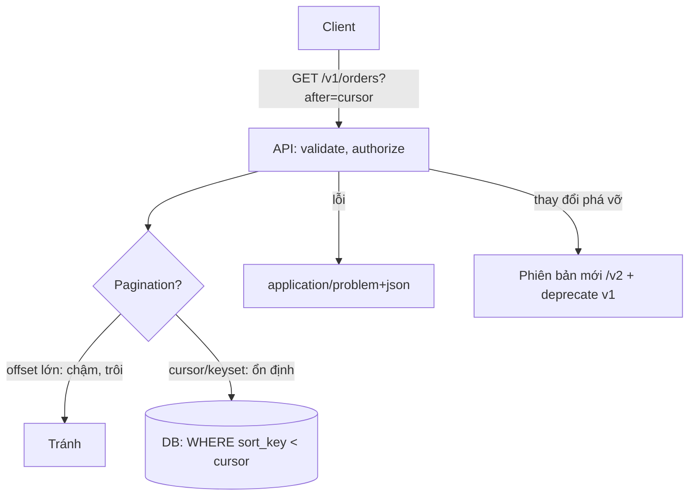

## 1. Core Concept

**REST API** là cách thiết kế API HTTP xoay quanh **tài nguyên (resource)** được định danh bằng URL và thao tác bằng **động từ HTTP** có ngữ nghĩa chuẩn. API tốt là **hợp đồng (contract)** giữa bên cung cấp và nhiều client bạn **không kiểm soát được**: mọi thay đổi **phá vỡ tương thích** (đổi tên trường, đổi kiểu) đều làm hỏng ai đó. Vì vậy thiết kế API là bài toán **nhất quán, tương thích ngược và dễ dùng đúng**.

**Mental model:** API như **menu nhà hàng in sẵn**: khách (client) gọi món theo tên cố định; bạn có thể **thêm món mới** thoải mái, nhưng **đổi tên hay bỏ món** làm khách gọi sai. Mã lỗi là **cách bếp báo "hết món"** — phải rõ ràng và nhất quán để khách biết xử lý.

## 2. How It Works

**Tài nguyên và động từ**
- URL là **danh từ số nhiều** (`/orders`, `/orders/42/items`), động từ nằm ở **method**: `GET` (đọc, **an toàn + idempotent**), `POST` (tạo, **không idempotent**), `PUT` (thay thế toàn bộ, idempotent), `PATCH` (sửa một phần), `DELETE` (idempotent). Mã trạng thái: `201 Created` + `Location`, `204 No Content`, `400/422` (dữ liệu sai), `401/403`, `404`, `409` (xung đột), `429`, `5xx`.

**Phân trang → Cursor so với offset**
- **Offset** (`?page=5000&limit=20`): DB phải **đọc rồi bỏ** 100.000 hàng (chậm dần) và **kết quả trôi** nếu dữ liệu thay đổi giữa các trang. **Cursor/keyset** (`?after=<token>`): dùng điều kiện trên khoá sắp xếp (`WHERE (created_at, id) < (...)`) → **chi phí gần như hằng số và ổn định**; không nhảy tới trang bất kỳ.

**Versioning và tương thích ngược**
- Cách: **URL** (`/v1/`), **header**, hoặc content negotiation. **Thay đổi tương thích**: thêm trường/endpoint mới (client phải **bỏ qua trường lạ**). **Phá vỡ**: xoá/đổi tên/đổi kiểu trường, biến trường tuỳ chọn thành bắt buộc, đổi ngữ nghĩa. Khi phải phá vỡ: **phiên bản mới + lộ trình deprecate** (header `Deprecation`/`Sunset`).

**Lỗi chuẩn hoá → Problem Details (RFC 9457)**
- Trả `application/problem+json` với `type`, `title`, `status`, `detail`, `instance` (và trường mở rộng) để client **xử lý máy đọc được** thay vì parse chuỗi.

**Idempotency và đồng thời**
- `POST` quan trọng (thanh toán) nhận **`Idempotency-Key`**; cập nhật dùng **`ETag` + `If-Match`** (412 nếu đã đổi) để chống ghi đè mất cập nhật. Việc dài: **`202 Accepted`** + `Location` để polling.

**REST vs gRPC vs GraphQL**
- **REST**: đơn giản, cache HTTP, hợp API công khai. **gRPC**: Protobuf nhị phân trên HTTP/2, **streaming**, hợp **service nội bộ** hiệu năng cao. **GraphQL**: client **chọn trường** (giảm over/under-fetch), nhưng cần kiểm soát **độ phức tạp truy vấn, N+1** và cache khó hơn.

**OpenAPI**
- Mô tả API dạng chuẩn → **tài liệu, sinh client/server, validation, kiểm thử hợp đồng** và **phát hiện thay đổi phá vỡ trong CI**.

```http
GET /v1/orders?limit=20&after=eyJjIjoiMjAyNi0xMS0yMSJ9 HTTP/1.1

HTTP/1.1 422 Unprocessable Content
Content-Type: application/problem+json
{"type":"https://api.example.com/errors/invalid-quantity","title":"Số lượng không hợp lệ",
 "status":422,"detail":"quantity phải >= 1","instance":"/v1/orders/42"}
```

## 3. Visual Diagram



## 4. Rules of Thumb & Trade-offs

| Tình huống / Nhu cầu | Chọn gì |
| --- | --- |
| Danh sách lớn, dữ liệu thay đổi | Cursor/keyset pagination |
| Cần nhảy tới trang bất kỳ, dữ liệu nhỏ | Offset |
| Thêm trường mới | Thay đổi tương thích, không cần version mới |
| Đổi tên/xoá trường | Phiên bản mới + deprecate |
| Thanh toán/tạo tài nguyên có hậu quả | `Idempotency-Key` |
| Service nội bộ hiệu năng cao, streaming | gRPC |
| Client cần chọn trường linh hoạt | GraphQL (kèm giới hạn độ phức tạp) |
| Lỗi máy đọc được | Problem Details |

- **Được gì:** API dễ dùng, tiến hoá không vỡ client. **Mất gì:** giữ tương thích ngược tốn công, nhiều phiên bản tăng chi phí bảo trì; cursor không nhảy tới trang tuỳ ý.

## 5. Must Remember / Production Pitfalls

- **API chậm dần ở trang sâu → offset lớn quét-bỏ nhiều hàng → keyset pagination**.
- **Client cũ hỏng sau khi deploy → đổi tên/kiểu trường (thay đổi phá vỡ) → thêm trường mới, giữ cũ, deprecate có lộ trình, kiểm tra bằng OpenAPI diff trong CI**.
- **Tạo đơn hai lần khi client retry → POST không idempotent → `Idempotency-Key` lưu kết quả**.
- **Hai client sửa cùng tài nguyên ghi đè nhau → thiếu kiểm soát đồng thời → `ETag`/`If-Match` (412)**.
- **Client không biết xử lý lỗi → trả chuỗi tự do và mã 200 cho lỗi → mã trạng thái đúng + Problem Details**.
- **Chatty API (nhiều request để dựng một màn hình) → thiết kế quá chi tiết → endpoint tổng hợp hoặc GraphQL/BFF**.
- Interview trap: "PUT vs POST?" → **PUT idempotent thay thế toàn bộ, POST tạo và không idempotent**; "offset vs cursor?" → **cursor ổn định và nhanh ở trang sâu**; "thêm trường có phá vỡ không?" → **không, xoá/đổi tên mới phá vỡ**.

## 6. Search Hooks

- `REST API design best practices` — nguyên tắc thiết kế API REST.
- `cursor vs offset pagination` — hai cách phân trang.
- `API versioning backward compatibility` — tiến hoá API không phá client.
- `Problem Details RFC 9457` — định dạng lỗi chuẩn.
- `REST vs gRPC vs GraphQL` — chọn kiểu API.
- `OpenAPI specification` — mô tả và kiểm thử hợp đồng API.
