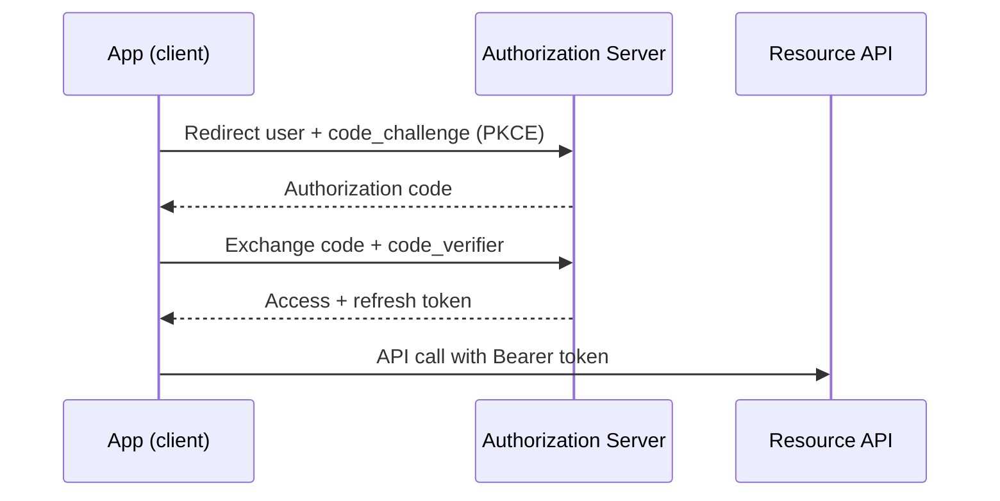

## 1. Core Concept

**Authentication (authN)** trả lời "bạn là ai", **authorization (authZ)** trả lời "bạn được làm gì". Hai công cụ phổ biến: **session cookie** phía server và **token (JWT)** tự chứa thông tin; **OAuth 2.0/OIDC** là khung để uỷ quyền và đăng nhập qua bên thứ ba. Mental model: *token là chìa khoá tạm — an toàn nằm ở việc nó **ngắn hạn**, **kiểm tra đủ** và **không để lộ**; còn quyền phải được kiểm tra **ở server, trên từng đối tượng**.*

## 2. How It Works

- **Session**: server lưu trạng thái, client giữ **session ID trong cookie** (`HttpOnly`, `Secure`, `SameSite`); thu hồi dễ (xoá session), nhưng cần kho chia sẻ khi scale ngang.
- **JWT**: `header.payload.signature` (Base64URL). Payload chứa **claims**: `sub`, `iss` (ai phát hành), `aud` (cho ai), `exp` (hết hạn). Server **kiểm chữ ký** bằng khoá (HS256 khoá chung, RS256/ES256 khoá công khai) — không cần tra DB (stateless). Payload **chỉ được mã hoá Base64, không bí mật**.
- **Access token** ngắn hạn (5–15 phút) + **refresh token** dài hạn để cấp token mới; **xoay vòng refresh token** và lưu phía server để thu hồi.
- **OAuth 2.0 Authorization Code + PKCE**: client chuyển người dùng tới Authorization Server → đăng nhập → nhận `code` → đổi `code` lấy token (kèm `code_verifier` chứng minh cùng client). **OIDC** thêm **ID token** để biết danh tính người dùng.
- **Mật khẩu**: băm bằng **argon2id/bcrypt** + salt, không bao giờ lưu rõ hay dùng hash nhanh (SHA-256 đơn thuần); thêm **MFA**.
- **Mô hình quyền**: **RBAC** (theo vai trò), **ABAC** (theo thuộc tính/ngữ cảnh), kiểm tra quyền ở **tầng nghiệp vụ** cho từng resource.

## 3. Visual Diagram

## 4. Rules of Thumb & Trade-offs

- Ứng dụng web truyền thống/một domain → **session cookie** đơn giản và an toàn; **SPA/mobile/API nhiều service** → token (OAuth/OIDC) với **PKCE**.
- **Không tự viết** hệ thống đăng nhập/quản lý token nếu có thể dùng IdP chuẩn (Keycloak, Cognito, Entra ID, Auth0).
- Token càng **ngắn hạn** càng giảm rủi ro khi bị lộ; đổi lại tăng số lần refresh.
- Trade-off: **stateless (JWT, dễ scale)** vs **thu hồi tức thì (session/introspection)**.

## 5. Must Remember / Production Pitfalls

- **Không thu hồi được JWT** đang còn hạn nếu chỉ kiểm chữ ký → giữ ngắn hạn, dùng danh sách chặn hoặc introspection cho trường hợp nhạy cảm.
- Lỗi kiểm tra: chấp nhận **`alg: none`**, lẫn **HS256/RS256 (key confusion)**, không kiểm `exp`/`aud`/`iss` → whitelist thuật toán và kiểm tra đủ claim.
- Lưu token ở **`localStorage`** dễ bị **XSS** lấy cắp; cookie `HttpOnly` an toàn hơn nhưng cần chống **CSRF** (`SameSite`, CSRF token).
- **Không đặt dữ liệu nhạy cảm** vào payload JWT; ai cũng đọc được.
- Kiểm tra quyền chỉ ở UI/route mà **không kiểm tra từng object** → **IDOR** (đổi `/orders/42` thành `/orders/43`).
- Interview trap: "JWT có mã hoá không?" → mặc định chỉ **ký**, không mã hoá (JWE mới mã hoá).

## 6. Search Hooks

- `OAuth 2.0 Authorization Code flow PKCE` — luồng uỷ quyền chuẩn cho SPA/mobile.
- `OpenID Connect ID token` — lớp danh tính xây trên OAuth 2.0.
- `JWT validation claims exp aud iss` — những gì phải kiểm tra khi nhận token.
- `session cookie HttpOnly SameSite CSRF` — bảo vệ session và chống CSRF.
- `RBAC vs ABAC` — hai mô hình phân quyền.
- `IDOR insecure direct object reference` — lỗi thiếu kiểm tra quyền theo từng đối tượng.
