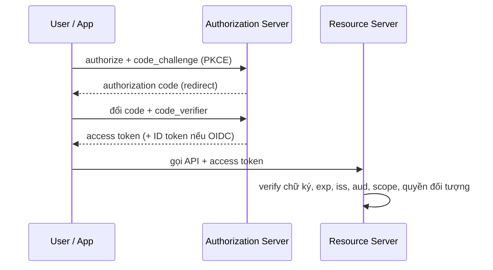

## 1. Core Concept

**Authentication (AuthN)** trả lời "**bạn là ai**"; **Authorization (AuthZ)** trả lời "**bạn được làm gì**". **OAuth 2.0** là khung **ủy quyền** (cho ứng dụng truy cập tài nguyên thay mặt người dùng mà không lộ mật khẩu), **OpenID Connect (OIDC)** thêm lớp **xác thực** lên trên (ID token), còn **JWT** là **định dạng token** tự chứa thông tin và chữ ký. Phần lớn sự cố bảo mật API nằm ở **kiểm tra token/quyền sai**, không phải ở mã hoá.

**Mental model:** OAuth giống **thẻ giữ xe valet**: bạn đưa cho người gửi xe chiếc chìa **chỉ khởi động và lái trong bãi** (scope giới hạn, thời hạn ngắn) chứ không đưa chìa chính. OIDC là **bảng tên** của người cầm thẻ ("đây là ai"). JWT là **thẻ có chữ ký nhà sản xuất** — ai cũng đọc được nội dung, nhưng chỉ tin nếu **chữ ký hợp lệ**.

## 2. How It Works

**OAuth 2.0 → Vai trò và luồng**
- Vai trò: **resource owner** (người dùng), **client** (ứng dụng), **authorization server** (cấp token), **resource server** (API). Luồng cho **ứng dụng web/mobile/SPA** là **Authorization Code + PKCE**: client tạo `code_verifier` ngẫu nhiên, gửi **`code_challenge = SHA256(verifier)`**, nhận `code` qua redirect rồi **đổi lấy token kèm `code_verifier`** → kẻ chặn `code` không dùng được. **Implicit flow đã lỗi thời.** **Client credentials** cho **service-to-service** (không có người dùng). **Refresh token** cấp lại access token (nên **xoay vòng**), **scope** giới hạn quyền.

**OIDC → Xác thực**
- Thêm **ID token** (JWT chứa `sub`, `iss`, `aud`, `exp`, `nonce`…) cho biết **ai đã đăng nhập**; access token dùng để **gọi API**. Không dùng access token để suy ra danh tính.

**JWT → Cấu trúc và kiểm tra**
- `header.payload.signature` (base64url; **payload không được mã hoá**, đừng đặt bí mật). **Phải xác minh**: **chữ ký** (khoá từ **JWKS**, chọn theo `kid`), **thuật toán thuộc whitelist** (từ chối `none`, chống nhầm lẫn RS256/HS256), và các claim **`exp`** (hết hạn), **`nbf`**, **`iss`** (đúng nhà phát hành), **`aud`** (token dành cho API này). **`jwt.decode` chỉ đọc nội dung, KHÔNG kiểm tra chữ ký** — dùng `verify`. Access token **sống ngắn** (5–15 phút) vì **khó thu hồi** (stateless).

**Session cookie vs token và CSRF**
- **Session** (state ở server) + cookie `HttpOnly; Secure; SameSite=Lax/Strict` chống XSS đánh cắp và giảm **CSRF** (thêm **CSRF token** cho thao tác thay đổi). Lưu token trong `localStorage` bị **XSS** đọc được.

**Phân quyền → RBAC, ABAC và kiểm tra theo đối tượng**
- **RBAC** (theo vai trò: admin/editor), **ABAC** (theo thuộc tính: phòng ban, giờ, mức nhạy cảm; linh hoạt hơn). **IDOR/BOLA** (Insecure Direct Object Reference): API nhận `GET /orders/42` mà **không kiểm tra đơn 42 thuộc người gọi** → đọc dữ liệu người khác (**lỗi API số 1 của OWASP**). Phải **kiểm tra quyền trên từng đối tượng** ở server, không tin id từ client.

**Mã trạng thái**
- **401** chưa xác thực/token sai; **403** đã xác thực nhưng không đủ quyền.

```python
# Đúng: xác minh chữ ký + thuật toán + claim
claims = jwt.decode(token, key=jwks_key(token), algorithms=["RS256"],
                    audience="api://orders", issuer="https://login.example.com/")
order = db.get_order(order_id)
if order.owner_id != claims["sub"]:             # kiểm tra quyền theo đối tượng (chống IDOR)
    raise Forbidden()
```

## 3. Visual Diagram



## 4. Rules of Thumb & Trade-offs

| Tình huống / Nhu cầu | Chọn gì |
| --- | --- |
| SPA/mobile đăng nhập và gọi API | Authorization Code + PKCE |
| Service gọi service | Client credentials (hoặc mTLS) |
| Cần biết ai đăng nhập | OIDC (ID token) |
| Quyền theo vai trò đơn giản | RBAC |
| Quyền theo ngữ cảnh/thuộc tính | ABAC |
| Chống XSS đánh cắp phiên | Cookie HttpOnly + SameSite |
| Thu hồi dễ | Token ngắn hạn + refresh; hoặc session server-side |

- **Được gì:** không lộ mật khẩu, quyền chi tiết, SSO. **Mất gì:** phức tạp (luồng, kiểm tra token, JWKS xoay khoá); JWT **khó thu hồi**; cookie/CSRF cần cấu hình đúng.

## 5. Must Remember / Production Pitfalls

- **Chấp nhận token giả → chỉ `jwt.decode` không kiểm tra chữ ký → dùng `verify` với khoá và whitelist thuật toán, kiểm tra `iss`, `aud`, `exp`**.
- **Người dùng xem được dữ liệu người khác bằng cách đổi id → IDOR/BOLA → kiểm tra quyền sở hữu trên từng đối tượng ở server**.
- **Token bị đánh cắp dùng được lâu → access token sống dài/lưu `localStorage` → TTL ngắn, refresh xoay vòng, cookie HttpOnly**.
- **Dùng access token để biết người dùng là ai → nhầm OAuth với OIDC → dùng ID token (và `nonce`) cho xác thực**.
- **Bỏ `SameSite`/CSRF token với cookie → CSRF → `SameSite=Lax/Strict` + CSRF token cho thao tác ghi**.
- Interview trap: "OAuth hay OIDC?" → **OAuth ủy quyền, OIDC xác thực**; "vì sao cần PKCE?" → **ngăn kẻ chặn authorization code dùng nó**; "401 vs 403?" → **chưa xác thực vs không đủ quyền**.

## 6. Search Hooks

- `OAuth 2.0 authorization code PKCE` — luồng chuẩn cho SPA/mobile.
- `OpenID Connect ID token` — lớp xác thực trên OAuth.
- `JWT validation exp aud iss` — kiểm tra token đúng cách.
- `session cookies HttpOnly SameSite CSRF` — bảo vệ phiên và chống CSRF.
- `RBAC vs ABAC` — hai mô hình phân quyền.
- `IDOR insecure direct object reference` — thiếu kiểm tra quyền theo đối tượng.
