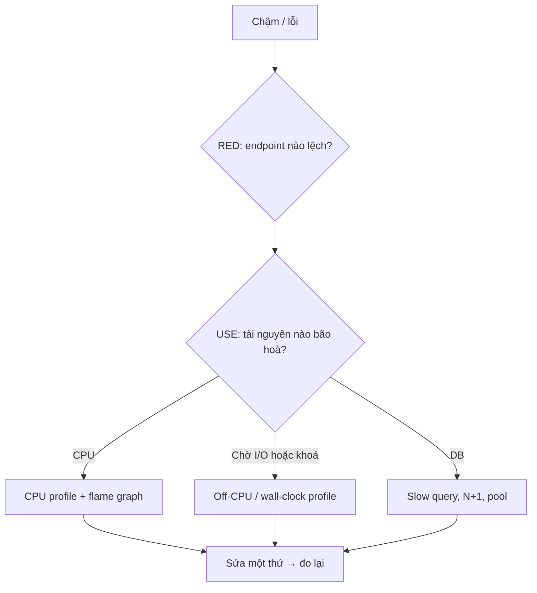

## 1. Core Concept

Tối ưu hiệu năng backend là **đo, tìm nút thắt, sửa đúng chỗ, đo lại** — không phải đoán. Đa số "chậm" đến từ **vài điểm nóng**: truy vấn DB (đặc biệt **N+1**), **connection pool** cạn, **thread pool bị bão hoà**, tranh chấp khoá hoặc một hàm tốn CPU. Công cụ tư duy: **RED/USE** để biết **chỗ nào bất thường**, **profiling/flame graph** để biết **hàm nào nóng**, **load test đúng cách** (tránh coordinated omission) để biết **giới hạn thật**.

**Mental model:** hệ thống như **đường ống nước**: lưu lượng bị **đoạn hẹp nhất** quyết định, mở rộng các đoạn khác không giúp gì. Profiling là **đo áp suất ở từng đoạn** để tìm chỗ hẹp, thay vì đập cả đường ống.

## 2. How It Works

**RED và USE → Biết nhìn vào đâu**
- **RED** (cho **dịch vụ/endpoint**): **R**ate (request/giây), **E**rrors (tỷ lệ lỗi), **D**uration (độ trễ, theo **percentile**). **USE** (cho **tài nguyên**): **U**tilization, **S**aturation, **E**rrors. Luôn xem **p95/p99**, không chỉ trung bình (bài Scalability).

**Profiling → Tìm hàm nóng**
- **CPU profiler** lấy mẫu stack định kỳ; **flame graph** hiển thị: **chiều rộng = tỷ lệ thời gian**, tìm **các "cao nguyên" rộng**. Phân biệt **CPU profile** (thời gian trên CPU) với **wall-clock/off-CPU** (thời gian chờ I/O, khoá — quan trọng khi CPU rảnh mà chậm). Có **allocation profile** (cấp phát bộ nhớ/GC) và **continuous profiling** ở production (overhead thấp).

**Connection pool sizing**
- Pool quá nhỏ → request **xếp hàng chờ kết nối**; quá lớn → **quá tải DB** (`max_connections`, context switch). Công thức tham khảo (HikariCP): **`((số core DB × 2) + số đĩa hiệu dụng)`**, thường chỉ **~10–30 kết nối** là đủ; hoặc Little's Law: **`pool ≈ TPS × thời gian giữ kết nối trung bình`** (500 TPS × 20 ms = ~10). Nhiều app instance → tổng kết nối = instance × pool → dùng **PgBouncer**.

**N+1 query**
- Một truy vấn lấy danh sách + **N truy vấn** cho từng phần tử (thường do ORM lazy loading). 100 đơn → **101 truy vấn**, mỗi cái thêm ~1 ms RTT. Sửa: **JOIN/prefetch/IN**, đếm số query mỗi request trong test.

**Thread pool starvation**
- Pool nhỏ chứa các task **chặn** (gọi HTTP/DB đồng bộ) hoặc **task chờ task khác trong cùng pool** → hết thread, **deadlock logic** hoặc độ trễ vọt lên dù CPU rảnh. Cách: **pool riêng cho I/O chặn**, timeout, async, giới hạn đồng thời (bulkhead).

**Coordinated omission → Load test nói dối**
- Công cụ gửi request **kế tiếp chỉ sau khi nhận phản hồi trước** sẽ **tự giảm tải** đúng lúc hệ thống chậm → **p99 thấp giả tạo**. Dùng **mô hình tốc độ đến cố định (open model)**: `wrk2`, k6 `constant-arrival-rate`, và tính độ trễ từ **thời điểm đáng lẽ gửi**. Ngoài ra: ramp-up, giai đoạn ổn định, **soak test** để thấy rò rỉ.

**Quy trình tối ưu**
- **Đo (baseline) → tìm bottleneck → sửa một thứ → đo lại**; truy vấn chậm xem `pg_stat_statements`/slow log; nhớ **Amdahl**: tối ưu phần chiếm 5% thời gian tối đa chỉ tăng 5%.

```python
# Sai: rò rỉ kết nối khi return sớm (chỉ sập sau vài giờ khi pool cạn)
def get_user(uid):
    conn = pool.acquire()
    row = conn.fetch(uid)
    if not row: return None          # quên release!
    pool.release(conn); return row

# Đúng: luôn trả kết nối
def get_user(uid):
    with pool.connection() as conn:
        return conn.fetch(uid)
```

## 3. Visual Diagram



## 4. Rules of Thumb & Trade-offs

| Tình huống / Nhu cầu | Chọn gì |
| --- | --- |
| Biết endpoint nào bất thường | RED (Rate, Errors, Duration) |
| Biết tài nguyên nào bão hoà | USE |
| Tìm hàm tốn CPU | CPU profile + flame graph |
| CPU rảnh mà vẫn chậm | Off-CPU/wall-clock profile, xem khoá/I/O |
| Truy vấn lặp theo phần tử | Sửa N+1 (JOIN/prefetch) |
| Tính cỡ pool | Công thức Hikari / Little's Law, nhỏ vẫn tốt |
| Load test đáng tin | Open model, arrival rate cố định |

- **Được gì:** sửa đúng chỗ, hiệu quả lớn với ít thay đổi. **Mất gì:** profiling thêm overhead nhỏ, cần môi trường giống production; tối ưu quá sớm làm code khó đọc.

## 5. Must Remember / Production Pitfalls

- **Endpoint chạy tốt khi test nhưng sập sau vài giờ → rò rỉ kết nối (return sớm không release) → try/finally hoặc context manager, giám sát pool**.
- **Độ trễ cao dù CPU rảnh → thread pool starvation hoặc chờ khoá/I/O → pool riêng cho I/O chặn, timeout, off-CPU profile**.
- **Số truy vấn mỗi request tăng theo dữ liệu → N+1 → JOIN/prefetch, test đếm query**.
- **Tăng pool lên 500 mà DB càng chậm → quá tải DB → giảm pool, dùng PgBouncer, đo thông lượng**.
- **Load test báo p99 đẹp nhưng production tệ → coordinated omission → open model (wrk2/k6 arrival-rate)**.
- **Tối ưu theo cảm tính không đo → sửa sai chỗ → profile trước, đo trước/sau**.
- Interview trap: "RED và USE khác gì?" → **RED cho dịch vụ (Rate/Errors/Duration), USE cho tài nguyên (Utilization/Saturation/Errors)**; "pool càng lớn càng tốt?" → **không, quá lớn làm DB quá tải**; "flame graph đọc thế nào?" → **chiều rộng là tỷ lệ thời gian, tìm cao nguyên rộng**.

## 6. Search Hooks

- `RED method USE method` — hai khung quan sát hệ thống.
- `flame graphs CPU profiling` — tìm hàm nóng bằng flame graph.
- `connection pool sizing HikariCP` — chọn cỡ pool kết nối.
- `N+1 query problem` — truy vấn lặp theo phần tử.
- `coordinated omission load testing` — vì sao load test báo độ trễ thấp giả.
- `thread pool starvation` — pool bị bão hoà bởi task chặn.
