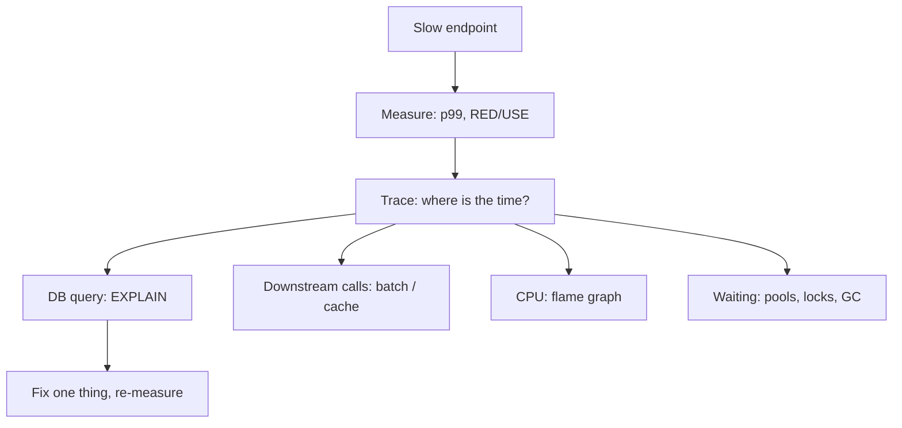

## 1. Core Concept

Tối ưu hiệu năng là **quy trình khoa học**, không phải đoán mò: *đo → tìm điểm nghẽn → sửa đúng chỗ → đo lại*. Phần lớn "backend chậm" đến từ vài nguyên nhân lặp lại: truy vấn DB kém, kết nối/thread bị cạn, gọi mạng thừa, lock và GC. Mental model: *thời gian một request là tổng các lần chờ — bạn chỉ làm nhanh hơn được bằng cách gỡ phần chờ lớn nhất.*

## 2. How It Works

- **Chỉ số đúng**: dùng **percentile (p50/p95/p99)** và histogram, không dùng trung bình. Đo cả **throughput** và **error rate**.
- **Hai khung kiểm tra nhanh**: **RED** cho service (**R**ate, **E**rrors, **D**uration) và **USE** cho tài nguyên (**U**tilization, **S**aturation, **E**rrors) — saturation (hàng đợi, thread chờ) thường là dấu hiệu sớm nhất.
- **Profiling**: **CPU profiler/flame graph** cho thấy hàm nào tốn CPU; **tracing** cho thấy thời gian nằm ở dependency nào; **EXPLAIN ANALYZE** cho truy vấn chậm; **heap/GC log** cho áp lực bộ nhớ.
- **Điểm nghẽn thường gặp**:
  - **N+1 query**, thiếu index, `SELECT *`, `OFFSET` lớn.
  - **Connection pool cạn** (request chờ lấy kết nối): pool quá nhỏ hoặc truy vấn giữ kết nối quá lâu; pool quá lớn lại làm DB quá tải.
  - **Thread pool starvation**: thread bị chặn bởi I/O chậm, hàng đợi dài.
  - **Chatty calls** (gọi nhiều lần nhỏ qua mạng), serialization/JSON lớn.
  - **Lock contention**, **GC pause**, log đồng bộ.
- **Load testing** (k6, wrk, Gatling) với dữ liệu và mẫu truy cập **giống thật**, tăng dần tải để tìm điểm gãy; chạy ở môi trường gần production.
- **Đòn bẩy sửa**: index/viết lại truy vấn, **batching**, **cache**, bất đồng bộ hoá việc không cần chờ, giảm payload, tái dùng kết nối.

## 3. Visual Diagram

## 4. Rules of Thumb & Trade-offs

- **Đừng tối ưu trước khi đo**; sửa điểm nghẽn lớn nhất theo **Amdahl's law**, tối ưu phần chiếm 5% thời gian không đáng.
- Đặt **timeout** cho mọi lời gọi ngoài và **giới hạn** hàng đợi để tránh sập dây chuyền.
- Kích thước connection pool: bắt đầu nhỏ (số core DB × 2 trở lại là điểm khởi đầu thường dùng), **đo** rồi chỉnh — nhiều kết nối hơn không có nghĩa nhanh hơn.
- Trade-off: **hiệu năng vs. độ phức tạp/độ đúng** (cache, async làm code khó hơn); đừng đánh đổi tính đúng để lấy vài mili-giây.

## 5. Must Remember / Production Pitfalls

- **Trung bình che giấu đuôi**: p99 mới phản ánh người dùng chậm nhất.
- **Coordinated omission**: công cụ load test đợi phản hồi rồi mới gửi tiếp làm **độ trễ đuôi bị đánh giá thấp**.
- Benchmark trên **dữ liệu nhỏ/DB rỗng** không phản ánh production (index, cache, kế hoạch truy vấn khác).
- Cache che vấn đề thay vì sửa gốc; **cache lạnh** sau deploy vẫn làm sập hệ thống.
- Interview trap: "API chậm, bạn làm gì đầu tiên?" → **đo/trace để xác định thời gian nằm ở đâu**, không phải thêm cache hay scale.

## 6. Search Hooks

- `RED method USE method` — hai khung kiểm tra hiệu năng nhanh.
- `flame graphs CPU profiling` — trực quan hoá hàm tốn CPU.
- `connection pool sizing HikariCP` — cách chọn kích thước pool.
- `N+1 query problem` — một truy vấn cho danh sách rồi thêm truy vấn mỗi phần tử.
- `coordinated omission load testing` — sai lệch đo độ trễ khi load test.
- `thread pool starvation` — thread bị chặn làm hàng đợi dài ra.
