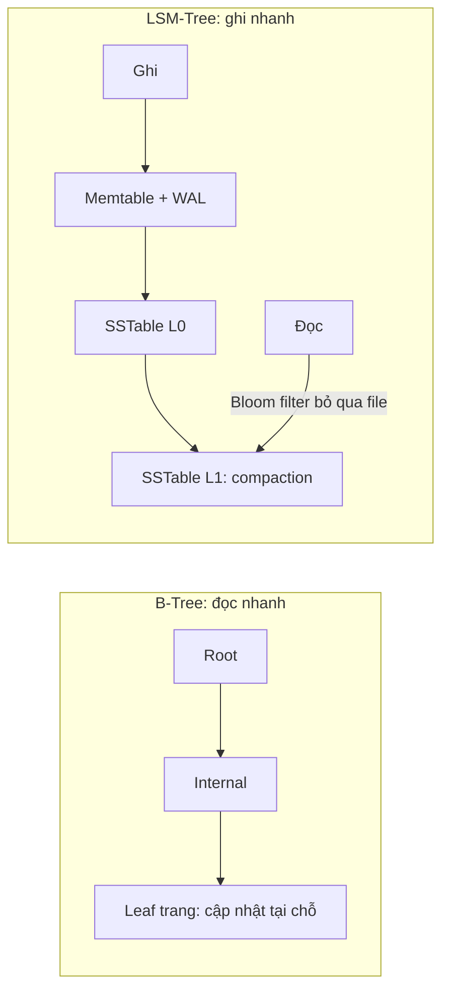

## 1. Core Concept

**Index** là cấu trúc dữ liệu phụ giúp DB **tìm bản ghi mà không quét toàn bộ bảng** — biến một truy vấn từ **O(n) thành O(log n)**. Cái giá là **mỗi index làm chậm ghi và tốn dung lượng**. Cách DB **lưu dữ liệu xuống đĩa** (storage engine) quyết định ai thắng ở đọc hay ghi: **B-Tree** (đọc nhanh, cập nhật tại chỗ) và **LSM-Tree** (ghi tuần tự rất nhanh, đọc phức tạp hơn). Hiểu đúng giúp bạn **thiết kế index, đọc `EXPLAIN` và chọn engine**.

**Mental model:** index như **mục lục cuối sách**: thay vì lật từng trang, tra tên → nhảy thẳng tới trang. Nhưng mỗi lần thêm/sửa/xoá nội dung phải **cập nhật cả mục lục**, nên mục lục càng nhiều thì viết sách càng chậm.

## 2. How It Works

**B-Tree → Cây cân bằng theo trang**
- Dữ liệu chia **trang 4–16 KB**; mỗi nút có **hàng trăm con trỏ** nên cây chỉ cao **3–4 tầng** dù có hàng tỷ bản ghi (một tra cứu ≈ vài lần đọc trang). **Cập nhật tại chỗ**, giữ thứ tự khoá nên hỗ trợ **truy vấn khoảng**; ghi có thể gây **tách trang (page split)** và ghi log WAL. Là mặc định của PostgreSQL, MySQL InnoDB.

**LSM-Tree → Ghi tuần tự, gộp dần**
- Ghi vào **memtable** (RAM, kèm WAL) → đầy thì **flush** thành file **SSTable đã sắp xếp, bất biến** → nền **compaction** gộp các file theo tầng. **Ghi rất nhanh** (tuần tự), nhưng **đọc** phải kiểm tra memtable và nhiều SSTable (giảm bằng **Bloom filter** để bỏ qua file chắc chắn không chứa khoá) và có **write amplification** do compaction. Dùng trong RocksDB, Cassandra, LevelDB.

**Write/read/space amplification → Tam giác đánh đổi**
- **Write amplification**: một lần ghi logic thành nhiều lần ghi vật lý (tách trang, compaction). **Read amplification**: một lần đọc phải chạm nhiều nơi. **Space amplification**: dữ liệu thừa/phiên bản cũ. Không engine nào tối ưu cả ba.

**Composite index → Quy tắc leftmost prefix**
- Index `(a, b, c)` dùng được cho điều kiện trên **`a`**, **`a,b`**, **`a,b,c`** nhưng **không** cho riêng `b` hay `c`. Thứ tự cột: **cột so sánh bằng trước**, rồi cột **khoảng**, rồi cột **sắp xếp**; ưu tiên cột **chọn lọc cao (selectivity/cardinality)**.

**Covering index → Index-only scan**
- Nếu index **chứa đủ mọi cột truy vấn cần** (kể cả `INCLUDE`), DB trả kết quả **chỉ từ index**, không đọc bảng chính. Ngược lại **secondary index** thường lưu **khoá chính** nên cần thêm một lần tra cứu (InnoDB: PK là **clustered index**).

**Đọc `EXPLAIN ANALYZE`**
- So **số hàng ước lượng với thực tế** (lệch lớn = thống kê cũ); phân biệt **Seq Scan**, **Index Scan**, **Index Only Scan**, **Bitmap Scan**; tìm **Sort tràn đĩa**, **nested loop** trên bảng lớn. Điều kiện **không sargable** (`WHERE date(created_at) = ...`, `LIKE '%x'`, ép kiểu ngầm) làm mất index.

```sql
CREATE INDEX idx_orders_cust_date ON orders (customer_id, created_at) INCLUDE (total);
EXPLAIN (ANALYZE, BUFFERS)
SELECT total FROM orders
WHERE customer_id = 42 AND created_at >= '2026-11-01' ORDER BY created_at;   -- index-only scan
```

## 3. Visual Diagram



## 4. Rules of Thumb & Trade-offs

| Tình huống / Nhu cầu | Chọn gì |
| --- | --- |
| Đọc nhiều, truy vấn khoảng, OLTP thông thường | B-Tree (PostgreSQL, MySQL) |
| Ghi rất nhiều (log, time-series, sự kiện) | LSM-Tree (Cassandra, RocksDB) |
| Truy vấn lọc nhiều cột | Composite index đúng thứ tự (bằng → khoảng → sắp xếp) |
| Tránh đọc bảng chính | Covering index (INCLUDE) |
| Bảng nhỏ hoặc truy vấn lấy phần lớn hàng | Không cần index (seq scan có thể nhanh hơn) |
| Chỉ một phần dữ liệu hay truy vấn | Partial index |

- **Được gì:** đọc nhanh theo cấp số. **Mất gì:** mỗi index làm **chậm INSERT/UPDATE/DELETE**, tốn bộ nhớ/đĩa; LSM đánh đổi đọc và compaction lấy ghi.

## 5. Must Remember / Production Pitfalls

- **Có index nhưng vẫn seq scan → hàm bọc cột, kiểu dữ liệu lệch, selectivity thấp hoặc thống kê cũ → viết điều kiện sargable, `ANALYZE`, kiểm tra `EXPLAIN`**.
- **Index `(a, b)` không giúp truy vấn chỉ lọc `b` → vi phạm leftmost prefix → tạo index theo thứ tự đúng hoặc index riêng**.
- **Ghi chậm dần khi thêm index → mỗi index phải cập nhật → xoá index không dùng, chỉ index truy vấn thật sự chạy**.
- **UUID ngẫu nhiên làm PK gây tách trang và phân mảnh → chèn vào vị trí ngẫu nhiên → UUIDv7/ULID tuần tự hoặc khoá tăng dần**.
- **Đọc chậm trên LSM sau nhiều ghi → compaction chưa theo kịp, nhiều file → điều chỉnh compaction, Bloom filter**.
- Interview trap: "B-Tree hay LSM?" → **B-Tree tối ưu đọc, LSM tối ưu ghi tuần tự đổi lấy compaction**; "index `(a,b,c)` dùng cho `b`?" → **không, leftmost prefix**; "vì sao nhiều index làm ghi chậm?" → **mỗi ghi cập nhật mọi index**.

## 6. Search Hooks

- `B-Tree vs LSM-Tree` — hai kiến trúc storage engine.
- `write amplification read amplification` — đánh đổi khuếch đại của engine.
- `composite index leftmost prefix` — thứ tự cột trong index.
- `covering index index-only scan` — truy vấn chỉ đọc từ index.
- `EXPLAIN ANALYZE query plan` — đọc kế hoạch thực thi.
- `Bloom filter` — bỏ qua file/khoá chắc chắn không chứa.
