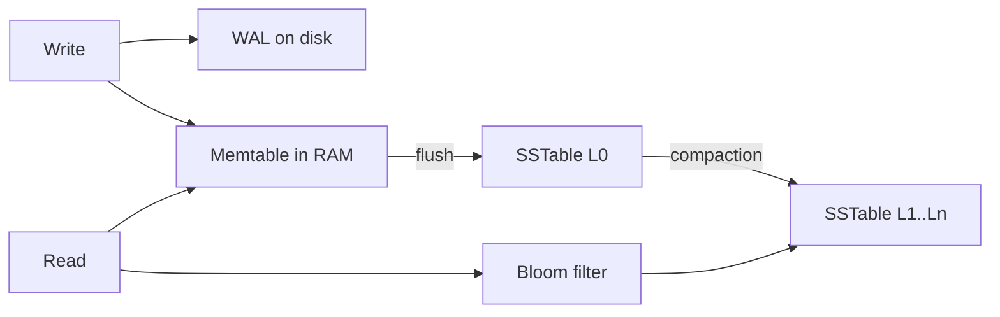

## 1. Core Concept

**Index** là cấu trúc dữ liệu phụ giúp tìm bản ghi mà không quét cả bảng; **storage engine** quyết định dữ liệu và index nằm trên đĩa thế nào. Hai họ chính: **B-Tree** (tối ưu đọc, cập nhật tại chỗ) và **LSM-tree** (tối ưu ghi, ghi tuần tự rồi gộp nền). Mental model: *mọi index đều đổi **chi phí ghi và dung lượng** lấy **tốc độ đọc**; chọn engine là chọn bạn muốn trả giá ở đâu.*

## 2. How It Works

- **B-Tree**: cây cân bằng các **page** (thường 4–16 KB), tìm kiếm **O(log n)**, cập nhật **in-place** (kèm **WAL** để chịu lỗi); dùng bởi **PostgreSQL, MySQL InnoDB**, hầu hết RDBMS. Rất tốt cho **range scan** và đọc điểm.
- **LSM-tree**: ghi vào **WAL + memtable** (RAM), đầy thì flush thành **SSTable** bất biến trên đĩa, **compaction** nền gộp và loại dữ liệu cũ; đọc phải tìm nhiều SSTable nên dùng **Bloom filter**. Dùng bởi **RocksDB, Cassandra, LevelDB**.
- **Ba loại amplification**: **write amplification** (ghi nhiều hơn dữ liệu gốc), **read amplification** (phải đọc nhiều chỗ), **space amplification**. B-Tree: ghi cao hơn khi random write; LSM: ghi tuần tự nhanh nhưng compaction tốn I/O.
- **Loại index**: **clustered** (dữ liệu sắp theo khoá chính — InnoDB), **secondary** (trỏ về primary key), **composite** (nhiều cột, dùng theo **leftmost prefix**), **covering** (index chứa đủ cột truy vấn, khỏi đọc bảng), **partial/filtered**.
- **Planner** chọn index dựa trên **selectivity** (cột phân biệt tốt) và thống kê; xem bằng `EXPLAIN (ANALYZE)`.

```sql
-- Hỗ trợ: WHERE user_id = ? AND created_at >= ? ORDER BY created_at
CREATE INDEX idx_orders_user_created ON orders (user_id, created_at);
EXPLAIN ANALYZE SELECT * FROM orders WHERE user_id = 42 AND created_at >= now() - interval '7 days';
```

## 3. Visual Diagram



## 4. Rules of Thumb & Trade-offs

- Workload **đọc nhiều, truy vấn đa dạng, cần transaction** → B-Tree (RDBMS). **Ghi rất nhiều, dữ liệu theo thời gian, key-value** → LSM.
- Thứ tự cột composite: **cột so sánh bằng (`=`) trước, cột range sau**; cột lọc mạnh nhất phù hợp truy vấn phổ biến.
- Mỗi index làm **chậm INSERT/UPDATE/DELETE** và tốn RAM/đĩa: chỉ tạo index cho truy vấn thực sự chạy.
- Trade-off: **Read vs Write performance vs Space**.

## 5. Must Remember / Production Pitfalls

- **Hàm trên cột** (`WHERE lower(email) = ...`, `WHERE date(created_at) = ...`) hoặc **ép kiểu ngầm** làm index vô hiệu → dùng functional index hoặc sửa điều kiện.
- `LIKE '%abc'` (wildcard đầu) không dùng được B-Tree index.
- Index trên cột **cardinality thấp** (giới tính, trạng thái 2–3 giá trị) thường vô ích.
- **UUID v4 ngẫu nhiên làm khoá chính** gây phân mảnh page ở clustered index; ưu tiên ID tăng dần theo thời gian (UUIDv7, ULID, snowflake).
- Quên index **khoá ngoại** làm `JOIN`/xoá cascade quét toàn bảng.
- Interview trap: "Vì sao thêm index mà truy vấn vẫn chậm?" → planner không dùng (thống kê cũ, selectivity thấp, sai thứ tự cột) — luôn nhìn `EXPLAIN`.

## 6. Search Hooks

- `B-Tree vs LSM-tree` — hai họ storage engine và đánh đổi đọc/ghi.
- `write amplification read amplification` — các dạng khuếch đại I/O của storage engine.
- `composite index leftmost prefix` — quy tắc dùng index nhiều cột.
- `covering index index-only scan` — index chứa đủ cột để khỏi đọc bảng.
- `EXPLAIN ANALYZE query plan` — đọc kế hoạch thực thi truy vấn.
- `Bloom filter LSM` — cấu trúc xác suất giúp bỏ qua SSTable không chứa key.
