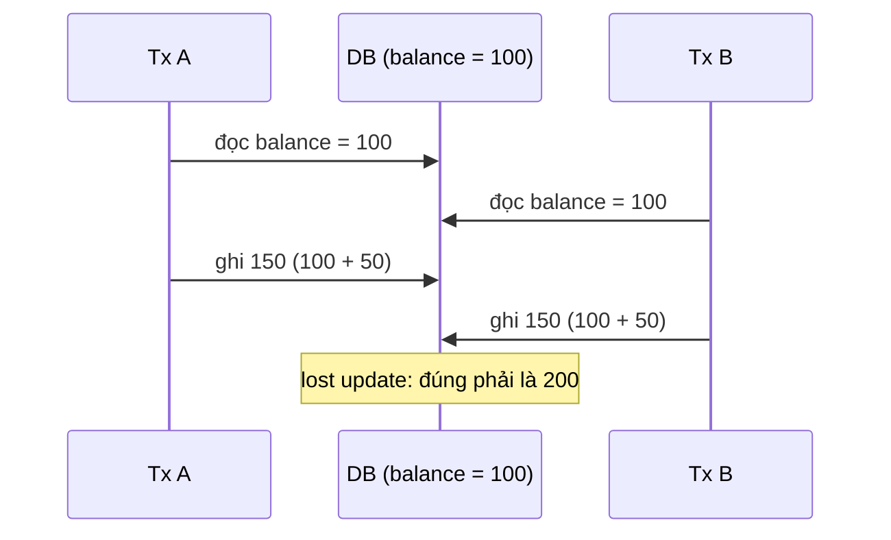

## 1. Core Concept

**Transaction** gom nhiều thao tác thành một đơn vị **"tất cả hoặc không gì cả"** và **cô lập** khỏi các transaction đồng thời. Độ cô lập tuyệt đối (serializable) **đắt**, nên DB cho chọn **isolation level** — mỗi mức **cho phép một số bất thường (anomaly)** để đổi lấy hiệu năng. Bug nguy hiểm nhất không ở chỗ crash mà ở chỗ **dữ liệu sai âm thầm khi hai request chạy chồng nhau** (mất cập nhật, write skew).

**Mental model:** nhiều người cùng sửa **một bảng tính chung**: isolation là **luật ai được thấy bản nháp của ai**. Càng nghiêm (serializable) càng như "từng người vào sửa một", an toàn nhưng chậm; càng lỏng (read committed) càng nhanh nhưng hai người có thể **ghi đè công việc của nhau mà không biết**.

## 2. How It Works

**ACID**
- **Atomicity** (hoặc commit hết hoặc rollback hết, nhờ **undo/WAL**), **Consistency** (giữ ràng buộc; một phần do ứng dụng), **Isolation** (cô lập giữa transaction), **Durability** (đã commit thì không mất, nhờ **ghi WAL và fsync**).

**Các bất thường và mức cô lập**
- **Dirty read** (đọc dữ liệu chưa commit), **non-repeatable read** (đọc lại cùng hàng thấy giá trị khác), **phantom** (đọc lại thấy hàng mới), **lost update**, **write skew**.
- **Read Committed** (mặc định PostgreSQL/Oracle): chặn dirty read. **Repeatable Read** (mặc định MySQL InnoDB; ở PostgreSQL là **snapshot isolation**): mỗi transaction thấy **ảnh chụp nhất quán**. **Serializable**: kết quả như chạy **tuần tự**, chặn mọi anomaly nhưng có thể **abort (serialization failure)** → ứng dụng phải **retry**.

**MVCC và snapshot isolation**
- **MVCC**: giữ **nhiều phiên bản** của mỗi hàng; transaction đọc **phiên bản hợp lệ theo ảnh chụp** của nó nên **đọc không chặn ghi, ghi không chặn đọc**; phiên bản cũ được dọn (VACUUM). Snapshot isolation vẫn **cho phép write skew**.

**Lost update vs write skew**
- **Lost update**: hai transaction **đọc-sửa-ghi** cùng một hàng, bản sau đè bản trước (`balance` đọc 100, cả hai ghi 150 thay vì 200). Sửa: **`UPDATE accounts SET balance = balance + ?`** (nguyên tử), **`SELECT ... FOR UPDATE`**, hoặc **optimistic locking** với cột `version`.
- **Write skew**: hai transaction **đọc cùng tập hàng, rồi ghi các hàng khác nhau**, vi phạm ràng buộc chung (ví dụ cả hai bác sĩ trực kiểm tra "còn ít nhất 2 người" rồi cùng xin nghỉ → còn 0). Sửa: **Serializable**, khoá cả tập đã đọc (`SELECT ... FOR UPDATE`), hoặc ràng buộc/hàng "vật chất hoá xung đột".

**Khoá và deadlock**
- **Pessimistic** (`SELECT FOR UPDATE`, `SKIP LOCKED` cho hàng đợi) vs **optimistic** (`WHERE version = ?` rồi retry). **Deadlock**: DB tự phát hiện và **abort một "nạn nhân"** → ứng dụng **retry** (có backoff); giảm bằng **lấy khoá theo thứ tự nhất quán** và **giữ transaction ngắn**.

```sql
BEGIN;
UPDATE accounts SET balance = balance + 50 WHERE id = 1;      -- nguyên tử, không lost update
COMMIT;
-- Optimistic locking
UPDATE items SET qty = qty - 1, version = version + 1 WHERE id = 7 AND version = 12;  -- 0 hàng → retry
```

## 3. Visual Diagram



## 4. Rules of Thumb & Trade-offs

| Tình huống / Nhu cầu | Chọn gì |
| --- | --- |
| Cộng/trừ số dư, bộ đếm | `UPDATE ... SET x = x + ?` nguyên tử |
| Đọc-sửa-ghi tranh chấp cao | `SELECT FOR UPDATE` (pessimistic) |
| Tranh chấp thấp, thông lượng cao | Optimistic locking (version) + retry |
| Ràng buộc trên nhiều hàng (write skew) | Serializable hoặc khoá cả tập đã đọc |
| Hàng đợi công việc trong DB | `FOR UPDATE SKIP LOCKED` |
| Báo cáo cần ảnh chụp nhất quán | Repeatable Read / snapshot |

- **Được gì:** dữ liệu đúng dưới đồng thời. **Mất gì:** cô lập mạnh hơn = **ít song song hơn, có thể abort/retry**; khoá giữ lâu gây nghẽn và deadlock.

## 5. Must Remember / Production Pitfalls

- **Số dư/kho sai thỉnh thoảng → đọc-sửa-ghi ở ứng dụng (lost update) → đẩy phép tính vào câu lệnh `SET x = x + ?`, hoặc khoá/version**.
- **Ràng buộc "ít nhất N" bị vi phạm dù từng transaction đều kiểm tra → write skew dưới snapshot isolation → Serializable hoặc khoá tập hàng**.
- **Transaction chạy lâu làm chậm cả hệ thống/vacuum phình → giữ khoá và phiên bản cũ → giữ transaction ngắn, không gọi HTTP bên ngoài trong transaction**.
- **Deadlock thỉnh thoảng báo lỗi → hai transaction lấy khoá ngược thứ tự → thứ tự khoá cố định, retry khi bị chọn làm nạn nhân**.
- **Nâng lên Serializable rồi gặp serialization failure → mong đợi bình thường → bắt lỗi và retry toàn bộ transaction**.
- Interview trap: "Repeatable Read có chặn write skew không?" → **không, snapshot isolation vẫn cho phép**; "lost update sửa thế nào?" → **UPDATE nguyên tử, SELECT FOR UPDATE hoặc optimistic version**; "ACID's I tốn gì?" → **song song và khả năng abort/retry**.

## 6. Search Hooks

- `ACID transactions` — bốn tính chất của transaction.
- `transaction isolation levels anomalies` — các mức cô lập và bất thường.
- `MVCC snapshot isolation` — nhiều phiên bản và ảnh chụp nhất quán.
- `lost update vs write skew` — hai bất thường đồng thời kinh điển.
- `SELECT FOR UPDATE optimistic locking` — hai cách kiểm soát đồng thời trong DB.
- `deadlock detection retry` — DB abort nạn nhân và ứng dụng retry.
