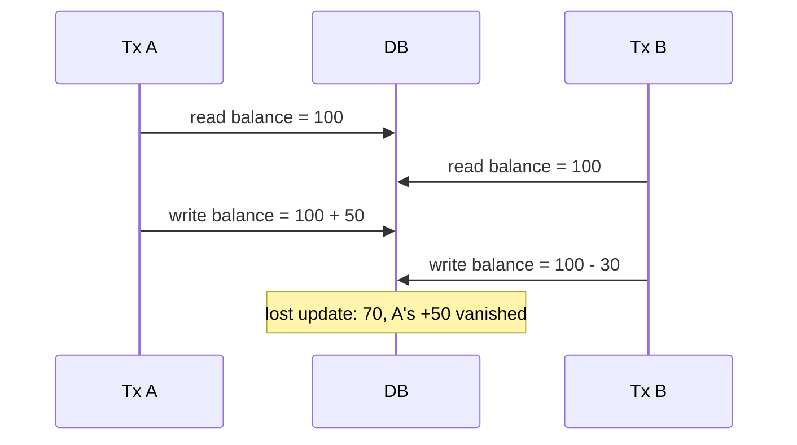

## 1. Core Concept

**Transaction** gom nhiều thao tác thành một đơn vị **ACID**; **isolation level** quyết định các transaction chạy đồng thời "nhìn thấy nhau" tới mức nào. Đây là chỗ concurrency gặp database: chọn sai isolation hoặc bỏ qua tranh chấp là nguồn của lost update, số dư sai, tồn kho âm. Mental model: *isolation càng cao càng giống chạy tuần tự (an toàn) nhưng càng nhiều chờ/abort (chậm).*

## 2. How It Works

- **ACID**: **Atomicity** (all-or-nothing), **Consistency** (giữ ràng buộc), **Isolation**, **Durability** (đã commit thì không mất — nhờ **WAL**).
- **Dị thường (anomaly)**: **dirty read** (đọc dữ liệu chưa commit), **non-repeatable read** (đọc cùng hàng hai lần ra khác nhau), **phantom read** (tập hàng thay đổi), **lost update** (hai read-modify-write đè nhau), **write skew** (hai transaction đọc cùng tập, ghi hàng khác nhau, vi phạm ràng buộc chung).
- **Bốn mức isolation chuẩn SQL**: Read Uncommitted → **Read Committed** → **Repeatable Read** → **Serializable**. Mặc định: **PostgreSQL = Read Committed**; **MySQL InnoDB = Repeatable Read**.
- **MVCC (Multi-Version Concurrency Control)**: mỗi transaction đọc một **snapshot**, người đọc không chặn người ghi. **Snapshot Isolation** chặn dirty/non-repeatable/phantom (khi đọc) nhưng **vẫn cho write skew**; **Serializable** (SSI trong PostgreSQL) phát hiện và abort.
- **Khoá**: `SELECT ... FOR UPDATE` (pessimistic), **optimistic** bằng cột `version`, hoặc cập nhật nguyên tử `UPDATE ... SET x = x - 1 WHERE x > 0`.

```sql
-- Optimistic locking: 0 hàng bị ảnh hưởng nghĩa là ai đó đã sửa trước
UPDATE accounts SET balance = :new, version = version + 1
WHERE id = :id AND version = :expectedVersion;
-- Hoặc atomic: không đọc rồi ghi trong app
UPDATE inventory SET stock = stock - 1 WHERE sku = :sku AND stock > 0;
```

## 3. Visual Diagram



## 4. Rules of Thumb & Trade-offs

| Anomaly | Read Committed | Repeatable Read (snapshot) | Serializable |
| --- | --- | --- | --- |
| Dirty read | Không | Không | Không |
| Non-repeatable read | Có thể | Không | Không |
| Phantom | Có thể | Tuỳ DB | Không |
| Write skew | Có thể | Có thể | Không |

- Mặc định **Read Committed** cho đa số; dùng **update nguyên tử hoặc optimistic lock** cho read-modify-write; **Serializable** khi bất biến phức tạp (kèm retry).
- Giữ transaction **ngắn**, không gọi API ngoài bên trong transaction.
- Trade-off: **Consistency vs Concurrency/Throughput**.

## 5. Must Remember / Production Pitfalls

- **Read-modify-write trong application** (`SELECT` rồi `UPDATE` bằng giá trị tính ở app) luôn rủi ro lost update — đẩy logic vào câu `UPDATE` hoặc dùng version/lock.
- **Transaction dài** giữ lock/snapshot, gây chờ, bloat (PostgreSQL) và deadlock.
- **Deadlock**: DB phát hiện và giết một transaction — code phải **retry**; giảm bằng thứ tự truy cập bảng/hàng nhất quán.
- Transaction **chỉ có tác dụng trong một database**; qua nhiều service cần Saga/outbox, không phải `@Transactional`.
- Lỗi serialization (`40001`) là bình thường ở Serializable → retry cả transaction.
- Interview trap: "Repeatable Read có chống phantom không?" — phụ thuộc DB (InnoDB dùng gap lock, PostgreSQL dùng snapshot); và **không chống write skew**.

## 6. Search Hooks

- `ACID transactions` — bốn đặc tính của transaction.
- `transaction isolation levels anomalies` — dirty read, non-repeatable read, phantom, write skew.
- `MVCC snapshot isolation` — đọc theo snapshot không chặn người ghi.
- `lost update vs write skew` — hai dị thường hay bị nhầm.
- `SELECT FOR UPDATE optimistic locking version column` — hai cách xử lý tranh chấp ghi.
- `deadlock detection retry` — DB giết một transaction, ứng dụng cần retry.
